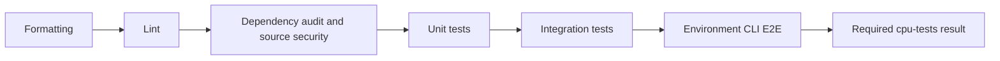

# Continuous integration



Each job depends on the previous job. The final `cpu-tests` check fails if any required stage fails, is cancelled, or is skipped. The existing check name is preserved for branch protection. CI runs on pull requests and pushes to the configured integration branch and `main`.

## Tools and environments

GitHub Actions runs Ubuntu 24.04 and Python 3.13. Ruff checks Python formatting and lint. mdformat with GFM support formats Markdown, and PyMarkdown checks its structure. The house policy permits historical repeated headings, issue references, HTML, autolinks, and separate quoted email blocks. Formatting is mechanical; it does not verify research claims.

`scripts/update_locks.py` uses pinned uv to generate complete hashed requirements for tooling, Linux CPU, and Linux CUDA environments. Runtime installation uses pip. `--check` compares the committed input and lock fingerprints without resolving dependencies. Regenerate locks after changing requirements; CI does not update them automatically.

CI installs its pinned tooling first, then audits all three complete environments before installing application dependencies. pip-audit checks direct and transitive packages. The audit wrapper records an explicit advisory mapping from PyTorch `+cpu` wheels to their upstream public versions while preserving install hashes and versions. Missing coverage, unsupported local versions, scanner errors, and known vulnerabilities fail the stage. No advisories are ignored.

Bandit scans production Python, blocking medium-or-higher findings with medium-or-higher confidence. Test files, fixtures, virtual environments, and reports are excluded from that production-source scan. Dependency and source scans have different coverage; neither establishes that the repository is free of security defects.

Transformers 5.23.0 replaces the vulnerable 4.45.0 pin. The regenerated tooling, CPU, and GPU locks report no known vulnerabilities as of November 19, 2026. Qwen's native router returns `(logits, scores, indices)`; the capture hook reads raw logits and preserves float32 softmax and top-4 selection. The model loader explicitly requests the configured dtype and pins model downloads. Dataset downloads use immutable revisions. [Upstream router implementation](https://github.com/huggingface/transformers/blob/v5.23.0/src/transformers/models/qwen2_moe/modeling_qwen2_moe.py), [release](https://github.com/huggingface/transformers/releases/tag/v5.23.0).

## Test coverage

Every test must have exactly one level: `unit`, `integration`, or `e2e`. `gpu` and `network` are independent requirements. The root conftest classifies existing files during migration and rejects unclassified additions. Repository-wide discovery remains enabled for future phases.

The runner rejects empty suites, skipped required tests, malformed reports, and missing coverage evidence. It preserves pytest failures and records per-suite branch coverage, including subprocesses. Coverage is reported without claiming every function is exhaustively tested.

CPU E2E runs the existing environment-verification command in a separate process. It checks successful validation and directory creation, then checks failure when dependencies are unavailable. It does not claim full model collection coverage. Forward-pass and full-collection features remain in their own PRs and must add their own integration and collection E2E tests when merged. There is no browser UI, so Playwright is not installed.

The dependency upgrade retains existing routing assertions. The tiny hook fixture explicitly requests fp32 to preserve its previous precision instead of inheriting the new configuration default. The GPU quantization test checks the exact native router class and still requires unquantized fp16 weights. A tiny legacy checkpoint compatibility experiment is separate from full-model GPU validation.

## Local checks

The locks target Linux x86_64/Python 3.13. Native macOS validation does not prove Linux or CUDA compatibility.

```bash
python -m pip install --require-hashes -r requirements/ci-tools.lock
ruff format --check .
ruff check .
git ls-files -z '*.md' | xargs -0 mdformat --check
git ls-files -z '*.md' | xargs -0 pymarkdown --config .pymarkdown.json --strict-config scan
python scripts/update_locks.py --check
python scripts/audit_dependencies.py requirements/ci-tools.lock requirements/cpu.lock requirements/gpu.lock
python -m pip install --require-hashes --extra-index-url https://download.pytorch.org/whl/cpu -r requirements/cpu.lock
python -m pip check
python scripts/run_tests.py unit
python scripts/run_tests.py integration
python scripts/run_tests.py e2e
```

For bug fixes, demonstrate a regression test failing before changing implementation, then require it to pass. Do not remove tests, widen tolerances, or hide scanner findings to clear CI. Keep fixtures small and model weights out of CPU tests. Network integration tests must fail visibly if required assets cannot be obtained.

Workflow actions use immutable commit SHAs. CI has read-only repository access, checkout credentials are disabled, jobs have timeouts, and superseded runs are cancelled. Available reports and environment logs are uploaded even on failures and retained for 14 days.

## GPU evidence and merging

Run GPU tests on a trusted isolated CUDA environment after auditing and hash-installing `requirements/gpu.lock`:

```bash
bash scripts/run_gpu_tests.sh FULL_REVIEWED_COMMIT_SHA
```

The script requires that exact SHA and a clean checkout, checks CUDA, saves the environment and tested SHA, checks installed pins, and runs the GPU suite. It preserves failures through `tee`. Real-model CUDA validation must be repeated after the Transformers upgrade. The CI-only change does not add collection orchestration or execute a full dataset collection.

The manual GPU-attestation workflow executes no checked-out repository code with its status-writing token. It verifies the PR's current SHA; a success attestation also requires a successful GitHub Actions `cpu-tests` result at that SHA. This records a reviewer's evidence assessment, not automatic proof that GPU execution occurred. The workflow must be on the default branch to dispatch normally.

Repository owners configure required reviews and the `cpu-tests` check in branch protection. Require GPU evidence where model behavior changes, with a reviewed applicability policy for documentation-only changes. This implementation does not change repository protections. Once merged, update existing PR branches from `main` so they inherit the workflow and rerun against their changes.

There is no deployment target, so no CD stage is configured. Dataset collection and publication remain explicit reviewed operations.
