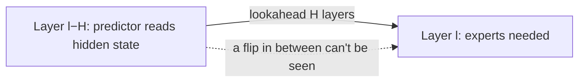
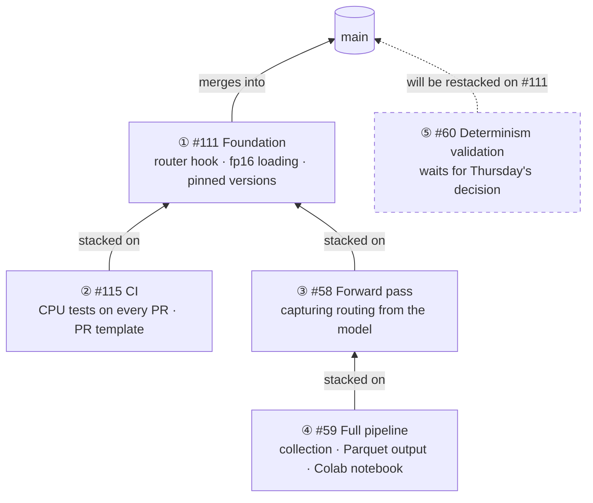

# Stephen's Claude Code session, 31 October 2026

Sanitized transcript of a Claude Code session. The user's prompts and Claude's replies are word for word. Each tool call is shown as one line; its output is omitted. Pasted content and Claude's internal reasoning are removed, and personal details are redacted. Nothing is removed by topic. See `../README.md` for how these files are made.

## Turn 1 (16:30)

**User:**

> Can you review phase 1 again, I want do create a separate related project.

**Claude:**

I'll start with the current state of the branch, since things may have moved since yesterday, then go through Phase 1's design, code and status.

<details><summary>2 tool calls</summary>

- Ran a command: shell command
- Ran a command: shell command

</details>

**Claude:**

My batching and prompt-extraction changes are now in the committed code (they were committed with `fe2aceb`), so the working copy is clean apart from the notebook. Now the design docs:

<details><summary>10 tool calls</summary>

- Read `README.md`
- Read `SYSTEM_DESIGN.md`
- Read `PHASE_1_MODEL_DECISION.md`
- Read `final_test.txt`
- Ran a command: shell command
- Read `phase_1/scripts/pytorch_forward_hooks.py`
- Read `phase_1/scripts/forward_pass.py`
- Ran a command: shell command
- Ran a command: shell command
- Ran a command: shell command

</details>

**Claude:**

Phase 1's code is all written, but it hasn't produced usable data yet. And the extraction code has bugs that will write wrong data **silently** once the current test failure is fixed. That matters most if your new project reuses this pipeline or its data.

## Where Phase 1 stands

- **The design is complete, the code is written, and nothing is validated end to end yet.** The latest GPU test (`final_test.txt`, 31 Oct 15:52) shows hooks firing on all 24 layers, but 0 routing events reach parquet.
- **There's an untested fix.** Commit `07031cc` ("handle dict format events") landed at the same minute as that test result, and nothing shows it has been run on the GPU since.
- **The model is locked** to Qwen1.5-MoE-A2.7B, 4-bit, on a Colab A100 (`PHASE_1_MODEL_DECISION.md`). That file is the only current statement of what Phase 1 runs.

## Bugs that will corrupt the data

These are all in the extraction code ([forward_pass.py:212-252](phase_1/scripts/forward_pass.py#L212-L252)) and the hook ([pytorch_forward_hooks.py:41-52](phase_1/scripts/pytorch_forward_hooks.py#L41-L52)). None would cause an error, and the current test only checks `routing_events > 0`.

1. **Every prompt in a batch gets prompt 0's routing.** The gate output is flattened to `[batch × seq_len, 60]` (the log shows `[78, 60]` for 2 prompts). Extraction indexes `logits[token_pos]` and never uses `prompt_idx`. With the default batch of 8, 7 of every 8 prompts get someone else's data.
2. **Left padding is ignored.** The tokenizer pads on the left, so a short prompt's first real token isn't at row 0. Even prompt 0 gets pad-token routing at its early positions.
3. **The hook takes the top 2 experts, but the model uses 4.** The cached config says `num_experts_per_tok: 4` (60 experts, `norm_topk_prob: false`), and `model_loader.py` also says `top_k: 4`. The hook hardcodes `k=2`.
4. **`selected_probs` holds all 60 probabilities**, not the k selected ones that the schema specifies.

A cheap test would catch all four: run 2–3 prompts both batched and one at a time, and compare the per-token rows. That needs one short GPU session.

## Risks to the research itself

- **The router is probably quantized too.** No `modules_to_not_convert` is set, and on transformers 4.45 `mlp.gate` is a plain `nn.Linear`, which bitsandbytes converts to 4-bit. If so, the traces describe the quantized model's routing, not the real model's. You can confirm cheaply: the loader already logs the gate's type at debug level.
- **The determinism check may fail for the wrong reason.** Shuffling changes which prompts share a batch and how much padding each gets, so fp16 results may not be bitwise identical between runs even if routing is deterministic. Options: run the determinism subset one prompt at a time, or compare top-k exactly and probabilities within a tolerance.
- **The GPU cost is bigger than it needs to be.**
  - The plan is 5 full runs per dataset, though `SYSTEM_DESIGN.md` §8 says one pass suffices and validation only needs the 200-prompt subset.
  - Extraction loops over every event for every token × layer and converts with `.tolist()` in Python, which means slow, paid GPU time.
  - A GSM8K run is roughly 10M rows.
- **Shared experts aren't captured.** Qwen1.5-MoE has an always-on shared expert with its own gate. That's fine for a prefetching study, since it's always resident, but it's worth deciding on deliberately.
- **MBPP is a subset.** The design says all 964 MBPP examples across splits; the loader loads only `train` (374).

## Environment and docs

- **Your local venv has transformers 5.17.0, not the pinned 4.45.0.** In 5.x the gate is a `Qwen2MoeTopKRouter` returning a tuple; in 4.45 it's an `nn.Linear` returning a tensor. So local runs exercise a different code path from Colab, which likely explains #86 (tests pass locally but fail on Colab).
- **Most docs are out of date:**
  - `README.md` says "pre-implementation".
  - `SYSTEM_DESIGN.md` still targets Mixtral / DeepSeek-V2-Lite.
  - `phase_1/docs/STATUS.md` (12 Sept) describes Mixtral with nothing started.

## What a related project could reuse

- **Reusable as-is:** the parquet writer and verifier (streaming, checksums, a defined schema), the GSM8K/MBPP loaders and the GSM8K grouping, the model loader, and the determinism-validation scaffolding.
- **Reusable after fixing:** the hook and extraction (issues 1–4 above).
- **Not reusable:** the data. No valid routing data exists yet.

What's the new project about? If you tell me, I can say which of these pieces carry over and which risks affect it.

I haven't filed issues for the extraction bugs. Shall I draft them?

## Turn 2 (16:33)

**User:**

> We are creating a parquet file as output of phase 1?

**Claude:**

Yes. I'll confirm the exact files and schema from the code rather than from the design doc.

<details><summary>1 tool call</summary>

- Ran a command: shell command

</details>

**Claude:**

Yes, Phase 1 writes Parquet files. More precisely, it writes **10 of them**: one per run per dataset.

**Files** ([full_pipeline.py:279](phase_1/scripts/full_pipeline.py#L279), [full_pipeline.py:291](phase_1/scripts/full_pipeline.py#L291)):
- `run_0_gsm8k.parquet` … `run_4_gsm8k.parquet`
- `run_0_mbpp.parquet` … `run_4_mbpp.parquet`

In the Colab notebook they go to `/content/drive/My Drive/moe_phase1_data`. They're written with zstd compression and page checksums, and checked by `verify_parquet` after each run.

**Schema** ([parquet_storage.py:28-40](phase_1/scripts/parquet_storage.py#L28-L40)), one row per token per layer:

| Column | Type |
|---|---|
| `sequence_id` | string (hash of the prompt) |
| `token_id` | int32 |
| `token_str` | string |
| `token_position` | int32 |
| `layer_index` | int32 |
| `expert_probs` | list<float32> (all 60 experts) |
| `selected_experts` | list<int16> (top-k) |
| `selected_probs` | list<float32> (top-k) |
| `dataset_source` | string (`gsm8k` / `mbpp`) |

This differs from the design in two ways:
- **Pre-softmax logits aren't stored.** `SYSTEM_DESIGN.md`'s Phase 1 objective says to capture them, and the extraction code produces `expert_logits`, but `_convert_to_parquet_rows` drops them and the schema has no column for them.
- **The file layout is different.** Design §7 calls for one file per dataset, partitioned by layer.

The data-quality caveats from my review also apply to these files:
- `selected_experts` currently holds the top 2 experts instead of 4.
- `selected_probs` holds all 60 probabilities instead of the k selected ones.
- Within each batch, the rows for every prompt after the first come from the wrong prompt.

## Turn 3 (16:34)

**User:**

> Those sound like serious data quality issues. How did those make it through>

**Claude:**

That deserves a real answer, not a guess, so I'll trace each bug back through git history and the tests.

<details><summary>3 tool calls</summary>

- Ran a command: shell command
- Ran a command: shell command
- Ran a command: shell command

</details>

**Claude:**

Each bug has a traceable origin, and they all got through for the same reason: **every test checks that data exists and has the right shape, and none checks that the values are correct.** Here's how each one happened.

**1. Top 2 instead of top 4: left over from Mixtral**
- The hook was first written on 4 Oct (`c9d6f74`) for Mixtral, which really does route to the top 2 experts. When the project switched to Qwen, the gate path changed to `mlp.gate`, but `k=2` stayed hardcoded. Even the buffer field is still called `top2_indices`.
- `model_loader.py` knows Qwen uses `top_k: 4`, but the hook never reads it.
- The hook test was loosened in `4763418` ("flexible topk check"). It looks up `config.experts_per_tok`, but the real attribute is `num_experts_per_tok`. The lookup silently falls back to 60, the test computes `min(2, 60) = 2`, and it passes with top-2 ([test_pytorch_forward_hooks.py:199-202](phase_1/scripts/test_pytorch_forward_hooks.py#L199-L202)).
- The version mismatch also hid it locally. On transformers 5.17 (your venv), the gate returns the model's own selected experts, so you get the correct top 4. On 4.45 (Colab), the gate returns raw logits and the hook computes top 2 itself. The bug only appears on Colab.

**2. Wrong prompt and padding rows: a quick fix to a code path that had never worked**
- The original extraction (`4e44ac5`, 29 Oct) expected events in a tuple format that carried a batch index. The buffer never produced that format, so nothing ever matched. That's why `routing_events` was 0 for so long.
- Yesterday's fix (`07031cc`) added a branch for the dict format the buffer actually produces. That dict has no batch index, so the new branch indexes by token position alone.
- The flattened `[batch × seq_len, experts]` layout was already documented in the hook tests ([test_pytorch_forward_hooks.py:144](phase_1/scripts/test_pytorch_forward_hooks.py#L144)). The extraction code just never used it, and nothing accounts for the left padding set in the model loader.
- The fix's success criterion was the failing test's only check: going from 0 events to more than 0. It met that, and wrong data meets it just as well.

**3. `selected_probs` holds all 60 probabilities:** this was written in the same `07031cc` branch.

**Why the process didn't catch them:**
- **The assertions can't detect wrong values.** They check things like `routing_events > 0`, `"expert_probs" in layer_data`, and `actual_tokens <= expected_tokens`. No test compares the output against a known-correct reference, such as the same prompt run alone without padding.
- **The forward-pass code was never reviewed.** PR #58 was never merged and has 0 reviews; CONTRIBUTING.md already notes it claimed acceptance criteria without running the tests. The code reached the integration branch directly. Yesterday's 18 commits were a fast debugging loop with no review step.
- **Tests were adjusted to pass the code.** The top-k check was loosened until it accepted what the hook produced, rather than what the model does.

**The good news:** the full collection has never produced data, so nothing downstream is contaminated. You found this before Phase 2 consumed any of it.

Here's what I'd suggest:
- A reference test that runs 2–3 prompts both batched and one at a time and requires matching per-token rows. This would have caught all four bugs, and it needs one short GPU session.
- Reading k from the model config instead of hardcoding it.
- Aligning the local transformers version with Colab, so local tests take the same code path.

Shall I draft issues for these? I'd show you the drafts before filing anything.

## Turn 4 (16:35)

**User:**

> I am paying for a colab run right now, should I stop it?

**Claude:**

If it's the **full collection run**, yes, stop it. Whatever it writes is unusable:
- With the default batch of 8, most prompts get another prompt's routing.
- Early token positions get padding-token routing.
- `selected_experts` holds the top 2 experts instead of 4.

Rerunning it after the fixes is unavoidable, so every extra minute is spent on data you'll throw away.

Before you stop it, check the log for a progress line like `400/7473 prompts, … routing records`. Its timestamps give you the speed per prompt, the one useful thing this run can tell you. Use it to estimate the cost of the real run.

If it's a **short test run** (like `test_single_pass_execution`), let it finish. It takes about a minute, and it shows whether yesterday's fix gets routing events above 0. That's worth knowing before the next fix. Its data is still wrong, though; this only checks whether rows get written.

## Turn 5 (16:37)

**User:**

> OK, can you create issues for these problems with as much detail as you have? I assume all of these are correctable?

**Claude:**

Yes, all of them can be fixed in code. Two of them may also turn up real findings rather than bugs, and I'll mark those in the issues:
- **Quantized gate:** keeping the gate unquantized is cheap, but it changes what the data represents.
- **Determinism:** if routing still differs after controlling for batching, that's a research result.

I'll check the exact line numbers and a few details before writing the issues.

<details><summary>3 tool calls</summary>

- Ran a command: shell command
- Read `phase_1/scripts/determinism_validation.py`
- Wrote `[scratchpad]`

</details>

**Claude:**

Before filing, I'll check that the line numbers I cite in `full_pipeline.py` and `tokenizer.py` still match the current code. Both files changed overnight.

<details><summary>1 tool call</summary>

- Ran a command: shell command

</details>

**Claude:**

The tokenizer changed overnight, so its line numbers have moved. I'll look at the current version.

<details><summary>3 tool calls</summary>

- Ran a command: shell command
- Ran a command: shell command
- Ran a command: shell command

</details>

**Claude:**

I created 12 issues, #99–#110. All cross-references are filled in, all labels applied, and no milestones set. Each issue has the evidence (links to lines at commit `4f63dd7`), how the bug got in where that's known, the fix, and acceptance criteria.

**Data corruption (fix before any collection run):**
- **#99** (critical) Extraction reads the wrong gate rows: it ignores the batch index and left padding.
- **#100** (critical) The hook selects the top 2 experts instead of 4. The issue includes the misspelled `experts_per_tok` that let the test pass.
- **#101** `selected_probs` stores all 60 probabilities.
- **#104** `sequence_id` uses Python's per-process `hash()`. IDs change between sessions, and a GSM8K collision has about a 3% chance. This is a new finding while drafting.

**Testing and validation:**
- **#102** A reference test, batched vs one prompt at a time. It includes a CPU version that costs no GPU time.
- **#105** Determinism validation has four problems, also found while drafting:
  - batching confounds the comparison
  - the row comparison is O(N²) and won't finish on a full run
  - missing data counts as a pass
  - "bitwise" means within 1e-6, and the check passes at 99%
- **#107** Local transformers 5.17 vs 4.45 on Colab.

**Decisions and cost:**
- **#103** The router gate is probably 4-bit. It includes a one-line check to confirm before changing anything.
- **#106** Extraction speed: the Python loop will take most of the paid GPU time.
- **#108** Pre-softmax logits and the shared-expert gate aren't stored.
- **#109** Five full runs vs one, and MBPP train split only.
- **#110** Out-of-date docs.

**On whether they're all fixable:** yes, all are code or configuration changes. Two may turn up results rather than bugs:
- **#103:** keeping the gate in fp16 is cheap, but you still have to decide whether the 4-bit model is what you're studying.
- **#105:** if routing still differs between batch compositions after the fixes, that's a finding about the model.

Several of these need a team decision rather than just a fix: #103, #108 and #109.

Six other issues (#92–#97) were filed today while I was working. Two overlap with mine:
- **#97** ("No routing events captured"): the fix for this (`07031cc`) introduced the indexing bug in #99.
- **#95** ("Hook receives tensor output"): the tensor branch it added is where #100's hardcoded top-2 lives.

Do you want me to add a cross-reference comment on #97 and #95?

## Turn 6 (16:42)

**User:**

> Is it appropriate in 100 to look at top-k rather than hardcode a number? Some parts of phase 1 aren't locked to a specific model, some are.

**Claude:**

Good question. Under your Phase 1 lock, a fixed value is the more consistent choice for the hook. Here's how I'd split it.

**The hook is in the locked part.** `PHASE_1_MODEL_DECISION.md` puts `pytorch_forward_hooks.py` explicitly in the locked part: "Hardcode for Qwen1.5's `mlp.gate`". The gate path is already hardcoded, so reading k from the config there adds flexibility the decision chose not to have.

The real lesson from #100 isn't "never hardcode". It's that **a hardcoded value went stale without anything noticing**. So I'd recommend:
- a named constant, `QWEN_TOP_K = 4`, next to the hardcoded gate path
- an assertion when the hooks are registered: `model.config.num_experts_per_tok == QWEN_TOP_K`

That keeps the lock, puts the Qwen fact in the code, and fails loudly if the model ever changes, which is what was missing when Mixtral's 2 carried over. One consequence: the hook tests' toy Qwen config has to use `num_experts_per_tok=4`, or the assertion will fire.

**In the model-agnostic parts, don't hardcode k at all.** The decision doc lists data collection, determinism validation, tokenization and Parquet storage as model-agnostic. There, k should come from the data:
- **#101** (row validation in `full_pipeline.py`): check that `len(selected_experts) == len(selected_probs)` and that the length is the same across rows. Don't compare against 4.
- **#105** (`check_randomization_consistency`): compare whatever top-k is in the files. Just drop the "top-2" wording.
- **The schema already fits:** `selected_experts` and `selected_probs` are variable-length lists.

#100 currently says "read k from `model.config.num_experts_per_tok`", and #101 says to check against `k`. Shall I update both issues to match this split?

## Turn 7 (16:44)

**User:**

> 95 and 97 should have been fixed in the phase1-validation-branch

**Claude:**

I'll check which commits fixed #95 and #97, to see how they relate to the new issues.

<details><summary>1 tool call</summary>

- Ran a command: shell command

</details>

**Claude:**

Agreed. They're fixed on the testing branch and stay open until their bugfix PRs, as your workflow says:
- **#95** was fixed by `ba7f9ff`, which handles the gate returning a tensor.
- **#97** was fixed by `07031cc`, which handles the dict-format events. `cb8e168` and `99541db` fixed duplicate `get_all()` calls.

The catch: **the code that fixes #95 and #97 is where #99, #100 and #101 live.**
- `ba7f9ff`'s tensor branch is where top-2 is hardcoded (#100).
- `07031cc`'s dict branch is where extraction ignores the batch index and padding (#99), and where `selected_probs` gets the full vector (#101).

So if the #95 and #97 bugfix PRs carry those commits across as they are, the data bugs come with them. Those PRs need to include the #99–#101 fixes, or wait for them.

Two smaller points on #97:
- Its body still says "Root Cause Unknown". The actual cause was the format mismatch: extraction expected tuple events with a batch index, but the buffer produces dicts without one, plus the duplicate `get_all()` calls.
- I haven't seen evidence that the fix works on the GPU. `final_test.txt` still shows 0 events, and it was written in the same minute `07031cc` was committed, so it may predate the fix. "Should have been fixed" hasn't been confirmed by a run yet.

I'd suggest a comment on #95 and #97 saying their PRs must include or wait for #99–#101, and on #97 recording the actual root cause. Shall I post those comments?

## Turn 8 (16:44)

**User:**

> Yes

<details><summary>1 tool call</summary>

- Ran a command: shell command

</details>

**Claude:**

I posted both comments:
- **#95:** its PR must include the top-2 fix (#100) or wait for it. The tensor branch from `ba7f9ff` is where `k=2` is hardcoded.
- **#97:** records the actual root cause: extraction expected tuple events with a batch index, but the buffer produces dicts without one, and `get_all()` was called more than once. It also says the fix hasn't been confirmed on the GPU, and that its PR must include #99 and #101 or wait for them.

I didn't edit #97's original "Root Cause Unknown" text. The comment says it updates that section.

One more open question: do you want #100 and #101 updated so the hook uses a named Qwen constant with an assertion, and the model-agnostic code takes k from the data?

## Turn 9 (16:45)

**User:**

> Yes

<details><summary>3 tool calls</summary>

- Ran a command: shell command
- Ran a command: shell command
- Ran a command: shell command

</details>

**Claude:**

I've updated both issues.

**#100 (hook, locked to Qwen):**
- Keep k hardcoded as a named constant, `QWEN_TOP_K = 4`, next to the gate path.
- `register_router_hooks` asserts that `model.config.num_experts_per_tok == QWEN_TOP_K`, so a model change fails loudly.
- The toy Qwen config in the tests needs `num_experts_per_tok=4`, or the new assertion will fire.
- New acceptance criterion: hook registration raises an error when the model's k isn't 4.
- The issue also notes that model-agnostic code shouldn't use this constant, and points to #101 and #105.

**#101 (row validation, model-agnostic):**
- `_validate_row` takes k from the data instead of a constant: `selected_experts` and `selected_probs` must be the same length, and lengths must match across all rows in a run.
- The acceptance criteria now check consistency and say "4 for the Qwen run", rather than requiring 4 everywhere.

I didn't change #105. It already points to #100 for the top-2 wording in `check_randomization_consistency`, which fits the split.

## Turn 10 (16:46)

**User:**

> OK, can we write tests for these issues?

**Claude:**

Yes. Most of these can be tested on CPU at no GPU cost, using synthetic data or the toy Qwen model the hook tests already use. Here's what I'd write:

| Issue | Test | Needs GPU? |
|---|---|---|
| #99 wrong rows | Toy Qwen2MoE: batched (left-padded) vs one prompt at a time, rows must match | No |
| #100 top-2 | Call the hook directly with a fake logits tensor and expect 4 indices; registration fails when k ≠ 4 | No |
| #101 `selected_probs` | Extraction on synthetic events: `selected_probs == expert_probs[selected_experts]`; validation rejects mismatched lengths | No |
| #104 `sequence_id` | Tokenize in two subprocesses with different `PYTHONHASHSEED` values; IDs must match | No |
| #105 determinism | Synthetic parquet runs: missing data must fail; a known difference must be detected | No |
| #107 version | Fails when the installed transformers version doesn't match `requirements.txt` | No |
| #103 quantized gate | Load the real model and check that `mlp.gate` isn't `Linear4bit` | Yes, one short run |
| #102 | This *is* the #99 test, plus a GPU version on the real model | Optional |

Not testable: #106 (speed is something to benchmark), and #108–#110 (decisions and docs).

These tests will **fail** until the fixes land, which is the point. I need a few decisions first:

<details><summary>1 tool call</summary>

- Asked the user: Where should the new tests for issues #99–#107 go? You mentioned someone else is fixing tests, and the integration branch is for testing only. / These tests fail until the fixes land. How should they be marked? / The local venv has transformers 5.17.0 but Colab uses 4.45.0 (#107), so local toy-model tests take a different gate code path. What should I do?

</details>

**Claude:**

You asked what's in `requirements.txt`. I'll compare it with what's actually installed in the local venv.

<details><summary>1 tool call</summary>

- Ran a command: shell command

</details>

**Claude:**

The requirements work was done, but the local venv was never updated to match it:

| Package | `requirements.txt` | Local venv |
|---|---|---|
| transformers | 4.45.0 | **5.17.0** |
| torch | 2.15.0 | **2.14.0** (the old version #73 replaced) |
| torchvision | 0.29.2 | **not installed** |
| bitsandbytes | ≥0.46.1 | not installed (only needed on GPU) |
| datasets / pyarrow / tqdm | 5.0.1 / 25.0.1 / 4.70.1 | match |
| pytest | ≥7.4.0 | 9.2.0 |

Python differs too: Colab runs 3.13, the venv 3.12.

Three things aren't pinned at all, so Colab and local can drift:
- **pandas** (local 3.0.5) and **numpy** (local 2.5.3). That could be part of #86 (tests pass locally but fail on Colab).
- **accelerate**: `model_loader.py` uses `device_map`, which needs it. Colab happens to preinstall it.

My suggestion is to run `venv/bin/pip install -r requirements.txt`, which brings the existing venv in line with Colab: transformers → 4.45.0, torch → 2.15.0, and torchvision added. Then the toy-model tests run the same gate code path as Colab. It's a few GB of downloads and replaces what's in the venv.

Shall I update the venv?

For the tests, I've noted your choices: they go on the integration branch, as plain failing tests, and stay uncommitted until you say otherwise. I'll start writing them once the environment question is settled.

## Turn 11 (16:50)

**User:**

> Yes update the venv. We should lock in specific versions of pandas and numpy matching colab (we've done a lot of recent testing there) and then run all the cpu tests locally. We should also use 3.13 locally for now.

**Claude:**

I'll start by finding the pandas and numpy versions Colab is actually using, and checking whether Python 3.13 is installed locally.

<details><summary>1 tool call</summary>

- Ran a command: shell command

</details>

**Claude:**

The notebooks don't record pandas or numpy versions, so I'll look more broadly through their saved outputs.

<details><summary>6 tool calls</summary>

- Ran a command: shell command
- Ran a command: shell command
- Ran a command: shell command
- Edited `requirements.txt`
- Ran a command: shell command
- Ran a command: shell command

</details>

**Claude:**

Two test files use the real-model fixture with no per-test skip guard. I'll check for module-level guards before deciding what's safe to run.

<details><summary>4 tool calls</summary>

- Ran a command: shell command
- Ran a command: shell command
- Ran a command: shell command
- Ran a command: shell command

</details>

**Claude:**

With only the cost-saving skips removed, **49 passed and 5 skipped** (the 5 are the real GPU-only tests). Nothing failed.

<details><summary>1 tool call</summary>

- Ran a command: shell command

</details>

**Claude:**

The local environment now matches Colab, and every CPU-safe test passes.

**Environment:**
- I rebuilt `venv` with Python 3.13.18 (Colab has 3.13.16) from `requirements.txt`. It now has torch 2.15.0, torchvision 0.29.2, transformers 4.45.0, datasets 5.0.1 and pyarrow 25.0.1, and `pip check` is clean.
- I pinned `pandas==2.2.3` and `numpy==2.1.3` in `requirements.txt` to match Colab; that change is uncommitted. pip had pulled in pandas **3.1.0**, a major version ahead of Colab. That mismatch could explain #86.
- `accelerate` is still unpinned. Your Colab output didn't include it.

**Tests: 49 passed, 5 skipped (GPU-only), 0 failed** (full log: `[scratchpad]`)
- **Cost-saving skips:** 22 tests have an unconditional "skipped to save GPU costs" marker but run on CPU. I ran them with a scratchpad plugin that removes only that marker; I didn't edit the test files. Locally they cost nothing, so you may want that skip to apply only on Colab.
- **Not run:** `test_forward_pass.py` (6 tests) and `test_tokenizer.py` (10 tests). They load the full model, which would crash a machine with 8 GB of RAM. The 10 tokenizer tests only need the tokenizer and could run locally with a tokenizer-only fixture.
- **Passing doesn't mean correct:** `test_top2_indices_extracted` passes, but it accepts the top-2 bug (#100). The new tests are meant to catch exactly this.

**Something to tidy:** the old venv is at `venv-py312-old/`, which `.gitignore` doesn't cover, so it shows as untracked and could get committed by accident. Shall I delete it?

**Something for #109:** `test_data_collection.py` passes a test called `test_full_load_uses_gsm8k_train_and_all_mbpp_splits`. So `data_collection.py` loads all MBPP splits, while `full_pipeline.py` loads only `train`. The repo has two loading paths that disagree.

Next is writing the new failing tests for #99–#107 on the integration branch, uncommitted. Shall I start?

## Turn 12 (16:55)

**User:**

> You can remove those skips.

<details><summary>1 tool call</summary>

- Ran a command: shell command

</details>

**Claude:**

`test_data_collection.py` has 30 of these markers but only 15 tests, so some must be doubled up. I'll look before removing anything.

<details><summary>1 tool call</summary>

- Ran a command: shell command

</details>

**Claude:**

They're duplicated decorators, the same marker applied twice per test. Removing every line that is exactly this marker handles both.

<details><summary>3 tool calls</summary>

- Ran a command: shell command
- Read `[claude config]`
- Edited `[claude config]`

</details>

**Claude:**

I removed all 37 skip markers from three files. The 15 tests in `test_data_collection.py` had theirs applied twice, which is why the count was off.
- `test_data_collection.py`: 30 markers
- `test_full_pipeline.py`: 4
- `test_pytorch_forward_hooks.py`: 3

The plain test run, without the plugin, now gives **49 passed, 5 skipped (GPU-only), 0 failed**. The changes are uncommitted.

On Colab, these 22 tests add only seconds: none of them loads the model, and they ran in about 10 seconds on CPU. If you want to limit what runs during Colab debugging, you can select tests on the pytest command line instead of using skip markers. I've noted that preference for future sessions.

Still open:
- **Old venv:** `venv-py312-old/` shows as untracked. Shall I delete it?
- **New tests:** shall I start the failing tests for #99–#107?

## Turn 13 (16:56)

**User:**

> Yes

**Claude:**

I'll delete the old venv first, after checking that it really is the moved one.

<details><summary>1 tool call</summary>

- Ran a command: shell command

</details>

**Claude:**

The old venv (Python 3.12, transformers 5.17.0) is deleted. Next I'll read the APIs the new tests will use: the hook tests' toy-model fixture and the determinism validator.

<details><summary>2 tool calls</summary>

- Ran a command: shell command
- Wrote `phase_1/scripts/test_routing_data_quality.py`

</details>

**Claude:**

The tests are written. Next I'll run them. Each should either pass as a control or fail **for the bug it targets**, not because of a setup error. I'll check each failure's message.

<details><summary>2 tool calls</summary>

- Ran a command: shell command
- Ran a command: shell command

</details>

**Claude:**

With a correct extraction patched in, all 7 data-correctness tests pass, including #99 and the router-logits check. So the tests fail only because of the bugs, and they will pass once the bugs are fixed. The patch lives only in the scratchpad (`reference_fix.py`), and it could serve as a starting point for the #99–#101 fixes.

## Result

`phase_1/scripts/test_routing_data_quality.py` is new and uncommitted, on the integration branch. It has 22 tests: **11 fail on purpose, 9 pass, 2 skipped (GPU)**.

| Issue | Tests | Now | Verified it can pass? |
|---|---|---|---|
| #99 wrong rows | batched vs one-at-a-time, toy model | ❌ | ✅ |
| #100 top-k | 4 experts per row; matches the model's own router logits; registration rejects k≠4 | ❌ ×3 | ✅ |
| #101 `selected_probs` | equals `expert_probs[selected]`; validation rejects length mismatch (+1 passing control) | ❌ ×2 | ✅ |
| #104 `sequence_id` | stable across `PYTHONHASHSEED` values; dict prompts rejected | ❌ ×2 | Not patched (simple assertions) |
| #105 determinism | missing data fails; one changed row fails; 10k rows in under 2s (now 5.4s) | ❌ ×3 | Not patched (simple assertions) |
| #107 versions | each `==` pin in `requirements.txt` matches what's installed | ✅ ×7 | — |
| #103 quantized gate | `mlp.gate` isn't `Linear4bit` | skipped | GPU |
| #102 real model | batched vs single, top-k agreement ≥ 98% | skipped | GPU |

The CPU tests take about 9 seconds and need no downloads.

Things to know:
- **The #104 test assumes the current interface.** It reads `sequence_ids` from `tokenize_batch`. If the fix moves ID creation into the loaders, as the issue suggests, this test will need updating along with it.
- **The #105 speed limit (under 2s for 10k rows) depends on the machine.** The current code takes 5.4s here, and a vectorized comparison would take well under a second. It still allows some headroom.
- **The two GPU tests each load the model**, because the fixture is function-scoped. When you next have a Colab session, you can run just those two with `pytest phase_1/scripts/test_routing_data_quality.py -k "not_quantized or real_model"`.

All uncommitted changes:
- `requirements.txt`: pandas/numpy pins
- the three test files with skips removed
- the new test file
- `Test_Dependencies.ipynb`, which was already modified and isn't mine

## Turn 14 (17:01)

**User:**

> Aside: can you explain the toy model to me? I understand the concept in general but not the application here.

**Claude:**

The toy model is the **same model code at a tiny size, with random weights**. It works here because the bugs are in the code that *records* the routing, not in the model's routing decisions.

**What it is.** `make_toy_qwen()` builds a `Qwen2MoeForCausalLM`, the same class transformers uses to run the real Qwen1.5-MoE-A2.7B, but from a small config:

| | Real model | Toy model |
|---|---|---|
| Layers | 24 | 2 |
| Hidden size | 2048 | 32 |
| Routed experts | 60 | 8 |
| **Experts per token (top-k)** | **4** | **4** |
| **`norm_topk_prob`** | **false** | **false** |
| Vocabulary | 151,936 tokens | 128 |
| Weights | trained, 4-bit, ~14B parameters | random, full precision, tens of thousands of parameters |

The properties the bugs depend on, top-4 and unnormalized probabilities, are kept the same. Everything else is shrunk, so it builds in milliseconds on a laptop with no download.

**Why random weights are fine.** The routing a random model chooses is meaningless, but the tests don't care what it chooses. They only care whether the pipeline **records what the model actually chose, for the right token**. The bugs are all bookkeeping:
- reading the wrong prompt's rows (#99)
- reading padding instead of real tokens (#99)
- keeping 2 of the 4 selected experts (#100)
- storing the wrong probabilities (#101)

That bookkeeping depends on the *shape* of the gate's output, `[batch × padded length, experts]`, and the toy model produces exactly the same shape. Random weights even help: each token gets a fairly arbitrary set of experts, so if rows get swapped between tokens, the mismatch shows up.

**Where the correct answer comes from.** Each test needs something to compare against that doesn't go through the code being tested:
- **#99:** run each prompt *on its own* (no batch, no padding) and compare with the same prompts run as a left-padded batch. If extraction is correct, the rows match. The prompts are 3, 7 and 5 tokens long, so each gets a different amount of padding.
- **#100:** the model can report its own router logits (`output_router_logits=True`). Taking the top 4 of those gives the experts the model really used, without going through the hook at all.

**What it can't test.** Anything that depends on the real model:
- fp16 and 4-bit arithmetic
- whether the gate is quantized (#103)
- GPU memory
- the real tokenizer
- speed
- whether real routing is deterministic

That's why the two GPU tests repeat the batched-vs-single check on the real model (#102) and inspect the gate's type (#103).

**Why the transformers version mattered.** The toy model and the real model share *code*, not weights. So the toy model only tests the Colab code path when it's the same transformers version. On 5.17, the gate is a different class with a different output, which is why fixing the venv had to come first (#107).

## Turn 15 (17:05)

**User:**

> OK, quick status check, where are we and what is next?

**Claude:**

## Where we are

**Done today:**
- **Phase 1 review:** the pipeline runs end to end, but it would have written corrupted data. No valid routing data exists yet, so nothing downstream is affected.
- **Issues #99–#110** filed:
  - #99–#101 are the data-corruption bugs.
  - #103, #108 and #109 need team decisions.
- **#100 and #101** updated: the hook uses a Qwen constant with an assertion, and the model-agnostic code takes k from the data.
- **#95 and #97** commented: their bugfix PRs must include the #99–#101 fixes, or wait for them.
- **Local environment** now matches Colab: Python 3.13, the pinned versions installed, and pandas/numpy pinned to Colab's versions. That pandas difference may also explain #86.
- **Tests:**
  - I removed the 37 "skip to save GPU costs" markers, and all 49 CPU tests pass.
  - The new `test_routing_data_quality.py` has 11 tests that fail on purpose, one or more per bug. I checked that #99–#101's tests pass once the bugs are fixed.

**Uncommitted on `integration/phase-1-validation`:**
- `requirements.txt`
- the 3 test files with skips removed
- the new test file

`Test_Dependencies.ipynb` is also modified, but that change isn't mine.

## What's next

I'd suggest this order:

1. **Get the changes to Colab.** Colab runs from this branch, so the version pins and new tests only reach it once they're committed and pushed. That's your call.
2. **Fix #99–#101 on the integration branch.** These block any valid collection run. The patch in `[scratchpad]` is a starting point, and the new tests show when each is done. Bugfix branches and PRs come after validation, as your workflow says.
3. **Settle the three team decisions before the full run**, because each one changes what the run collects:
   - **#103:** is the 4-bit model what you're studying, or a stand-in for fp16?
   - **#108:** store the logits and the shared-expert gate?
   - **#109:** one full run or five, and which MBPP splits?
4. **One Colab GPU session, after the fixes:** run the two GPU tests and a small subset collection. Doing this after the fixes avoids paying for the GPU twice.

Smaller items:
- `accelerate` is still unpinned.
- The tokenizer tests load the whole model when they only need the tokenizer, which is why they can't run locally.
- The pandas mismatch is probably worth a comment on #86.

**Your related project:** the review is done, but you haven't told me what the project is yet. Once you do, I can say what from Phase 1 carries over.

Which do you want to take on first?

## Turn 16 (17:06)

**User:**

> Why move the changes to colab before making the fixes?

**Claude:**

There's no good reason; you're right. Pushing first wouldn't change anything on Colab:
- **The pins match what Colab already has**, so they do nothing there.
- **The new tests would just fail on Colab** for bugs we already know about.
- **The two GPU tests should wait for the fixes anyway**, or you'd pay for a GPU session to confirm known failures.

The better order is:
1. **Fix #99–#101 locally**, with the new CPU tests as the check. This costs nothing.
2. **Commit and push the fixes, tests and pins together**, when you decide.
3. **One Colab session:** the two GPU tests and a small subset collection.

The only reason to push earlier is coordination. Whoever is fixing tests is working on the same branch. Until these changes are pushed, they won't see the removed skips or the new test file, which could cause duplicate work or merge conflicts. If that's a concern, it's a question of sharing the changes with them, not of getting them to Colab.

Shall I start on the #99–#101 fixes?

## Turn 17 (17:07)

**User:**

> We fix locally, push to this branch and then pull this branch into colab. We track the commits on this branch in the issues to make cherry picking fixes to the real branches easier. OK? Suggestions?

**Claude:**

Yes, that works. It's cherry-picking from a testing branch, and the main risk is commits that are hard to separate cleanly. Here's what I'd suggest to avoid that:

1. **One commit per issue, containing only that issue's change.** No debug prints and no unrelated changes. The pins and removed skips go in their own commit, referencing #107 and #86.
2. **Use `Refs #99` in commit messages on this branch, not `Fixes #99`.** "Fixes" closes the issue as soon as the commit reaches `main` in any way. Save it for the bugfix PR.
3. **Use `git cherry-pick -x`.** It records the original commit SHA in the bugfix-branch commit, so each fix traces back to its testing commit.
4. **Don't rebase or squash this branch once SHAs are recorded in issues.** That changes the SHAs, and the issue comments would point at nothing.
5. **Split the new test file by issue.** Right now one file covers #99–#107, so cherry-picking it into the #100 bugfix branch would bring along failing tests for issues that branch doesn't fix. With one file per issue, each fix commit carries its own test.
6. **Handle #99, #100 and #101 together.** They overlap:
   - #99 and #101 both rewrite `_extract_routing_data`.
   - #100 renames `top2_indices`, which the extraction code uses.

   Cherry-picked separately, they'd conflict or need a particular order. I'd make them **one bugfix branch and one PR** ("routing capture correctness"), still as three commits, one per issue. #95 and #97 already depend on them, so they could go in the same PR.
7. **Use a consistent issue comment after each push**, for example:
   > On `integration/phase-1-validation`: `abc1234`. Verified: CPU tests `test_extraction_rows.py` pass. GPU: pending.

   Then the issue shows both where the fix is and how far it's been checked. I can post these as part of the workflow, if you're OK with that.

If you agree, I'd start by splitting the test file by issue, then fix #100 → #99 → #101 in that order, one commit each, and stop before pushing so you can review.

## Turn 18 (17:08)

**User:**

> I agree

**Claude:**

Here's the plan:
1. Split the test file by issue.
2. Commit the environment changes.
3. Fix #100, then #99, then #101: test and fix in one commit per issue, each message saying `Refs #N`.
4. Commit the remaining tests for #103, #104, #105 and #107.

I'll stop before pushing. First I'll find everything that refers to `top2_indices`, which #100 renames, and the extraction helpers #99 replaces.

<details><summary>12 tool calls</summary>

- Ran a command: shell command
- Ran a command: shell command
- Wrote `phase_1/scripts/routing_test_helpers.py`
- Wrote `phase_1/scripts/test_extraction_rows.py`
- Wrote `phase_1/scripts/test_router_topk.py`
- Wrote `phase_1/scripts/test_selected_probs.py`
- Wrote `phase_1/scripts/test_sequence_ids.py`
- Wrote `phase_1/scripts/test_determinism_checks.py`
- Wrote `phase_1/scripts/test_pinned_versions.py`
- Wrote `phase_1/scripts/test_router_gate_quantization.py`
- Ran a command: shell command
- Ran a command: shell command

</details>

**Claude:**

**Step 3: the shared test helpers** get their own commit, since every fix's test imports them.

<details><summary>1 tool call</summary>

- Ran a command: shell command

</details>

**Claude:**

**Step 4: fix #100.** This covers the hook constant, the float32 softmax, the registration check and the rename. Here are the hook edits:

<details><summary>2 tool calls</summary>

- Ran a command: shell command
- Ran a command: shell command

</details>

**Claude:**

The #100 tests and the existing hook tests all pass (13). There's one leftover docstring line to fix, and then I'll run the whole CPU suite to check nothing else broke.

<details><summary>1 tool call</summary>

- Ran a command: shell command

</details>

**Claude:**

Only the expected failures remain: #99, #101, #104 and #105. Committing #100:

<details><summary>3 tool calls</summary>

- Ran a command: shell command
- Read `phase_1/scripts/forward_pass.py`
- Ran a command: shell command

</details>

**Claude:**

Removing the old helpers left `F` and `Tuple` unused, so I'll drop those imports. Then the tests.

<details><summary>1 tool call</summary>

- Ran a command: shell command

</details>

**Claude:**

The #99 test now passes, and nothing else changed. Committing:

<details><summary>1 tool call</summary>

- Ran a command: shell command

</details>

**Claude:**

**Step 6: fix #101.** That's the `selected_probs` line in the extraction, plus the length and width checks in `_validate_row`.

<details><summary>2 tool calls</summary>

- Read `phase_1/scripts/full_pipeline.py`
- Ran a command: shell command

</details>

**Claude:**

All four #101 tests pass, and the existing row-validation tests in `test_full_pipeline.py` still pass with the new checks. Committing:

<details><summary>1 tool call</summary>

- Ran a command: shell command

</details>

**Claude:**

**Step 7:** the remaining tests (#103, #104, #105, #107) get one commit each, so each can be cherry-picked with its future fix.

<details><summary>3 tool calls</summary>

- Ran a command: shell command
- Ran a command: shell command
- Ran a command: shell command

</details>

**Claude:**

This changes the cherry-pick plan. Here's the situation:

**Most of the Phase 1 pipeline isn't on `main` yet.** It lives in open, unmerged feature PRs:

| File | Comes from | My fixes that touch it |
|---|---|---|
| `pytorch_forward_hooks.py` | PR #56, **merged to main** | #100 |
| `forward_pass.py` | PR #58, open (`feature/15-forward-pass-routing`) | #99, #101, #100 (rename) |
| `full_pipeline.py` | PR #59, open (`feature/16-full-pipeline-integration`) | #101 (validation) |
| `determinism_validation.py` | PR #60, open (`feature/8-determinism-validation`) | #105 (tests only) |
| `tokenizer.py` | on main, plus PR #57 open | #104 (tests only) |

The integration branch is 64 commits ahead of `main`. So "cherry-pick into a bugfix branch off `main`" only works for #100's hook change. #99 and #101 change files that don't exist on `main`.

**What I'd suggest instead:** cherry-pick the fixes onto the **open feature branches**, so each feature merges with its bugs already fixed:
- **#99 and #101** go to `feature/15` (PR #58). The #101 validation change also goes to `feature/16` (PR #59).
- **#100's hook change** gets a real bugfix branch off `main`, since the hooks are already there.
- **#105 and #104** follow later to `feature/8` and `feature/14` with their fixes. The existing determinism bugfix PRs (#67–#69) seem to follow the same pattern.

**One adjustment while it's still cheap:** my #100 commit (`924197f`) changes both the hook file (on `main`) and `forward_pass.py` (only on `feature/15`). Cherry-picked onto `main`, it would conflict on the missing file. Nothing is pushed and no SHAs are recorded yet, so I can split it into two commits:
- the hook change and its tests, which apply to `main`
- the `top2_indices` → `topk_indices` rename in `forward_pass.py`, for `feature/15`

The later commits would get new SHAs, but nobody has seen them yet.

Shall I split `924197f`? After that I'd stop for your review before pushing. Once you push, I'd post the commit and verification comments on #99, #100, #101, #103, #104, #105 and #107.

## Turn 19 (17:15)

**User:**

> Yes split

**Claude:**

I'll split `924197f` into three commits. Some care is needed because `test_router_topk.py` imports the test helpers, which import `forward_pass.py`, so it can't go to `main` either:
1. **The hook change and the existing hook tests.** These are all files on `main`.
2. **The `topk_indices` rename in `forward_pass.py`**, for `feature/15`.
3. **`test_router_topk.py`**, also for `feature/15`.

Commits 1 and 2 have to land together: the extraction reads the buffer field that commit 1 renames. I'll say so in both messages.

To do this safely, I'll put a backup branch on the current tip and set `Test_Dependencies.ipynb` aside with a stash, since it isn't mine and a reset would discard it. Then I'll rebuild the commits and check that the final tree is byte-for-byte unchanged.

<details><summary>2 tool calls</summary>

- Ran a command: shell command
- Ran a command: shell command

</details>

**Claude:**

It doesn't apply cleanly. Let me see which earlier integration commits the hook file depends on.

<details><summary>1 tool call</summary>

- Ran a command: shell command

</details>

**Claude:**

The split worked: the final tree is byte-for-byte unchanged, and the hook change is now separate from the `forward_pass.py` change. But **the hook commit still doesn't apply to `main`**. The test cherry-pick conflicted in both hook files.

The reason: `main` has the hook file as PR #56 left it. On the integration branch, 14 commits have changed it since, none of them merged:
- `2abcd13`: locked to Qwen, switching the gate path to `mlp.gate`
- `370ca96` and `ba7f9ff`: handle the tensor output (the #95 fix)
- logging fixes mixed in with debug commits

My #100 fix edits the code those commits wrote, so it can't land on `main` without them. This isn't specific to #100. With 64 interleaved commits since `main`, **any** fix made here depends on earlier unmerged work.

What this means for your workflow:
- **Cherry-picking single commits works** only when the target branch already has the same version of the file. That's true for future fixes once the target branches have caught up, but not today.
- **Today, the practical move is to port at the file level.** For each target branch, check out the current version of the affected files from the integration branch, as one reviewed commit whose message lists the integration commits and issues it carries. For example:
  - the #95 + #100 bugfix branch off `main` takes `pytorch_forward_hooks.py` and its tests from integration
  - `feature/15` (PR #58) takes `forward_pass.py` and the `forward_pass.py`-based tests

  After that, those branches match the integration branch, and later fixes cherry-pick cleanly.
- **Tracking SHAs in issues still pays off.** It's how you know which integration commits a ported file contains.

Nothing is pushed. The old tip is on a local branch, `backup-before-split`; you can delete it once you're happy with the history.

How do you want to proceed?
- push the integration branch so Colab can pull it, then post the SHA and verification comments on the issues, or
- review the commits first?

## Turn 20 (17:17)

**User:**

> Actuallly first can you review https://github.com/scerruti/moe-expert-prefetching/discussions/98 and integrate it with this email I sent.
>
> "
>
>
>
> *[pasted content removed: 7 lines]*
>
>
>
> "
>
> Should we post and update on the discussion or wait?

**Claude:**

I'll read the discussion and its comments first.

<details><summary>1 tool call</summary>

- Ran a command: shell command

</details>

**Claude:**

I've read the discussion. Before drafting anything, I'll check who reads it.

<details><summary>1 tool call</summary>

- Ran a command: shell command

</details>

**Claude:**

**Post now, but keep it short.** The full write-up can wait until the fixes are validated on Colab. Waiting has a real cost:
- **PR approvals:** the post asks for PR approvals, and #58 and #59 have review requested from Dvora Celniker. Those PRs carry the extraction code behind #99–#101. Approving them would merge code that writes wrong data.
- **The data:** the post says the pipeline works end to end, and the email says a full run is underway. Anyone reading either would reasonably treat that run's output as usable. It isn't.

I'd post it as a **reply comment, not an edit** to the original post. That fits your "laugh at my past self" goal: the original stays as it was, with the correction under it.

**What in the post is now out of date:**
- **"Routing pipeline now works end to end" / "validated at subset_size=2":** it runs end to end, but the rows are wrong. With 2 prompts in one batch of 8, prompt 1 got prompt 0's rows, and the only check was `routing_events > 0`.
- **The #97 fix** introduced #99 (wrong rows), and **the #95 fix** kept top-2 (#100).
- **The #90 fix** (JSON-encode dict prompts) would feed the model the reference answer if a dict ever reached the tokenizer. The hash is also salted per session (#104).
- **"4 CPU-only tests skipped":** it was 22 tests, and the markers are now removed.
- **Next step 1 (per-issue bugfix branches off `main`)** won't work as described: most of the files aren't on `main`.

Here's a draft in your voice. **Written for: the project team (Taylor, Waleed, Dvora), as a reply on discussion #98.**

---

> ## Update: the pipeline runs, but the routing data it writes is wrong
>
> The post above says the routing pipeline works end to end. It *runs* end to end, but a review of the extraction code found that the rows it writes are wrong. My validation couldn't catch it: at `subset_size=2`, the test only checked that routing events existed (`routing_events > 0`), not that they were correct.
>
> **Please hold reviews and approvals on #58 and #59** until the fixes below are in those branches. Both carry the bugs.
>
> ### What's wrong with the data
> - **#99:** every prompt in a batch gets the first prompt's routing, and early token positions get padding-token routing. The fix for #97 introduced this: the buffered events carry no batch index, so extraction indexed by token position alone.
> - **#100:** the hook records the top 2 experts, but Qwen1.5-MoE-A2.7B routes each token to 4. It's left over from Mixtral, and the fix for #95 kept `k=2`.
> - **#101:** `selected_probs` holds all 60 expert probabilities instead of the 4 selected ones.
> - **#104:** `sequence_id` uses Python's `hash()`, which changes every session, with about a 3% chance of a collision within GSM8K. Also, the fix for #90 JSON-encodes dict prompts, so if a dataset dict ever reaches the tokenizer, the model is fed the reference answer.
>
> ### The full run from my email
> It was meant to smoke out crashes, and it's still useful for that: whether it finishes, memory use, time per prompt. **Its parquet output shouldn't be used for analysis.** [RESULT OF THE RUN]
>
> ### Fixed on the testing branch
> - #99, #100 and #101 are fixed. Each has a test that compares batched output with running each prompt alone, on a tiny CPU model, so it costs no GPU time. Verified locally; the GPU check is pending.
> - The local environment now matches Colab: Python 3.13, plus pinned versions. pandas and numpy are now pinned to Colab's versions; locally I'd had pandas 3, a likely cause of #86.
> - I removed the "skip to save GPU costs" markers. None of those 22 tests loads the model, and they run in about 10 seconds on a CPU.
> - Failing tests now cover #103, #104 and #105, to drive the next fixes.
>
> ### Correction to "next steps": cherry-picking
> `forward_pass.py`, `full_pipeline.py` and `determinism_validation.py` aren't on `main`. They're in the open PRs #58, #59 and #60. The hook file on `main` is also 14 commits behind the testing branch. Per-issue cherry-picks onto branches off `main` won't apply, so the plan is:
> 1. Bring each feature branch up to date with the testing branch's version of its files, as one reviewed commit listing the commits and issues it carries.
> 2. Cherry-pick later fixes from there.
>
> ### Decisions needed before the real collection run
> - **#103:** the router gate is probably quantized to 4-bit. Is the 4-bit model what we're studying, or a stand-in for fp16?
> - **#108:** should we store pre-softmax logits and the shared-expert gate value?
> - **#109:** one full run or five? The design calls for one pass plus a 200-prompt determinism subset. And all three MBPP splits, or train only?
>
> Full list: #99–#110.

---

Before I post:
1. **What happened with the 3–4 hour run?** Did it finish, crash, or did you stop it? I'll fill in the placeholder.
2. **"Fixed on the testing branch"** is only true for others once the commits are pushed. Should I push first, or change it to "fixed locally, pushing after review"?
3. **Anything to change** in tone or content? Then I'll post it as a reply on #98.

## Turn 21 (17:19)

**User:**

> I canceled the run.

**Claude:**

With the run canceled, I'll revise that section to:

> ### The full run from my email
> I canceled it once these bugs turned up: its output would have been unusable for analysis. The next full run waits until the fixes are validated on Colab and the decisions below are made.

That leaves one blocker before I post: the draft says the fixes are "on the testing branch", but they're only on your machine until they're pushed. Which do you want?
- **Push first** (recommended): push the integration branch, then post the reply. Others can see the fixes, Colab can pull them, and I'll add the commit and verification comments on the issues afterwards.
- **Post now**, with "fixed locally, pushing after review" in place of "on the testing branch".

If you have no other changes to the draft, tell me which and I'll go ahead.

## Turn 22 (17:19)

**User:**

> Let's push it, then run tests on colab?

**Claude:**

I'll check that nobody else has pushed to the branch since I last fetched, then push.

<details><summary>1 tool call</summary>

- Ran a command: shell command

</details>

**Claude:**

It's pushed (`4f63dd7..6a93c78`, a fast-forward with nothing new on the remote). Next I'll post the reply on discussion #98, with the canceled-run section filled in.

<details><summary>1 tool call</summary>

- Ran a command: shell command — **blocked by permission check**

</details>

**Claude:**

The push worked, but **posting the reply on discussion #98 was blocked** by Claude Code's permission check for writes to external systems. Your last message asked for the push and Colab tests and didn't explicitly OK the post, so I've stopped there rather than work around the check. I've also held off on the commit comments on the issues for the same reason.

The reply is ready as written (with the canceled-run section) at `[scratchpad]`. If you say "post it", I'll try again; if the check still blocks it, you can paste that file as a reply on #98 yourself.

## Colab tests

In your Colab terminal:

```bash
cd /content/moe-expert-prefetching
git fetch origin && git checkout integration/phase-1-validation && git pull --ff-only
git log -1 --oneline        # should show 6a93c78, so we know it isn't running stale code (#88)
pip install -q -r requirements.txt
python -m pytest \
  phase_1/scripts/test_pinned_versions.py \
  phase_1/scripts/test_extraction_rows.py \
  phase_1/scripts/test_router_gate_quantization.py \
  "phase_1/scripts/test_full_pipeline.py::test_single_pass_execution" \
  -v 2>&1 | tee /content/colab_gpu_tests.txt
```

This loads the model three times, which should be a few minutes of A100 time. It skips everything already verified on CPU. What I expect:

| Test | Expected | What it tells us |
|---|---|---|
| `test_pinned_versions` | pass | Colab really runs the pinned versions |
| `test_extraction_rows` (real model) | pass | #99–#101 fixes hold on the real model; batched and single runs agree on ≥98% of top-k |
| `test_router_gate_quantization` | **probably fail** | Confirms #103: the gate is 4-bit. A pass would mean it isn't, which is also useful to know |
| `test_single_pass_execution` | pass | The test that failed earlier with 0 routing events now gets events |

Paste back the output (or `/content/colab_gpu_tests.txt`). After that, I'll post the issue comments with commit SHAs and the GPU results, with your OK.

## Turn 23 (17:22)

**User:**

> OK, should I post the discussion reply manually while this runs?

**Claude:**

Yes, post it now. The urgent part is asking people to hold reviews on #58 and #59, and that doesn't depend on the Colab results. The text stays accurate while the tests run: it says "the GPU check is next". When the results come in, I'll put them on the issues, so the discussion doesn't need a second update yet.

The text is in `[scratchpad]`. Open it in VS Code and paste it as a **reply comment** on #98, not an edit to the original post.

If you'd rather not copy it yourself, say "post it" and I'll try again.

## Turn 24 (17:23)

**User:**

> Can you get me markdown for the reply to copy/paste? Your version here was rendered.

**Claude:**

Here's the raw markdown. Copy everything inside the box:

````markdown
## Update: the pipeline runs, but the routing data it writes is wrong

The post above says the routing pipeline works end to end. It *runs* end to end, but a review of the extraction code found that the rows it writes are wrong. My validation couldn't catch it: at `subset_size=2`, the test only checked that routing events existed (`routing_events > 0`), not that they were correct.

**Please hold reviews and approvals on #58 and #59** until the fixes below are in those branches. Both carry the bugs.

### What's wrong with the data
- **#99:** every prompt in a batch gets the first prompt's routing, and early token positions get padding-token routing. The fix for #97 introduced this: the buffered events carry no batch index, so extraction indexed by token position alone.
- **#100:** the hook records the top 2 experts, but Qwen1.5-MoE-A2.7B routes each token to 4. It's left over from Mixtral, and the fix for #95 kept `k=2`.
- **#101:** `selected_probs` holds all 60 expert probabilities instead of the 4 selected ones.
- **#104:** `sequence_id` uses Python's `hash()`, which changes every session, with about a 3% chance of a collision within GSM8K. Also, the fix for #90 JSON-encodes dict prompts, so if a dataset dict ever reaches the tokenizer, the model is fed the reference answer.

### The full run from my email
I canceled it once these bugs turned up: its output would have been unusable for analysis. The next full run waits until the fixes are validated on Colab and the decisions below are made.

### Fixed on the testing branch (`integration/phase-1-validation`)
- #99, #100 and #101 are fixed. Each has a test that compares batched output with running each prompt alone, on a tiny CPU model, so it costs no GPU time. Verified locally; the GPU check is next.
- The local environment now matches Colab: Python 3.13, plus pinned versions. pandas and numpy are now pinned to Colab's versions; locally I'd had pandas 3, a likely cause of #86.
- I removed the "skip to save GPU costs" markers. None of those 22 tests loads the model, and they run in about 10 seconds on a CPU.
- Failing tests now cover #103, #104 and #105, to drive the next fixes.

The commits are listed on each issue.

### Correction to "next steps": cherry-picking
`forward_pass.py`, `full_pipeline.py` and `determinism_validation.py` aren't on `main`. They're in the open PRs #58, #59 and #60. The hook file on `main` is also 14 commits behind the testing branch. Per-issue cherry-picks onto branches off `main` won't apply, so the plan is:
1. Bring each feature branch up to date with the testing branch's version of its files, as one reviewed commit listing the commits and issues it carries.
2. Cherry-pick later fixes from there.

### Decisions needed before the real collection run
- **#103:** the router gate is probably quantized to 4-bit. Is the 4-bit model what we're studying, or a stand-in for fp16?
- **#108:** should we store pre-softmax logits and the shared-expert gate value?
- **#109:** one full run or five? The design calls for one pass plus a 200-prompt determinism subset. And all three MBPP splits, or train only?

Full list: #99–#110.
````

The line "The commits are listed on each issue." won't be true until I post the commit comments on the issues. I'll do that, with your OK, once the Colab results are in. If you post before then, you could drop that line.

## Turn 25 (17:25)

**User:**

> Let's discuss the decsions before I post the reply. We had to quantize qwen to 4bits to use colab. Hopefully that is valid for the purposes of phase 1.

**Claude:**

4-bit can be valid for Phase 1. Whether it is depends on what you want to be able to claim from the data, and part of the problem goes away for free.

**There are two separate questions in #103:**

1. **Is the router gate itself 4-bit?** The Colab run in progress will answer this. If it is, keeping the gate in fp16 is essentially free: about 6 MB across 24 layers, compared with roughly 8 GB for the 4-bit model. The gate makes the routing decision you're measuring, so I'd do this regardless.
2. **Does the rest of the model being 4-bit change the routing?** Quantization perturbs the hidden states that feed the gate, so some tokens near a tie between experts will route differently. How many is an empirical question, and it's cheap to measure.

**Whether that matters depends on the claim:**
- **If the claim is "prefetching works for memory-constrained MoE inference",** 4-bit is arguably the *right* model to study. Expert offloading and prefetching matter precisely where memory is tight, and quantized deployment is common there. You'd just state it: "routing traces from Qwen1.5-MoE-A2.7B, 4-bit nf4".
- **If the claim is about Qwen's routing in general,** for example the Phase 2 domain-specialization findings, you'd want evidence that 4-bit routing matches fp16 routing.

**A cheap check I'd recommend either way:** one short Colab session comparing fp16 and 4-bit on about 100 prompts, measuring top-4 agreement per layer. High agreement means 4-bit is a solid stand-in, and you have a number to cite. Low agreement means you've learned something important before spending hours on a full run.

**Worth checking: fp16 may actually fit.** The model has about 14.3B parameters, so fp16 weights are about 29 GB, under the A100's 40 GB, and prefill on short prompts needs little extra. The OOMs in #89 and #96 came from models not being freed between tests, not from the model's size. `PHASE_1_MODEL_DECISION.md` records 4-bit, but not that fp16 was tried and failed on the A100. If fp16 fits, the question disappears. It may also be **cheaper**, since bitsandbytes 4-bit inference spends extra time dequantizing weights. `conftest.py` already has an fp16 fixture (`qwen_model_no_4bit`), so the comparison above would test this too.

What do you know about why 4-bit was needed: was fp16 tried on the A100, or was the decision carried over from the Mixtral OOMs? Once you've answered, I'll update the #103 bullet in the draft reply, and we can move on to #108.

## Turn 26 (17:28)

**User:**

> We tried to load Mixtral and qwen without quantization and ran out of memory in a colab high memory a100

**Claude:**

That's useful history. There's one detail worth checking before treating it as settled, because it could change the conclusion. I'll look at how the loader requests the precision when quantization is off.

<details><summary>2 tool calls</summary>

- Ran a command: shell command
- Ran a command: shell command

</details>

**Claude:**

That history matters. But **the current code can't load the model in fp16 at all**, so a recent OOM wouldn't tell us whether fp16 fits:

- Commit `67b6f1b` (30 Oct) removed the `torch_dtype` argument from the unquantized load path. Its message says Qwen "doesn't accept it with device_map".
- With no `torch_dtype`, transformers 4.45 loads in **fp32**. That's documented in `from_pretrained`: "If not specified, the model will get loaded in `torch.float` (fp32)."
- 14.3B parameters × 4 bytes ≈ **57 GB**, so an unquantized load today OOMs on a 40 GB A100 no matter what.
- In fp16 it's about **29 GB**, which should fit.

I can't tell which way your earlier attempt went:
- **Before `67b6f1b`,** the loader did pass `torch_dtype=float16`. If an fp16 load of Qwen1.5-MoE-A2.7B OOMed then, that's surprising and worth understanding.
- **"Qwen" might also have meant Qwen3-VL-30B,** which is still in the loader's model list. That one is about 60 GB in fp16 and would OOM.
- **The leak in #89 and #96** (models not freed between tests) could also have produced an OOM in the same session.

Also, the "doesn't accept dtype" error came on 30 Oct. That's the same day the local environment was on transformers 5.17, where the argument names differ. `torch_dtype` together with `device_map` is standard usage in 4.45.

**This is cheap to settle.** After your tests finish, run this in the Colab terminal. It's a fresh process, so nothing from the tests is still in memory:

```bash
python -c "
import torch
from transformers import AutoModelForCausalLM
m = AutoModelForCausalLM.from_pretrained('Qwen/Qwen1.5-MoE-A2.7B-Chat', torch_dtype=torch.float16, device_map='cuda')
print(f'{torch.cuda.memory_allocated()/1e9:.1f} GB allocated of {torch.cuda.get_device_properties(0).total_memory/1e9:.1f} GB')
print(type(m.model.layers[0].mlp.gate).__name__)
" 2>&1 | tail -3
```

That's a minute or two of GPU time, and it doesn't change any repo code.
- **If it fits:** you can choose fp16 for Phase 1, and the #103 question goes away. It may also run faster than 4-bit. The loader would need its `torch_dtype` back; that's a one-line fix, and I'd ask before making it.
- **If it OOMs:** 4-bit is confirmed as necessary. Then I'd still keep the gate in fp16, state "4-bit nf4" in the methods, and measure fp16-vs-4-bit routing agreement another way. For example, a few prompts in fp16 on the high-RAM runtime's CPU: slow, but the weights fit.

Either way, the #103 bullet in the draft reply should wait for this result.

## Turn 27 (17:30)

**User:**

> Ok, at this point do the decisions in the reply need updating?

**Claude:**

Only the #103 bullet needs updating. #108 and #109 are still the right open questions; we just haven't discussed them yet.

Two things changed for #103:
- **The team needs to know why 4-bit was chosen:** unquantized loads ran out of memory.
- **"Does fp16 fit?" is now an open question,** because today's unquantized path loads in fp32.

Here's the replacement for the #103 line, as raw markdown:

````markdown
- **#103: 4-bit quantization.** We quantized to 4-bit because unquantized loads ran out of memory on the Colab A100. Two things are being checked on Colab now:
  - **Is the router gate itself 4-bit?** If so, we'll keep it in fp16 (about 6 MB in total), since it makes the routing decision we're measuring.
  - **Does fp16 actually fit?** Since `67b6f1b` removed `torch_dtype`, the unquantized path loads in fp32 (about 57 GB), so an OOM there doesn't tell us about fp16 (about 29 GB). If fp16 fits, we can use it and most of this question goes away.

  If we stay with 4-bit, the team needs to decide: are we studying the quantized model (realistic for memory-constrained inference, where prefetching matters most), or using it as a stand-in for fp16? If it's a stand-in, we should measure how much its routing differs from fp16.
````

The Colab results should settle both checks within minutes. I'd wait for them and post once, with facts instead of "being checked". Posting now is fine too if you want the "hold #58 and #59" message out sooner.

Do you want to discuss #108 and #109 while the tests run?

## Turn 28 (17:30)

**User:**

> So wait to post the reply?

**Claude:**

Yes, wait. The tests and the fp16 check should finish within minutes. Then you can post once with facts in the #103 bullet, instead of "being checked" followed by a correction. The "hold #58 and #59" request isn't urgent on that timescale: neither PR has any reviews yet.

The one exception: if the Colab session gets stuck or turns into troubleshooting, post the reply as it stands. Holding off on approvals matters more than having the #103 details.

Paste the test output and the fp16 result here when you have them. I'll update the reply, and we can look at #108 and #109 in the meantime if you like.

## Turn 29 (17:31)

**User:**

> *[pasted content removed: 93 lines]*

**Claude:**

All 12 results are what I expected. The fixes hold on the real model.

| Test | Result | What it means |
|---|---|---|
| Version pins (8) | ✅ | Colab runs exactly the pinned versions, and `git log` confirmed it wasn't stale code (#88) |
| Extraction, toy model | ✅ | Same as locally |
| **Extraction, real model** | ✅ | **The #99–#101 fixes hold on the GPU:** batched and single runs agree on ≥98% of top-4 selections |
| **`test_single_pass_execution`** | ✅ | The test that had 0 routing events now passes |
| **Router gate quantization** | ❌ (expected) | **#103 confirmed:** `mlp.gate` is `Linear4bit` |

The failure shows one more thing: **`shared_expert_gate` is 4-bit too.** If we keep the router gate in fp16, that one should probably stay fp16 as well. It's even smaller: 2048 weights per layer.

While the session is still up, could you run the fp16 check? It's the last thing the reply is waiting on:

```bash
python -c "
import torch
from transformers import AutoModelForCausalLM
m = AutoModelForCausalLM.from_pretrained('Qwen/Qwen1.5-MoE-A2.7B-Chat', torch_dtype=torch.float16, device_map='cuda')
print(f'{torch.cuda.memory_allocated()/1e9:.1f} GB allocated of {torch.cuda.get_device_properties(0).total_memory/1e9:.1f} GB')
print(type(m.model.layers[0].mlp.gate).__name__)
" 2>&1 | tail -3
```

Once I have that result, I'll update the #103 bullet in the reply with both answers. Then, with your OK, I'll post the issue comments with commit SHAs and these results: #99, #100, #101, #102, #103 and #107.

## Turn 30 (17:32)

**User:**

> *[pasted content removed: 102 lines]*

**Claude:**

**fp16 fits: 28.7 GB of the A100's 42.4 GB, and the router gate is a plain `Linear`.** So 4-bit wasn't needed for Qwen1.5-MoE-A2.7B on this GPU. The earlier unquantized OOM was almost certainly the fp32 load (about 57 GB) that the current loader does, or a different model.

**What this means:**
- **#103 mostly goes away if Phase 1 runs in fp16:** the routing comes from the model as released, with no quantization question.
- **It could also be cheaper:** fp16 avoids bitsandbytes' dequantization overhead, so it may be faster per prompt. Not measured yet.
- **One thing is still unchecked:** whether a full forward pass at batch size 8 fits in the remaining ~13.7 GB. For prefill on prompts this short it should, but it hasn't been run.
- **It reverses a recorded decision:** `PHASE_1_MODEL_DECISION.md` locks 4-bit. Switching also needs code changes:
  - the loader's `torch_dtype` restored
  - `full_pipeline.py`'s hardcoded `load_in_4bit=True` changed
  - the conftest fixture changed
  - the #103 test's control updated

  I'd treat that as a team decision. The reply below proposes it rather than announcing it.

Here's the full updated reply. Changed: the "Fixed" section now includes the GPU results, and #103 is rewritten. Raw markdown:

````markdown
## Update: the pipeline runs, but the routing data it writes is wrong

The post above says the routing pipeline works end to end. It *runs* end to end, but a review of the extraction code found that the rows it writes are wrong. My validation couldn't catch it: at `subset_size=2`, the test only checked that routing events existed (`routing_events > 0`), not that they were correct.

**Please hold reviews and approvals on #58 and #59** until the fixes below are in those branches. Both carry the bugs.

### What's wrong with the data
- **#99:** every prompt in a batch gets the first prompt's routing, and early token positions get padding-token routing. The fix for #97 introduced this: the buffered events carry no batch index, so extraction indexed by token position alone.
- **#100:** the hook records the top 2 experts, but Qwen1.5-MoE-A2.7B routes each token to 4. It's left over from Mixtral, and the fix for #95 kept `k=2`.
- **#101:** `selected_probs` holds all 60 expert probabilities instead of the 4 selected ones.
- **#104:** `sequence_id` uses Python's `hash()`, which changes every session, with about a 3% chance of a collision within GSM8K. Also, the fix for #90 JSON-encodes dict prompts, so if a dataset dict ever reaches the tokenizer, the model is fed the reference answer.

### The full run from my email
I canceled it once these bugs turned up: its output would have been unusable for analysis. The next full run waits until the decisions below are made.

### Fixed on the testing branch (`integration/phase-1-validation`)
- #99, #100 and #101 are fixed. Each has a test that compares batched output with running each prompt alone, on a tiny CPU model, so it costs no GPU time.
- **Verified on Colab's A100:** on the real model, batched and single-prompt runs now agree on at least 98% of top-4 expert selections. The single-pass pipeline test that previously captured 0 routing events now passes.
- The local environment now matches Colab: Python 3.13, plus pinned versions, and a test checks the pins on both. pandas and numpy are now pinned to Colab's versions; locally I'd had pandas 3, a likely cause of #86.
- I removed the "skip to save GPU costs" markers. None of those 22 tests loads the model, and they run in about 10 seconds on a CPU.
- Failing tests now cover #103, #104 and #105, to drive the next fixes.

The commits are listed on each issue.

### Correction to "next steps": cherry-picking
`forward_pass.py`, `full_pipeline.py` and `determinism_validation.py` aren't on `main`. They're in the open PRs #58, #59 and #60. The hook file on `main` is also 14 commits behind the testing branch. Per-issue cherry-picks onto branches off `main` won't apply, so the plan is:
1. Bring each feature branch up to date with the testing branch's version of its files, as one reviewed commit listing the commits and issues it carries.
2. Cherry-pick later fixes from there.

### Decisions needed before the real collection run
- **#103: 4-bit or fp16?** We quantized to 4-bit because unquantized loads ran out of memory. Checked on Colab:
  - With 4-bit, the router gate itself is quantized (`Linear4bit`), as is the shared-expert gate, so routing decisions come from 4-bit weights.
  - **fp16 fits:** 28.7 GB of the A100's 42.4 GB, with the gate as a plain `Linear`. The earlier OOM was most likely an fp32 load: since `67b6f1b` removed `torch_dtype`, the unquantized path loads in fp32, about 57 GB.

  **Proposal:** run Phase 1 in fp16. The routing then comes from the model as released, the quantization question goes away, and it may be faster. This reverses the 4-bit decision in `PHASE_1_MODEL_DECISION.md`, so I'd like agreement first. Still to check: a full forward pass at batch size 8 fits in the remaining memory.
- **#108:** should we store pre-softmax logits and the shared-expert gate value?
- **#109:** one full run or five? The design calls for one pass plus a 200-prompt determinism subset. And all three MBPP splits, or train only?

Full list: #99–#110.
````

**Before you post:** the line "The commits are listed on each issue." needs the issue comments to exist. May I post them now? They'd go on #99, #100, #101, #102, #103 and #107, each with its commit SHAs and today's local and Colab results. On #103, I'd add the fp16 finding.

## Turn 31 (17:32)

**User:**

> Post them now

<details><summary>1 tool call</summary>

- Ran a command: shell command

</details>

**Claude:**

The comments were written but nothing was posted: `gh` needs to run inside the repo. Retrying with the repo specified:

<details><summary>1 tool call</summary>

- Ran a command: shell command

</details>

**Claude:**

I posted all six comments. Each one has the commit SHAs, CPU and Colab results, and notes for the eventual bugfix PR:
- [#99](https://github.com/scerruti/moe-expert-prefetching/issues/99#issuecomment-6551224312): fix `b384ef3`, verified on CPU and the A100. It must land with `c8f517c`.
- [#100](https://github.com/scerruti/moe-expert-prefetching/issues/100#issuecomment-6551224505): the three commits. It also notes that `9805357` doesn't cherry-pick onto `main`, so port the hook file together with #95.
- [#101](https://github.com/scerruti/moe-expert-prefetching/issues/101#issuecomment-6551224687): fix `7fdd0d1`. It says plainly that `selected_probs` is checked directly only on CPU.
- [#102](https://github.com/scerruti/moe-expert-prefetching/issues/102#issuecomment-6551224876): the reference tests, passing on CPU and GPU.
- [#103](https://github.com/scerruti/moe-expert-prefetching/issues/103#issuecomment-6551225051): both gates confirmed 4-bit, the fp16 finding (28.7 of 42.4 GB), and the decision needed.
- [#107](https://github.com/scerruti/moe-expert-prefetching/issues/107#issuecomment-6551225250): pins and test, verified on both machines. It notes that the conftest check and the `accelerate` pin are still open.

All issues stay open until their bugfix PRs merge.

**One gap I created:** #104 and #105 also got test commits (`97013ec` and `b1392a4`), but I left them out of the list I asked about. The reply says "the commits are listed on each issue", so to make that true I'd add a short comment on each with its commit, saying the tests fail as expected and no fix exists yet. Shall I post those two? Otherwise, change that line in the reply to "listed on #99–#103 and #107".

After that, the reply is ready for you to post. The remaining decisions are #108 (logits and shared-expert gate) and #109 (number of runs, MBPP splits).

## Turn 32 (17:34)

**User:**

> Yes

<details><summary>1 tool call</summary>

- Ran a command: shell command

</details>

**Claude:**

I posted both:
- [#104](https://github.com/scerruti/moe-expert-prefetching/issues/104#issuecomment-6551231461): the test commit `97013ec`, with the hash values that differed. It notes the test will need updating if the fix moves ID creation into the loaders.
- [#105](https://github.com/scerruti/moe-expert-prefetching/issues/105#issuecomment-6551231685): the test commit `b1392a4`, with today's failures (passes with 0 comparisons, passes at 199/200, 5.4 s for 10,000 rows).

"The commits are listed on each issue" is now true, so the reply is ready to post as it is.

Next would be #108 (store logits and the shared-expert gate?) and #109 (one run or five, which MBPP splits). Do you want to settle those first, or post the reply with them still open?

## Turn 33 (17:36)

**User:**

> Reply posted. Something about fixing the problems in the open PRs so thost could be reviewed and merged?

**Claude:**

Yes. That was the plan in the reply: bring each open feature PR up to date with the testing branch's versions of its files, so the PRs carry the fixes and can be reviewed. Before proposing concrete steps, I need to see what each PR contains, what it's based on, and how far it is from the testing branch.

<details><summary>2 tool calls</summary>

- Ran a command: shell command
- Ran a command: shell command

</details>

**Claude:**

I'll check one more thing before proposing a plan: whether any feature branch has work the testing branch lacks. Porting files over would overwrite that work.

<details><summary>2 tool calls</summary>

- Ran a command: shell command
- Ran a command: shell command

</details>

**Claude:**

Each bugfix commit adds the whole 424-line file rather than a small change, so comparing the full versions is more reliable:

<details><summary>2 tool calls</summary>

- Ran a command: shell command
- Ran a command: shell command

</details>

**Claude:**

Yes, this is doable. Here's what I found and what I'd suggest.

## What I found

- **The feature PRs (#57–#60) are behind but safe to update.** Each feature branch is already fully contained in the testing branch, so bringing them up to date loses nothing.
- **The PRs depend on each other but all target `main`.** `forward_pass.py` imports the hook module, and `full_pipeline.py` imports `forward_pass.py`. Reviewed separately against `main`, #58 and #59 can't pass their tests: `main` has the old hook file and no `conftest.py`.
- **The bugfix PRs #67–#69 don't contain their fixes.** All three commits add the *same* `determinism_validation.py`, without the #61 fix (`np.isnan`) or the #62 fix (`pd.concat`). They do include unreviewed copies of `forward_pass.py` and `full_pipeline.py`.
  - The testing branch already has the #61 and #62 fixes.
  - **#63 (numpy JSON) isn't fixed anywhere:** `save_report` is the same in all versions.
- **Two testing-branch changes shouldn't go to `main`:**
  - `model_loader.py`: `67b6f1b` removed `torch_dtype`, which causes the fp32 load. `main`'s version passes fp16, which is correct.
  - `tokenizer.py`: the #90 fix JSON-encodes dict prompts, the hazard described in #104. It's no longer needed, since the pipeline now passes strings.

## Proposed plan: stacked PRs

Each PR's base is the PR below it, so each one shows only its own changes and passes its own tests. When the base merges, GitHub retargets the next PR to `main`.

| Order | PR | Contents (from the testing branch) | Issues |
|---|---|---|---|
| 1 | **New: Phase 1 foundation** (off `main`) | hook file and tests, `requirements.txt` pins, `conftest.py` fixtures, `test_pinned_versions.py` | #95, #100, #107, #89 |
| 2 | **#58** forward pass (base: 1) | `forward_pass.py`, its tests, the test helpers, `test_extraction_rows.py`, `test_router_topk.py` | #97, #99, #100, #102 |
| 3 | **#59** full pipeline (base: 2) | `full_pipeline.py`, its tests, `test_selected_probs.py` | #83, #101 |
| 4 | **#60** determinism (base: 1) | `determinism_validation.py` and its tests | #61, #62 |
| — | **#57** tokenization (base: 1) | `test_tokenizer.py` only | — |
| — | **Close #67–#69** | Comment that they contain no fix, and that #61/#62 are covered by #60. Keep #63 open | — |

Each update is **a new commit on the existing branch**, listing the testing-branch commits and issues it carries. No force-pushes, so reviewers' context on #58 and #59 is preserved.

**Kept out until fixed:** the failing tests for #103, #104 and #105, so every PR is green. The docs (CONTRIBUTING, the model decision, GPU testing) can go in their own small PR.

**One dependency on a decision:** if Phase 1 switches to fp16 (#103), `model_loader.py` and `full_pipeline.py` change again. I'd make that decision first, so #59 isn't reviewed twice.

As before, I'd do the branch work locally and stop before pushing so you can review. Shall I start with the foundation PR, or settle #103 first?

## Turn 34 (17:40)

**User:**

> 103, I think it is clear that er should do fp16.

**Claude:**

Agreed. I'll make the switch on the testing branch and stop before pushing, as before. First I'll find everything that assumes 4-bit.

<details><summary>6 tool calls</summary>

- Ran a command: shell command
- Ran a command: shell command
- Ran a command: shell command
- Ran a command: shell command
- Wrote `phase_1/scripts/test_router_gate_quantization.py`
- Read `PHASE_1_MODEL_DECISION.md`

</details>

**Claude:**

Now the decision record. I'll amend it with a dated entry rather than rewriting it, so the history stays readable:

<details><summary>1 tool call</summary>

- Ran a command: shell command

</details>

**Claude:**

My filter hid the added bullet lines, since they start with `+-`. Here are the changed sections directly:

<details><summary>4 tool calls</summary>

- Ran a command: shell command
- Ran a command: shell command
- Ran a command: shell command
- Ran a command: shell command

</details>

**Claude:**

The loader passes `torch_dtype=torch.float16` with no quantization config. Committing in the three parts:

<details><summary>1 tool call</summary>

- Ran a command: shell command

</details>

**Claude:**

The fp16 switch is committed locally in three commits. **Nothing is pushed.**

| Commit | Files | Goes to |
|---|---|---|
| `60c9916` | `model_loader.py` (restores `torch_dtype`), `conftest.py` (fp16 fixture, removes the unused duplicate), the gate test (now asserts no 4-bit layers and an fp16 gate), `PHASE_1_MODEL_DECISION.md` (dated amendment) | foundation PR |
| `fdd6164` | `full_pipeline.py` (fp16 instead of the hardcoded `load_in_4bit=True`), skip reasons in its tests | #59 |
| `68a25ce` | test helper wording | #58 |

**Checked locally:**
- The CPU suite is unchanged (65 passed; only the known #104 and #105 failures).
- With the model download stubbed out, the loader now passes `torch_dtype=torch.float16` and no quantization config.

**The amendment states the cause precisely.** The history supports it: `67b6f1b` removed `torch_dtype` at 08:46 on 30 Oct, and `e79c64c` enabled 4-bit at 11:20 the same morning. So the unquantized OOM in between was an fp32 load.

**Left as they are:** `GPU_TESTING.md` still quotes 4-bit memory numbers, and `test_model_loader_colab.ipynb` still has a 4-bit option. `bitsandbytes` stays in `requirements.txt`, since the loader still supports 4-bit.

**What still needs the GPU:** the fp16 forward pass itself, and whether **batch size 8** fits. If you push, this Colab run checks both, using the 8 longest prompts as the worst case. It also measures speed, which gives a first cost estimate for the full run:

```bash
cd /content/moe-expert-prefetching && git pull --ff-only && git log -1 --oneline   # expect 68a25ce
python -m pytest phase_1/scripts/test_router_gate_quantization.py phase_1/scripts/test_extraction_rows.py \
  "phase_1/scripts/test_full_pipeline.py::test_single_pass_execution" -v 2>&1 | tee /content/colab_fp16_tests.txt | tail -6
python -c "
import sys, time, torch; sys.path.insert(0, 'phase_1/scripts')
from pathlib import Path
from full_pipeline import FullPipeline
p = FullPipeline(num_runs=1, output_dir=Path('/content/fp16_check'))
p.load_model()
g, m = p.load_datasets()
longest = sorted(g + m, key=len)[-8:]
torch.cuda.reset_peak_memory_stats(); t = time.time()
n, ev = p.run_single_pass(0, 42, longest, 'mem_check', Path('/content/fp16_check/longest8.parquet'))
print(f'{n} prompts, {ev} rows, {time.time()-t:.1f}s, peak {torch.cuda.max_memory_allocated()/1e9:.1f} GB of {torch.cuda.get_device_properties(0).total_memory/1e9:.1f} GB')
" 2>&1 | tail -1
```

Shall I push? Once the Colab results are in, I'd add them to #103 (with your OK) and then start on the foundation PR.

## Turn 35 (17:43)

**User:**

> Yes

<details><summary>1 tool call</summary>

- Ran a command: shell command

</details>

**Claude:**

Pushed: `6a93c78..68a25ce`, a fast-forward with nothing new on the remote.

The Colab commands from my last message are ready to run. `git log -1` should show `68a25ce`. Paste back the test summary and the last line of the memory check: prompt count, rows, time and peak GB.

## Turn 36 (17:45)

**User:**

> =================== 4 passed, 1 warning in 70.39s (0:01:10) ====================

**Claude:**

All 4 tests pass in fp16, including the real-model batched-vs-single check and the single-pass pipeline test.

**fp16 is now working end to end.** Still missing is the last line of the second command, the memory and speed check on the 8 longest prompts:

```
8 prompts, … rows, …s, peak … GB of 42.4 GB
```

That's the remaining open question in the amendment: whether batch size 8 fits. If the command didn't print anything, paste whatever it showed.

## Turn 37 (17:45)

**User:**

> 8 prompts, 34584 rows, 9.7s, peak 30.5 GB of 42.4 GB

**Claude:**

**Batch size 8 fits, with room to spare: a peak of 30.5 GB of 42.4 GB on the 8 longest prompts.** That's only 1.8 GB above the weights for the worst-case batch.

From the numbers:
- **34,584 rows ÷ (8 prompts × 24 layers) ≈ 180 tokens per prompt.** These are the longest prompts; typical GSM8K questions are much shorter.
- **9.7 s for 8 prompts.** On an A100, a forward pass over 8 × 180 tokens takes a fraction of a second. Most of that time is probably the Python row-by-row extraction (#106), not the GPU.
- **A rough cost estimate:** extraction time scales with the number of tokens, and average prompts are perhaps a third this long. That would make one pass over all ~7,850 prompts about an hour, so five passes come to roughly the 3–4 hours you saw before. This is an estimate from one batch, not a measurement.
- **Bigger batches wouldn't help much yet,** since the GPU isn't the bottleneck. Fixing #106 and running one pass instead of five (#109) are the real cost levers.

As part of our workflow, I'll record this on #103 and update the amendment's "still to confirm" line.

<details><summary>1 tool call</summary>

- Ran a command: shell command

</details>

**Claude:**

Done:
- [#103](https://github.com/scerruti/moe-expert-prefetching/issues/103#issuecomment-6551347333) has the fp16 commits, the Colab results, and the decision.
- `PHASE_1_MODEL_DECISION.md` now records batch size 8 as confirmed (`7ab6547`, committed locally, **not pushed**). It's a one-line doc change, so I'd push it with the next batch of work rather than on its own.

#103 is settled: fp16, verified. The next step is the **foundation PR**, the first of the stacked PRs off `main`. It would contain:
- `pytorch_forward_hooks.py` and its tests (#95, #100)
- `model_loader.py` with fp16 (#103), but **not** the `67b6f1b` change that removed `torch_dtype`
- `requirements.txt` pins and `test_pinned_versions.py` (#107)
- `conftest.py` fixtures (#89) and the gate test (#103)

I'd build it as a new branch off `main`, taking those files from the testing branch in one commit that lists the testing-branch commits and issues it carries. I'd run the CPU tests on it and stop before pushing so you can review.

#108 and #109 don't block the foundation PR, but they affect #59, so they should be settled before #59 is updated.

Shall I start the foundation branch?

## Turn 38 (17:46)

**User:**

> Yes

**Claude:**

I'll build the foundation branch in a separate worktree in the scratchpad. That leaves your main checkout, including the uncommitted `Test_Dependencies.ipynb`, untouched. First I'll compare the foundation files on `main` and on the testing branch.

<details><summary>4 tool calls</summary>

- Ran a command: shell command
- Ran a command: shell command
- Ran a command: shell command
- Ran a command: shell command

</details>

**Claude:**

The foundation branch is ready: `feature/phase-1-foundation`, one commit (`8913ec3`) on top of `main`, **not pushed**.

**What's in it:** 8 files, +275 −47:
- **Router hook and its tests** (#95, #100)
- **fp16 loading:** the `conftest.py` fixture, the gate test, and the decision record (#103, #89). `main`'s `model_loader.py` was already correct, so it only gains a comment.
- **Environment:** pins replacing `main`'s broken torch 2.14 / transformers 5.17, plus the pin test (#73–75, #107)

**Deliberately left out:**
- The `torch_dtype` removal from `67b6f1b`
- The tokenizer's JSON encoding of dict prompts

**The commit message lists each testing-branch commit it carries,** grouped by area. That's your record for tracing it back.

**Verified:**
- CPU: 44 passed, 1 skipped (the GPU test).
- GPU: these files are identical to the ones that passed on Colab at `68a25ce`. The foundation branch itself hasn't been run on Colab, but nothing in it differs except the doc line.

The worktree is at `[scratchpad]`. The branch also shows up in your normal checkout, so you can review it there with `git show feature/phase-1-foundation`.

**Next steps, both of which publish:**
1. **Push the branch and open the PR** against `main`. I'd write a PR description for reviewers (Dvora, as on #58 and #59), drawn from the commit message.
2. **Then #58:** rebase it onto this branch and add one commit porting `forward_pass.py` and its tests.

Shall I push and open the foundation PR? If you'd like to see the PR description first, I'll show it before posting.

## Turn 39 (17:49)

**User:**

> Reviewers are both Dvora and Waleed. But yes continue. I don't need to see the PR description, I understand.

<details><summary>1 tool call</summary>

- Ran a command: shell command

</details>

**Claude:**

`waleedA13` is the collaborator account for Waleed. Pushing the branch and opening the PR with both of them as reviewers:

<details><summary>6 tool calls</summary>

- Ran a command: shell command
- Ran a command: shell command
- Ran a command: shell command
- Ran a command: shell command
- Ran a command: shell command
- Ran a command: shell command

</details>

**Claude:**

The local branch is at `4e44ac5`, the same as the remote, so I'll use it as is.

<details><summary>2 tool calls</summary>

- Ran a command: shell command
- Ran a command: shell command

</details>

**Claude:**

The PR diff against the foundation branch is 5 files, +790 lines: only #58's own work. Pushing (a fast-forward, no force) and stacking #58 on #111:

<details><summary>1 tool call</summary>

- Ran a command: shell command

</details>

**Claude:**

#58 is updated and stacked on #111:
- **Branch:** pushed `feature/15` as a fast-forward (`4e44ac5 → 18ad5bc`). There's a merge commit bringing in the foundation, then one port commit listing every testing-branch commit it carries.
- **[PR #58](https://github.com/scerruti/moe-expert-prefetching/pull/58):**
  - Its base is now `feature/phase-1-foundation`, so it shows only its own 5 files.
  - Waleed is added as a reviewer alongside Dvora.
  - [A comment](https://github.com/scerruti/moe-expert-prefetching/pull/58#issuecomment-6551406292) explains the update, the fixes, the tests, and the CPU caveat for `test_forward_pass.py`. I added a comment rather than editing the original description, so the history stays visible.

**Where the stack stands:**

| PR | Status |
|---|---|
| #111 foundation | Open, review requested |
| #58 forward pass | Updated, stacked on #111 |
| #59 full pipeline | Waiting: #108 and #109 change what it collects |
| #60 determinism | Can go next; no decision needed |
| #67–#69 | To close: they don't contain their fixes |
| #57 tokenization | Small; can follow #60 |

**Two things need you:**
1. **Closing #67, #68 and #69** is a visible action on PRs you opened. I'd close each with a comment saying the commit doesn't contain its fix, that #61 and #62 are fixed in the testing branch's `determinism_validation.py` (coming with #60), and that #63 stays open because the numpy JSON bug isn't fixed anywhere. OK to close them?
2. **Next:** shall I do #60, or settle #108 and #109 first so #59 can follow?

## Turn 40 (17:53)

**User:**

> 1. All of that is ok.
> 2. Ask this question again with more detail on the option after you do 1

<details><summary>1 tool call</summary>

- Ran a command: shell command

</details>

**Claude:**

I closed all three with comments:
- **#67:** the commit has no #61 fix; the fix comes with #60. #61 stays open.
- **#68:** the commit has no #62 fix; the fix comes with #60. #62 stays open.
- **#69:** the commit has no #63 fix, and **#63 isn't fixed anywhere**. The comment says what a fix needs: convert numpy scalars like `max_deviation` before calling `json.dump`, plus a test. #63 stays open.

## What next: #60 or the #108/#109 decisions?

### Option A: update #60 (determinism validation) now

**What I'd do:**
1. Merge the foundation into `feature/8`.
2. Port the testing branch's `determinism_validation.py` and its tests in one commit.
3. Stack it on #111 and add a comment, the same way as #58.

That brings the #61 fix (NaN/inf checks), the #62 fix (`pd.concat`), and the #84/#85 fixes (dataclass defaults, PyArrow conversions). It needs no GPU and no decisions.

**The catch:** the validator would still have the #105 problems, so it **couldn't validate a real run**:
- The cross-run comparison is O(N²). A full run is about 10M rows, and even the 200-prompt subset is about 290k rows, so it won't finish either way.
- Missing data counts as a pass, and a 99% match counts as "bitwise identical".

You could merge #60 as it is with #105 open, but reviewers would be approving a validator that can't do its job yet. Fixing #105 is a real rewrite (a vectorised join, separate determinism and batch-invariance checks), and its design depends on #109: comparing five full runs is a different job from comparing a 200-prompt subset.

### Option B: settle #108 and #109 first, then #59

These are quick decisions for you, but they reach further than #59:
- **#108, what to store per row:**
  - **Pre-softmax logits:** 60 more floats per row, about doubling file size. They can mostly be recovered from `log(expert_probs)`, up to a constant per row. This changes `full_pipeline.py` and the schema.
  - **Shared-expert gate value:** 1 float per row. This needs a hook on `mlp.shared_expert_gate`, which changes the **foundation PR (#111)** and possibly #58, both already open.
- **#109, how much to collect:**
  - **Five full runs or one?** Five costs about 5× the GPU time; the design itself says one pass plus a 200-prompt determinism subset is enough.
  - **MBPP:** train only (374 prompts), or all splits (964)?

  This changes `run_collection` and `load_datasets` in #59, and decides what #105's validator has to compare.

Once decided, #59 is a port plus the decided changes. If #108 adds the shared-gate hook, #111 and #58 get one more commit each.

### My recommendation: B first

Both decisions are quick, and they determine the shape of #59, the design of #105 (and so whether #60 is worth reviewing yet), and possibly #111. If #60 goes first, it's likely to be reviewed twice.

Do you want to go through #108 and #109 now? For each, I'd bring a recommendation and its cost.

## Turn 41 (17:55)

**User:**

> B First

**Claude:**

Here's #108 first, then #109 once you've decided. #108 has two separate questions.

## #108a: store the pre-softmax router logits?

**What you'd gain:** very little. The probabilities are a softmax of the logits, so `log(expert_probs)` gives back the logits up to a constant per row. Everything the later phases use doesn't depend on that constant: top-4 selection, probability distributions, Jensen-Shannon divergence (Phase 2), and predictor targets (Phase 3). The only thing you'd lose is the *absolute* logit size, for example a measure of router confidence based on logit magnitude, and nothing in the design uses that.

**Cost:** 60 more floats per row, which **roughly doubles** the parquet size: there are already 60 probabilities per row and little else. It also changes `full_pipeline.py` (#59) and the schema. There's no extra GPU cost; the extraction already computes the logits and then drops them.

**Recommendation: don't store them.** Record in the design that logits = `log(probs)` + a constant. `SYSTEM_DESIGN.md` lists capturing logits as a Phase 1 objective, so that line changes (#110).

## #108b: store the shared-expert gate value?

**What it is:** each Qwen1.5-MoE layer adds `sigmoid(shared_expert_gate(x)) × shared_expert(x)` to the routed experts' output. The shared expert runs for **every** token.

**What you'd gain:** nothing for the prefetching question. An expert that always runs is always in memory, so there's nothing to predict. It could matter for a Phase 2 analysis of how much each token relies on the shared expert versus the routed ones, but that isn't in the plan.

**Cost:**
- **Data:** 1 float per row, negligible.
- **Code:** a second hook (in #111), extraction (#58), a new schema column (on `main`, including the "Phase 2 contract" test), and the pipeline (#59). That's every open PR.
- **The real trade-off:** adding it *later* means re-running the whole collection on the GPU.

**Recommendation: don't store it.** It's outside the research question, and adding it now touches every PR. Only reconsider if someone already expects to analyse shared-versus-routed behaviour. In that case, collecting it now is cheaper than a later re-run.

What's your decision on each?

## Turn 42 (17:57)

**User:**

> 108a is no. 108b, this sounds really useful without much cost. I don't want to add it now, but I want to add it into the official documentation somewhere as a future possibility (makes sense?)

**Claude:**

Yes, that makes sense: it's cheap to collect, outside Phase 1's question, and easy to forget. The natural home is **`SYSTEM_DESIGN.md` §6, "Optional Extensions (Post-MVP)"**, which exists for exactly this kind of item. The note should say that collecting it later means **re-running the collection**, so whoever picks it up knows when to decide.

While I'm in that file, I'll also record #108a where the Phase 1 objective still says to capture logits. Let me read both places.

<details><summary>2 tool calls</summary>

- Ran a command: shell command
- Ran a command: shell command

</details>

**Claude:**

Both notes are in. Committing on the testing branch:

<details><summary>2 tool calls</summary>

- Ran a command: shell command
- Ran a command: shell command

</details>

**Claude:**

## #109a: five full runs, or one?

**What the design says:** it's internally inconsistent.
- §1.2 and §8 say a single pass is enough, because routing in prefill is deterministic.
- §2 says to run the collection 5 times, and *also* to validate on a 200-prompt subset.

**What the downstream work needs:** only Phase 2's #29 (determinism verification) uses multiple runs, and it compares **a stratified sample of 200 prompts per dataset** across 5 runs. Nothing downstream uses five full runs.

**Cost:**
- Five full passes: roughly **4–5 hours** of A100 (from the earlier 3–4 hour run and my rough per-batch estimate) and 5× the storage.
- One full pass plus 5 orderings of 200 prompts per dataset: roughly **1.5 hours**, mostly the single full pass.
- Fixing #106 (vectorised extraction) would shrink both.

**Recommendation: one full pass, plus 5 randomized orderings of the 200-prompt subset per dataset.** That gives #29 exactly what it specifies and cuts GPU time by about two thirds. The subset runs still use batching and shuffling, so they also measure the batch-composition effect (#105).

## #109b: which MBPP splits?

**Sizes:** train 374, test 500, validation 90, plus a 10-example `prompt` split of few-shot examples.

**What the design and code say:**
- `SYSTEM_DESIGN.md` says all 964 examples (train + test + validation).
- `data_collection.py` loads all splits, but `full_pipeline.py` loads only `train`. The two code paths disagree.

**Cost of all splits:** +590 prompts, about **+7.5%** of the total. Short prompts, so small.

**Is there a reason to hold the test split out?** GSM8K's test split is held out, which suggests saving it for a later evaluation. But nothing in Phases 1–5 evaluates code generation on MBPP. Phase 1 only records how the model *routes* those prompts, so using MBPP's test prompts doesn't contaminate anything.

**Recommendation: all three splits (964 prompts), excluding the few-shot `prompt` split,** as the design says. More code prompts help the Phase 2 domain comparison: 964 against 7,473 math prompts instead of 374. And `full_pipeline.py` should use the same loading as `data_collection.py`, so there's one code path.

What's your decision on each?

## Turn 43 (18:00)

**User:**

> 109a, accept the recommendation, make note of changes in the documentation. Uh oh, 109b what is MBPP?

**Claude:**

**MBPP** stands for **"Mostly Basic Python Problems"**, a dataset Google released in 2021. It's the project's **code** domain, compared against GSM8K's **math** domain:
- **What it is:** about 1,000 crowd-sourced, entry-level Python programming tasks. Each has a one-sentence task description, a reference solution, and 3 test assertions.
- **What Phase 1 feeds the model:** only the description. For example: *"Write a function to find the longest chain which can be formed from the given set of pairs."* The solutions and tests are never used.
- **Why it's here:** `SYSTEM_DESIGN.md` §2 sets up GSM8K (math word problems) against MBPP (programming tasks) to see whether routing differs by domain, for example whether code tokens go to different experts than numbers do.
- **The splits:** train, test and validation exist for training and *evaluating* code-generation models. Phase 1 doesn't do either; it only records routing on the descriptions. So the split labels don't matter much here, which is why I'd include all three.

Now the 109a documentation. Let me find every place in the design that says five full runs.

<details><summary>2 tool calls</summary>

- Ran a command: shell command
- Ran a command: shell command

</details>

**Claude:**

I've documented 109a in `SYSTEM_DESIGN.md` (`c93d3c4`, committed locally):
- **§2, randomization strategy:** one full pass, plus 5 randomized orderings of a stratified 200-prompt subset per dataset. It's marked as revised on 1 Nov with #109, explains the change, and links it to Phase 2's #29 and to #105.
- **§6, Phase 1 milestone:** reworded to match.

The rest of the design already described one pass plus a subset, so those two places were the only conflict.

Now that you know what MBPP is, **109b** is still open: **all three MBPP splits (964 prompts, about +7.5% GPU time) or train only (374)?** My recommendation is still all three. Phase 1 only records routing on the task descriptions, so using the test split doesn't contaminate anything, and it nearly triples the code-domain sample for the Phase 2 comparison.

Once you decide, I'll document it the same way. Then I'll push the three doc commits (`7ab6547`, `6c77b9d`, `c93d3c4`), record the decisions on #108 and #109, and move on to #59.

## Turn 44 (18:01)

**User:**

> 109b Taylor says there is no need for a hold out.

**Claude:**

That settles MBPP: **all splits**. One thing to confirm before I write it down, because "no need for a hold-out" may reach further than MBPP:

- **GSM8K's test split.** The design holds out GSM8K's 1,319 test problems ("Phase 1 uses only the 7,473 train examples; test is held out"). If no hold-out is needed anywhere, those would be included too: about **+17%** prompts and GPU time, and more math-domain data. Did Taylor mean MBPP only, or GSM8K as well?
- **MBPP's 10-problem `prompt` split** (the few-shot examples). With no hold-out, there's no reason to leave it out. It's 10 prompts, so I'd include it: all 974.

For MBPP, the documentation already says "all splits are used", so that doesn't change. The code change goes into #59: `full_pipeline.py` will load all MBPP splits the same way `data_collection.py` does.

## Turn 45 (18:02)

**User:**

> Taylor is the academic advisor on the project. He said that we are testing the prediction model, not the model so we don't need to hold out any data. Do you agree? Is there a hidden benefit we hadn't considered?

**Claude:**

Before answering, I want to check one practical thing: Phase 1 has a GSM8K grouping (`gsm8k_groups.json`), and I need to know whether it covers only the train split.

<details><summary>1 tool call</summary>

- Ran a command: shell command

</details>

**Claude:**

Yes, I agree with Taylor's core point. There's also a hidden benefit, and one subtlety that becomes important once the hold-out is gone.

**Why he's right:** a benchmark's test split exists so a model can be scored on problems it wasn't tuned on. Phase 1 doesn't score Qwen on GSM8K or MBPP. It only records how Qwen routes the text, and that's the same whichever split a prompt came from. Holding out the benchmark test splits protects nothing.

**The subtlety: the predictor still needs a held-out set, just of routing traces.** Phase 3 trains a predictor on the routing traces, and the design splits them 80/10/10. That split has to be **by prompt**, not by row. Tokens within one prompt are strongly correlated, and the predictor looks at a sliding window of earlier tokens. If rows from the same prompt land in both training and test, the test score is inflated. So the hold-out moves from Phase 1 to Phase 3. It doesn't disappear.

**The hidden benefit: collect everything, but keep each prompt's source split.** The official benchmark splits give you a **ready-made, by-prompt, reproducible** train/test split for the *predictor*. For example, train the predictor on GSM8K-train traces and test it on GSM8K-test traces. Anyone else can reproduce that split exactly. Collecting everything also allows the **cross-domain** test that may matter most for prefetching: train on math, test on code (or the reverse), to see whether the predictor transfers to text unlike its training data.

The cheapest way to keep the split is through #104: if `sequence_id` becomes something like `gsm8k-test-01234` or `mbpp-validation-602`, every row records its source split and example without a new column.

**One thing a hold-out never protected against:** Qwen1.5 may well have seen GSM8K and MBPP, test splits included, during pretraining. Routing on memorized text could differ from routing on new text. A hold-out wouldn't help with that, but it's worth one sentence in the eventual paper.

**One practical cost:** the GSM8K complexity grouping (`gsm8k_groups.json`, 8 groups) covers only the 7,473 train problems. If GSM8K test is included and Phase 2 uses the groups, the grouping script needs to run on the test split too. The collection pipeline itself doesn't use the groups.

**My recommendation:**
- Include **all splits of both datasets**: GSM8K 7,473 + 1,319, and MBPP 974. That's about 9,770 prompts, roughly +25% over the current 7,847.
- **Encode the source split in `sequence_id`** as part of the #104 fix.
- Record in the design that **the predictor's hold-out is by prompt**, with the official splits as the default.

Shall I document it that way?

## Turn 46 (18:04)

**User:**

> OK, that makes sense to me.

**Claude:**

I'll document it in `SYSTEM_DESIGN.md`. Let me find the dataset sizes, the hold-out statement, and the Phase 3 split.

<details><summary>2 tool calls</summary>

- Ran a command: shell command
- Ran a command: shell command

</details>

**Claude:**

All the decisions are documented. I'll push the four doc commits and record the decisions on #108, #109 and #104 (the `sequence_id` format now has to encode the split).

<details><summary>2 tool calls</summary>

- Ran a command: shell command
- Ran a command: shell command

</details>

**Claude:**

Everything is pushed (`origin` is at `70b76bc`) and recorded:
- [#108](https://github.com/scerruti/moe-expert-prefetching/issues/108#issuecomment-6551534180): no logits; the shared-expert gate is documented as a future option, noting that adding it later needs a re-run.
- [#109](https://github.com/scerruti/moe-expert-prefetching/issues/109#issuecomment-6551534406): one pass plus the 5-ordering subset, all splits of both datasets, and the code changes still to make.
- [#104](https://github.com/scerruti/moe-expert-prefetching/issues/104#issuecomment-6551534642): `sequence_id` should encode dataset, split and example index.

**Decisions so far:** #103 fp16 ✅, #108 ✅, #109 ✅. Nothing blocks #59 any more.

**What #59 needs now:** more than a port. The decisions add code changes to `full_pipeline.py`:
1. **#109:** `run_collection` does one full pass plus the 5-ordering subset, and `load_datasets` loads all splits of both datasets.
2. **#104:** stable `sequence_id`s that encode dataset, split and example. This touches `load_datasets` (passing IDs through) and `tokenizer.py`. The failing tests for it already exist.

Both should land **before the real collection run**. Otherwise the run's data has unstable IDs or the wrong scope.

**Suggested order, following your workflow:**
1. Implement #109 and #104 on the testing branch, with tests, CPU-verified, one commit each.
2. One short Colab check: a small subset run with the new IDs and splits.
3. Port to #59: `full_pipeline.py`, its tests and `test_selected_probs.py`. Stack it on #58, then comment, as before.

#60 (determinism) waits on #105 as before. Its design is now clear: compare the 200-prompt subset across 5 orderings.

Shall I start on #109 and #104 on the testing branch?

## Turn 47 (18:05)

**User:**

> Yes

**Claude:**

I'll start by reading the code both changes touch: the pipeline's `run_collection` and `load_datasets`, the tokenizer, and the tests that depend on their current behaviour.

<details><summary>3 tool calls</summary>

- Ran a command: shell command
- Ran a command: shell command
- Ran a command: shell command

</details>

**Claude:**

Before writing anything, let me confirm what the dataset loaders give per split. The IDs will be built from GSM8K's `example_id` and MBPP's `task_id`.

<details><summary>7 tool calls</summary>

- Ran a command: shell command
- Ran a command: shell command
- Ran a command: shell command
- Ran a command: shell command
- Ran a command: shell command
- Wrote `phase_1/scripts/test_collection_scope.py`
- Ran a command: shell command

</details>

**Claude:**

Both #104 tests now pass, along with the new pipeline test, and the rest of the suite is unchanged. Only the three known #105 failures remain. Committing #104:

<details><summary>3 tool calls</summary>

- Ran a command: shell command
- Ran a command: shell command
- Ran a command: shell command

</details>

**Claude:**

Now `run_collection` itself. Let me read it in full before replacing it.

<details><summary>2 tool calls</summary>

- Read `phase_1/scripts/full_pipeline.py`
- Ran a command: shell command

</details>

**Claude:**

The new `run_collection` is in place. Next are the #109 tests, all on CPU. The orchestration tests replace `run_single_pass` with a recorder, so they check *what* gets run without needing a model.

<details><summary>1 tool call</summary>

- Ran a command: shell command

</details>

**Claude:**

All 7 tests pass. To make sure the new #109 tests actually detect the old behaviour, I'll run them against the previous commit (`d9b04b7`) in a throwaway worktree. They should fail there.

<details><summary>4 tool calls</summary>

- Ran a command: shell command
- Ran a command: shell command
- Ran a command: shell command
- Ran a command: shell command

</details>

**Claude:**

The edit worked and the JSON is valid, but `git diff` shows nothing for the notebook. That suggests a git filter or an ignore rule. Let me check.

<details><summary>4 tool calls</summary>

- Ran a command: shell command
- Ran a command: shell command
- Ran a command: shell command
- Ran a command: shell command

</details>

**Claude:**

Pushed (`origin` is at `0b9ee18`).

**Colab check.** This runs a small real collection: 20 prompts per dataset, 2 orderings. It then lists each output file with its row count and sample IDs. That checks the `full/` and `determinism/` layout, the IDs in the parquet files, and the completion counts, at the cost of one model load and a few minutes of A100 time:

```bash
cd /content/moe-expert-prefetching && git pull --ff-only && git log -1 --oneline   # expect 0b9ee18
python -c "
import sys, time; sys.path.insert(0, 'phase_1/scripts')
from pathlib import Path
import pyarrow.parquet as pq
from full_pipeline import run_full_pipeline
out = Path('/content/scope_check'); t = time.time()
stats = run_full_pipeline(num_runs=2, subset_size=20, output_dir=out)
print(f'{time.time()-t:.0f}s  full passes {stats.full_passes_completed}/2  orderings {stats.runs_completed}/2  valid {stats.validation_passed}  errors {stats.errors}')
for f in sorted(out.rglob('*.parquet')):
    tbl = pq.read_table(f, columns=['sequence_id'])
    ids = sorted(set(tbl.column(0).to_pylist()))
    print(f.relative_to(out), tbl.num_rows, 'rows', len(ids), 'prompts', ids[:2])
" 2>&1 | tail -7
```

What I expect:
- **Summary:** full passes `2/2`, orderings `2/2`, `valid True`, and no errors.
- **Six files:** `full/gsm8k.parquet` and `full/mbpp.parquet`, plus `determinism/run_{0,1}_{gsm8k,mbpp}.parquet`. Each has 20 prompts, with IDs like `gsm8k-train-00000` and `mbpp-train-601`.

`subset_size=20` takes the first 20 prompts of each dataset, which all come from the train splits. The CPU test already checks that every split loads.

Paste the output here. With your OK, I'll then record the results on #104 and #109 and port everything to #59.

## Turn 48 (18:18)

**User:**

> *[pasted content removed: 51 lines]*

**Claude:**

Everything matched what I expected:
- **Completion:** full passes 2/2, orderings 2/2, `valid True`, no errors.
- **Files:** all six are present in `full/` and `determinism/`, each with 20 prompts and IDs in the new format (`gsm8k-train-00000`, `mbpp-train-601`).
- **Consistency:** every ordering of a dataset produced exactly the same number of rows as the full pass (30,336 for GSM8K, 8,136 for MBPP). Same prompts, same tokens, no dropped rows.

**A refined runtime estimate:** the rows imply an average of about 63 tokens per GSM8K prompt and 17 per MBPP prompt. Scaling from the earlier speed measurement, the full run comes to roughly **1.2–1.5 hours**, mostly the GSM8K full pass. That fits the notebook's "roughly 1.5 hours". It's still an estimate until #106 is measured.

As part of our workflow, I'll record this on #104 and #109:

<details><summary>1 tool call</summary>

- Ran a command: shell command

</details>

**Claude:**

I posted both:
- [#104](https://github.com/scerruti/moe-expert-prefetching/issues/104#issuecomment-6551677947): fix `d9b04b7`, verified on CPU and on the A100.
- [#109](https://github.com/scerruti/moe-expert-prefetching/issues/109#issuecomment-6551678159): implementation `0b9ee18`, the Colab results, and the runtime estimate (roughly 1.2–1.5 hours, marked as an estimate).

**Next is #59.** One choice first. The pipeline now calls `tokenize_batch(..., sequence_ids=...)`, so #59 needs the updated `tokenizer.py`. That file is on `main`, and no open PR carries it: #57 contains only `test_tokenizer.py`. I'd put it **in #59 itself**, since #59 is what needs it. The tokenizer then reaches `main` together with the code that uses it.

**The plan for #59**, done the same way as #58:
1. Merge `feature/15` (#58) into `feature/16`, so #59 stacks on #58.
2. One port commit containing:
   - `full_pipeline.py` and `test_full_pipeline.py`
   - `test_selected_probs.py` (#101), `test_collection_scope.py` (#104, #109) and `test_sequence_ids.py` (#104)
   - `tokenizer.py` (#104)

   The commit message lists every testing-branch commit and issue it carries.
3. Run the CPU tests, push (a fast-forward, no force), set #59's base to `feature/15`, add Waleed as a reviewer, and post a comment explaining the update.

The #105 tests (`test_determinism_checks.py`) stay out. They still fail, and they belong with #60.

Shall I go ahead?

## Turn 49 (18:20)

**User:**

> silly git question feature/16 was built off of feature/15 wasn't it? Do we merge or rebase? Or am I confused?

**Claude:**

Not a silly question. The answer depends on how `feature/16` was actually created, so let me check its history.

<details><summary>1 tool call</summary>

- Ran a command: shell command

</details>

**Claude:**

You're right about the *intent*, but not about the git history. **`feature/16` was branched from `main`, not from `feature/15`:**
- It has a single commit (`417da2c`) on top of `main`'s tip (`e3ac01b`), adding `full_pipeline.py` and its tests.
- `feature/15`'s commit (`4e44ac5`) isn't in its history.

So #59 depends on #58 *logically*: `full_pipeline.py` imports `forward_pass.py`, which exists only on `feature/15`. In git, though, it doesn't depend on it at all. That's why #59 on its own can't run its tests against `main`.

**Merge or rebase?** Both end in the same place: with #59's base set to `feature/15`, the PR shows only #59's own changes. The difference is in the history and in how you push:

| | Merge `feature/15` into `feature/16` | Rebase `feature/16` onto `feature/15` |
|---|---|---|
| History | Adds a merge commit; `417da2c` keeps its SHA | Linear; `417da2c` gets a new SHA |
| Push | Fast-forward, no force | **Force-push required** |
| Reviewer impact | None | Would invalidate review comments, but #59 has **no reviews yet**, so none here |
| Consistency | Same as #58 (the foundation was merged into `feature/15`) | Different from #58 |

**My recommendation: merge.** It's what we did for #58, it needs no force-push, and it keeps the stack updated the same way throughout. When something lower in the stack changes, for example after review fixes on #111, the same merge brings it up. Rebasing would also be safe here, since nobody has reviewed #59 and the branch has one commit. If you prefer linear history, I'd use `--force-with-lease`.

Which do you want?

## Turn 50 (18:20)

**User:**

> Merge

**Claude:**

Merging, then. Before porting the tokenizer change, I need to check one risk: `test_tokenizer.py` (on `main`, and updated on the testing branch for #57) might pass dict prompts. Those now raise `TypeError`.

<details><summary>3 tool calls</summary>

- Ran a command: shell command
- Ran a command: shell command
- Ran a command: shell command

</details>

**Claude:**

I'll build it in a scratchpad worktree, as before:

<details><summary>1 tool call</summary>

- Ran a command: shell command

</details>

**Claude:**

On the stacked `feature/16`: **65 passed, 7 skipped (GPU), 0 failed.** The #105 tests aren't part of this branch, as planned. Committing the port:

<details><summary>1 tool call</summary>

- Ran a command: shell command

</details>

**Claude:**

Against `feature/15`, the PR diff is 6 files: only #59's own work. Pushing (a fast-forward), setting #59's base to `feature/15`, adding Waleed, and commenting:

<details><summary>2 tool calls</summary>

- Ran a command: shell command
- Ran a command: shell command

</details>

**Claude:**

The worktrees are gone, and all three branches match their remotes. `backup-before-split` is still in your local repo from the earlier split; it can be deleted whenever you like.

## Where things stand

| PR | Base | Status |
|---|---|---|
| **#111** foundation | `main` | Open; Dvora and Waleed requested |
| **#58** forward pass | #111 | Updated; Dvora and Waleed requested |
| **#59** full pipeline | #58 | Updated; Dvora and Waleed requested |
| #60 determinism | `main` | Waits on #105 |
| #57 tokenization tests | `main` | Small; not started |
| #67–#69 | — | Closed |

**Decided and implemented:** #103 (fp16), #108 (no logits; shared-expert gate documented for later), #109 (one pass plus the subset, all splits). Also implemented: #99–#101 and #104.

## What's next: options

1. **Run the real Phase 1 collection now.** Every fix that affects the data is in and verified on the A100. The validator (#105) isn't needed to *collect* data, only to check it afterwards. That's roughly 1.2–1.5 hours of A100 time from the testing branch at `0b9ee18`; record that SHA with the data.
2. **Fix #106 (extraction speed) first.** Most of the run time is probably Python extraction rather than the GPU, so this could cut the run substantially, though I haven't measured how much. It pays off more if you expect re-runs, for example if the shared-expert gate is ever added.
3. **Fix #105 (validator), then update #60.** That completes the stack, and you'd need it to check the collection's determinism data anyway.
4. **Smaller items:** #57 (port the tokenizer tests), and #63 (numpy JSON serialisation, unfixed).

My suggestion: **#105 first, then the collection run.** The validator is needed to trust the run, and with #105 done you can validate the data the moment it's collected. #106 is worth it only if you expect several runs.

Which would you like?

## Turn 51 (18:23)

**User:**

> I want to do 105 and 106 first. Since we are on a testing branch we definitely will run the full collection again once everything is approved.

**Claude:**

Both of these are worth doing before the real run, especially since it will be run again after approval: every speed-up from #106 pays off on each run.

I'll do **#105 first**. It's CPU-only, and I can verify it fully on your machine. **#106** needs a GPU timing check, which can go in the same Colab session as the validator's first real use.

I'll start by reading the validator as a whole. #105 changes how it compares runs, so I need to see all of its checks and how the report is built.

<details><summary>4 tool calls</summary>

- Read `phase_1/scripts/determinism_validation.py`
- Read `phase_1/scripts/determinism_validation.py`
- Read `phase_1/scripts/determinism_validation.py`
- Ran a command: shell command

</details>

**Claude:**

I need to see what the existing validator tests assume about the comparison before changing it:

<details><summary>2 tool calls</summary>

- Ran a command: shell command
- Ran a command: shell command

</details>

**Claude:**

The new test passes, along with the existing validator tests (10 passed). The output against the *old* validator was cut off, so let me confirm the new test actually fails there:

<details><summary>1 tool call</summary>

- Ran a command: shell command

</details>

**Claude:**

On the old validator it fails with exactly the #63 error: `TypeError: Object of type float32 is not JSON serializable`. Committing #63:

<details><summary>1 tool call</summary>

- Ran a command: shell command

</details>

**Claude:**

**Now #105.** I'll replace the four checks and add shared helpers that load each run once, as arrays.

<details><summary>2 tool calls</summary>

- Ran a command: shell command
- Ran a command: shell command

</details>

**Claude:**

All 10 pass. Let me run the full CPU suite and see the speed-up on the 10,000-row comparison, which took 5.4 s before:

<details><summary>6 tool calls</summary>

- Ran a command: shell command
- Ran a command: shell command
- Ran a command: shell command
- Ran a command: shell command
- Ran a command: shell command
- Ran a command: shell command

</details>

**Claude:**

Let me check the end of `run_single_pass` around my insertion, then add a test that the timing breakdown is recorded:

<details><summary>2 tool calls</summary>

- Ran a command: shell command
- Ran a command: shell command

</details>

**Claude:**

Pushed (`origin` is at `73024b6`). That includes #63 and #105, which are ready, plus the timing instrumentation.

**Colab measurement.** This loads the model and does a short warm-up pass, so first-call GPU costs don't skew the numbers. It then times the same random 200 GSM8K prompts at **batch size 8** (current) and **batch size 32**. If the forward pass dominates, larger batches spread Hugging Face's per-expert Python loop over more prompts, and memory has room for it (30.5 of 42.4 GB at batch 8 on the longest prompts).

```bash
cd /content/moe-expert-prefetching && git pull --ff-only && git log -1 --oneline   # expect 73024b6
python -c "
import sys, random, time; sys.path.insert(0, 'phase_1/scripts')
from pathlib import Path
from full_pipeline import FullPipeline
p = FullPipeline(output_dir=Path('/content/timing'))
p.load_model()
g, m = p.load_datasets()
sample = random.Random(0).sample(g, 200)
p.run_single_pass(0, 1, sample[:8], 'warmup', Path('/content/timing/warmup.parquet'))
for bs in (8, 32):
    p.batch_size = bs; p.stats.timings.clear(); t = time.time()
    p.run_single_pass(0, 42, sample, 'gsm8k', Path(f'/content/timing/bs{bs}.parquet'))
    total = time.time() - t
    print(f'batch {bs}: {total:.1f}s, {1000*total/len(sample):.0f} ms/prompt | ' + ', '.join(f'{k} {v:.1f}s' for k, v in p.stats.timings.items()))
print('errors:', p.stats.errors)
" 2>&1 | tail -3
```

It should take a few minutes of A100 time. The two `batch …` lines show where the time goes (`tokenize`, `forward`, `extract`, `convert`, `write`, `verify`, `other`) and whether batch 32 helps. Then I'll optimise whatever actually dominates.

## Turn 52 (18:32)

**User:**

> While that is running can we speak confidentially? I feel like I haven't kept this project organized very well.

**Claude:**

Yes. Nothing from this part of the conversation goes anywhere unless you ask: I won't post it, put it in an issue, or save it to memory.

Here's my honest read. You're partly right, but the picture is better than it probably feels from the inside.

**What's genuinely been disorganized:**
- **The testing branch became the project's real history.** It's about 80 commits of debugging, fixes and experiments mixed together, while the PRs that were supposed to carry the work (#57–#60) sat unreviewed and drifted away from it. That's why "cherry-pick into bugfix branches" didn't work and we had to port whole files.
- **"Done" sometimes meant "the test passes" rather than "the result is right."** The 0-events bug was fixed by making events appear, and the top-k test was loosened until it passed. That's how three data-corrupting bugs got through, as you saw.
- **Decisions weren't written down when they were made.** Five runs versus one, 4-bit, which splits: these lived in people's heads or in commit messages, so the design doc and the code drifted apart.
- **Environment churn:** about six rounds of version pins, and a local environment that didn't match Colab.

**What's actually been good, and it's not small:**
- **You catch things and stop.** You cancelled a paid run when the data turned out to be wrong, rather than hoping. Many projects collect the bad data and find out in Phase 3.
- **You write things down, and you're improving at it.** CONTRIBUTING.md came out of a real mistake. The discussion is a running log, and the decision record now has a dated amendment. The instinct is there.
- **You ask the right questions.** "Why push before fixing?" and "Is there a hidden benefit to the hold-out?" changed what we did. So did asking your advisor.
- **The structure is sound.** Issues for everything, a separate testing branch, reviewers on every PR. The problem isn't missing structure; it's that the work outran it.

**Some context:** this is a small research project run alongside a full-time job, with collaborators at three institutions, a paid GPU you can only use in short sessions, and a lot of new tooling. Fast debugging under cost pressure produces exactly this kind of mess. It isn't a character flaw. The question is whether the next phase repeats it, and you're already changing that: stacked PRs, value-checking tests, decisions recorded as they're made.

If it would help, I could suggest **two or three lightweight habits** for Phase 2, sized to your time, rather than a big process. But first: what feels most disorganized to *you*? It may not be what I see from the code.

## Turn 53 (18:33)

**User:**

> I think I am being thrown off by being unable to get timely reviews.

**Claude:**

That makes a lot of sense, and I think it explains more of the disorganization than anything else. When reviews don't come, work can't go to `main`. So it piles up on the testing branch, the PRs drift out of date, and the testing branch quietly becomes the real project. Almost everything I listed comes from that one bottleneck. It isn't a sign you're bad at organising.

Some ideas, from lightest to heaviest:

1. **Make each review a smaller, clearer ask.** The current stack is large: #111 is about 275 lines, #58 about 790, #59 about 1,160. Faced with that, a busy reviewer tends to postpone. A short note at the top of each PR helps a lot, along the lines of: *"15 minutes: please check X and Y; the tests are mechanical and can be skimmed; the decision I need from you is Z."* I can draft those for the open PRs.
2. **Ask each person for what they're best placed to judge.** Not everyone needs to review everything:
   - **Waleed:** perhaps the ML correctness, such as whether the extraction logic and the near-tie rule make sense.
   - **Dvora:** perhaps readability and whether the tests check the right things.
   - **Taylor:** research decisions, which you've already been bringing him.

   Smaller, matched asks tend to get answered.
3. **Agree on a review timeout.** Many small teams use "lazy consensus": if a PR has had no review after an agreed time, say five working days, the author may merge it. That's safer now than it would have been a month ago: the tests check values, not just that data exists, and anything merged can be reverted. Writing it into CONTRIBUTING.md makes it a team norm, not you going around anyone.
4. **Review together, live.** A 30-minute call walking through the stack is often faster than days of waiting on asynchronous review, especially for collaborators who are busy, not unwilling.
5. **Use me as a first-pass reviewer.** I can review each PR before you request human review, so obvious problems are fixed and reviewers can focus on what needs judgement. That's a supplement, though, not a replacement. CONTRIBUTING.md's point is that someone other than the author checks the work.

One question that might matter more than any of these: **do your reviewers know what's expected of them, and do they have the time?** If a reviewer isn't confident with PyTorch internals, a PR full of hook and tensor-indexing code may feel impossible to approve rather than merely slow. If that's the situation, the fix is to change what you ask for, not to ask harder.

What do you think is behind the delays?

## Turn 54 (18:35)

*[Redacted at the user's request: other team members' personal circumstances.]*

## Turn 55 (18:37)

**User:**

> That's a good idea. Have code walkthrough meetings? Maybe from 4 to 4:30 before our meeting with Taylor? Also, based on your feedback, maybe break phase 2 into smaller pieces?

**Claude:**

Both are good ideas, and they reinforce each other. Before suggesting how to split Phase 2, let me look at how its issues are scoped now, since they were written before this week's Phase 1 decisions.

<details><summary>1 tool call</summary>

- Ran a command: shell command

</details>

**Claude:**

## Walkthrough meetings: yes

Holding them **just before the Taylor meeting** is a good slot. The code is fresh, and any research questions that come up (like this week's hold-out question) can go straight into the Taylor meeting. A shape that would fit in 30 minutes:
- **One PR per session.** The author drives: about 10 minutes on *why* and what changed, 10 minutes walking through the key function and **the test that proves it**, then 10 minutes of questions.
- **Reviewers comment or approve live,** so the review is done by the end of the meeting. Questions and decisions go on the PR as notes; items for Taylor go in the meeting notes.
- **No preparation for the learners.** Preparation is the author's job: a short "start here" note on the PR.
- **Later, rotate the driver.** Waleed presenting his own Phase 2 work is where the teaching really pays off.
- **First session: #111 (foundation).** It's the smallest PR and it unblocks the others.

## Phase 2: yes, and it needs some tidying first

Here's how Phase 2 looks now:
- **11 issues (#28–#38), each with 7–9 acceptance criteria and estimated at 1–4 days.** That's roughly 25–35 working days in chunks too big to review in one sitting.
- **A second, near-identical set, #40–#50,** with the same titles but no descriptions, plus a planning issue (#51). It looks like the duplicate pattern of #28 and #39, but across the whole phase.
- **PR #53 implements "#40", the duplicate, and is +3,534 lines across 8 files.** That's too big for a 30-minute walkthrough, and a sign of the same problem we hit in Phase 1.
- **Several issues predate this week's decisions.** For example, #29 "Determinism Verification" asks for comparisons across "all 5 runs" and max deviation per token, layer and expert. Much of that is now the Phase 1 validator (#105) running on the `determinism/` subset. #29 may shrink to "run the validator and report the results".

**How I'd split it:**
1. **Clean up first.** Decide whether #28–#38 or #40–#50 is the real set and close the other. Update each issue for the Phase 1 decisions (fp16, the `full/` + `determinism/` layout, `sequence_id` with splits, 974 MBPP examples, top-4).
2. **Size each slice for one walkthrough:** one issue, one PR, roughly 300 lines or fewer including a test that checks *values*. Most current issues become 2–4 slices. For example, #28 (data loading) could become:
   - a loader for the `full/` and `determinism/` layout, with schema checks
   - per-dataset and per-split summary statistics
   - (possibly drop) the memory profile
3. **Build on synthetic data now.** Real Phase 1 data doesn't exist yet. Slices tested on synthetic parquet in the Phase 1 schema, like the #105 tests, can be built and reviewed in the meantime.
4. **Keep one slice in review at a time,** matched to the weekly walkthrough.

**Before restructuring anything, I need to know: who opened #40–#50 and PR #53, and are they Waleed's work?** If #53 is his, it would make a great walkthrough subject, and splitting it would be something to do *with* him rather than to him.

The Colab timing results are still to come whenever they're ready.

## Turn 56 (18:38)

**User:**

> Ok, put something somewhere that blocks be from working phase 2 until a reorg.

**Claude:**

I'll put the block where you'd run into it, in three places:
1. **A "Phase 2 reorganisation" issue** with the cleanup checklist. Its "done when" defines when the block lifts.
2. **The `blocker/blocked` label on the Phase 2 issues that can currently be started** (`blocker/none`): #28, #40 and #51. The rest are already `blocker/depends-on`. I'm changing labels rather than adding comments, so nobody gets 23 notifications.
3. **The Phase 2 milestone description,** which shows on the milestone page.

I'll also save it to my memory for this project, so a future session will stop you if you start Phase 2 work. Let me check the milestone's current description first.

<details><summary>2 tool calls</summary>

- Ran a command: shell command
- Ran a command: shell command

</details>

**Claude:**

Now the memory note, so a future session holds you to it:

<details><summary>2 tool calls</summary>

- Wrote `[claude config]`
- Ran a command: shell command

</details>

**Claude:**

Phase 2 is now blocked in four places:
1. **[Issue #112](https://github.com/scerruti/moe-expert-prefetching/issues/112)** in the Phase 2 milestone, marked critical. It has the checklist and a clear "done when":
   - pick one issue set and close the duplicates
   - decide what happens to PR #53
   - update every issue for the Phase 1 decisions
   - re-scope determinism verification around the #105 validator
   - split everything into walkthrough-sized slices
2. **Labels:** #28, #40 and #51, the only Phase 2 issues that could be started, changed from `blocker/none` to `blocker/blocked`. All the others were already `blocker/depends-on`. I used no comments, so nobody got notifications.
3. **The Phase 2 milestone description** now begins "BLOCKED: no implementation work until the reorganisation in #112 is done".
4. **My memory for this project:** in future sessions, if you start Phase 2 implementation while #112 is open, I'll stop and remind you that you asked for this. Work on #112 itself is allowed.

To lift the block, finish #112's checklist, close it, and move the first slice back to `blocker/none`.

The Colab timing results for #106 are still pending, whenever you have them.

## Turn 57 (18:41)

**User:**

> Yes, one more discussion item before I go get those>
>
> One of the issues I had was that I assumed that when acceptance criteria were met we had and ran tests to prove it. Clearly that was false. I want to formalize this as much as possible with CI on github before moving to phase 2. 
>
> Can you research this a bit and give me your take?

**Claude:**

Here's what I'll look at before giving you my take:
- **The repo's starting point:** existing workflows, the CI/GPU testing docs you've already written, the related issues (#79, #81, #82), the repo's visibility (which decides whether CI minutes are free), and branch protection on `main`.
- **What CI options exist now,** especially for GPUs.

<details><summary>6 tool calls</summary>

- Ran a command: shell command
- Ran a command: shell command
- Ran a command: shell command
- WebSearch: GitHub Actions GPU larger runners pricing per minute 2026 public repository
- WebSearch: GitHub commit status API required status check external CI manual GPU test branch protection
- WebSearch: Modal or RunPod run GPU tests from GitHub Actions A100 per-second pricing 2026

</details>

**Claude:**

Here's my take. It's grounded in your repo as it stands, plus some current research. I've been careful about which external figures are verified.

## Where you are

- **No CI exists.** There's no workflow on `main` or the testing branch. `CI_GPU_TESTING.md`'s "Current State" says 30 CPU tests run on `ubuntu-latest`, but that's a plan written as a fact.
- **`main`'s protection requires 1 approval, enforced for admins too, but no status checks.** A PR with failing or missing tests can merge as soon as someone approves it.
- **The repo is public,** so standard GitHub-hosted runners are free for you. CPU CI costs nothing.
- **The CPU suite is now ready for CI:** 85 tests in about 20 s, with no GPU needed. Two test files would crash a CI runner, though: `test_forward_pass.py` and `test_tokenizer.py` load the full model with no GPU guard (#82).

## Recommendation: three layers, cheapest first

**1. CPU CI on every PR, required to merge. Do this before Phase 2.**
- **A GitHub Actions workflow** on every pull request (including the stacked ones) and on pushes to `main` and the testing branch. It would use Python 3.13 and `requirements.txt`, but with torch's **CPU-only** build so the runner doesn't download the much larger CUDA one. It would cache pip and the Hugging Face datasets, and run everything not marked `gpu`.
- **A required status check on `main`,** so nothing merges red. This is the change that turns "I assumed the tests ran" into "the merge button is disabled until they pass".
- **Prerequisites:** a `gpu` pytest marker on every test that loads the real model, and a tokenizer-only fixture so the tokenizer tests can run on CPU (#82).
- **It also checks the environment:** `test_pinned_versions.py` runs in CI, which covers most of #79.

**2. GPU tests as a required, attested check, run on Colab.** GitHub-hosted GPU runners don't work here: GitHub lists a 4-core Linux GPU runner at about $0.052/minute, billed even for public repos ([GitHub docs](https://docs.github.com/en/[email]/billing/reference/actions-runner-pricing), [larger runners](https://docs.github.com/en/actions/concepts/runners/larger-runners)). As far as I know it's a 16 GB-class GPU, and fp16 Qwen needs about 29 GB. So instead:
- **Extend `run_gpu_tests.sh`** to run the `gpu`-marked tests at the PR's exact commit, then post a **commit status** (`gpu-tests`, pass or fail, linking to the log) through GitHub's API from Colab.
- **Make that status a second required check.** Required status checks block merging until they pass ([GitHub docs](https://docs.github.com/en/pull-requests/collaborating-with-pull-requests/collaborating-on-repositories-with-code-quality-features/about-status-checks)). Because a status belongs to one commit, **any new push resets it**. The GPU proof is always for exactly the code being merged.
- **Costs and caveats:**
  - You'd store a narrowly scoped GitHub token as a Colab secret.
  - It's an attestation, not an automation: anyone with write access can set a status. For a four-person team, a check that shows *which commit was tested, with the log attached* is a big step up from today.
  - You'd pay for the GPU only when a PR is ready to merge.

**3. Fully automated GPU CI: later, only if needed.** Actions could call a serverless A100 on Modal or RunPod, at roughly **$2.50–2.75 an hour, billed per second** according to third-party comparisons ([flopper.io](https://flopper.io/providers/compare/modal-vs-runpod), [diyai.io](https://diyai.io/ai-tools/hosting/runpod-pricing/)). Check the official pricing pages before relying on that. A few-minute test session would cost about $0.25, plus the work of caching a 29 GB model and managing secrets. That's worth it once GPU tests run often. For now it's the same YAGNI call `CI_GPU_TESTING.md` already makes.

## The part CI can't do: "proven, not stated"

CI proves that tests *ran and passed*. It can't prove they **check the right thing**, and that was the actual failure this week: tests passed while checking only that data existed. That needs two lightweight additions:
- **A PR template** with a table mapping each acceptance criterion to the test that proves it and where it ran (CPU CI or the GPU check). Filling it in is the author's self-check, and reading it is the reviewer's job, which fits the walkthroughs.
- **A rule in CONTRIBUTING.md:** loosening an assertion to make a test pass needs a stated reason in the PR. That's the `4763418` "flexible topk check" lesson.

## Suggested order

1. **One small PR off `main`:** the CPU workflow, the `gpu` markers, the GPU guard and tokenizer fixture (#82), and the PR template. It's walkthrough-sized and a good first session.
2. **Turn on the required CPU check** in branch protection once it's green.
3. **Add the GPU status script** and make it required.
4. **Correct `CI_GPU_TESTING.md`** and close or update #79, #81 and #82.

The open stack (#111, #58, #59) would then need to pass CPU CI before merging. That's a reasonable gate: they pass locally today.

Want me to draft this as an issue first, so it's on record before any code? Sorting out your Colab numbers for #106 comes first, of course.

Sources:
- [GitHub Actions runner pricing (Enterprise Server 3.20)](https://docs.github.com/en/[email]/billing/reference/actions-runner-pricing)
- [GitHub larger runners](https://docs.github.com/en/actions/concepts/runners/larger-runners)
- [About status checks (GitHub)](https://docs.github.com/en/pull-requests/collaborating-with-pull-requests/collaborating-on-repositories-with-code-quality-features/about-status-checks)
- [Modal vs RunPod (flopper.io)](https://flopper.io/providers/compare/modal-vs-runpod)
- [RunPod pricing 2026 (diyai.io)](https://diyai.io/ai-tools/hosting/runpod-pricing/)
- [GitHub Actions pricing changes 2026 (cicdcost.com)](https://cicdcost.com/github-actions-pricing-changes-2026)

## Turn 58 (18:43)

**User:**

> Yes, please draft this

**Claude:**

I'll create it as an issue so it's on record, in the Phase 1 milestone, since it's the gate before Phase 2. I'm writing it for the whole team, so it explains the *why* for Waleed and Dvora as well as the steps.

<details><summary>1 tool call</summary>

- Ran a command: shell command

</details>

**Claude:**

It's on record as **[#113](https://github.com/scerruti/moe-expert-prefetching/issues/113)**, in the Phase 1 milestone, labelled high priority. It covers:
- **Why:** with the Phase 1 evidence.
- **Three layers:**
  - required CPU CI, after GPU markers and the tokenizer fixture
  - a required, attested `gpu-tests` status posted from Colab for the PR's exact commit
  - a criteria-to-test PR template, plus a CONTRIBUTING.md rule against loosening assertions
- **The order of work, and "done when".** The first step is one walkthrough-sized PR.

It links to #79, #81, #82, #66 and #112, so GitHub will show the connections both ways.

**One question:** you said you want this in place *before* Phase 2. Shall I add "#113 done" to #112's checklist, so the Phase 2 block can't lift until CI is enforced? It's a one-line edit to #112.

Then it's back to the Colab timing run for #106.

## Turn 59 (18:44)

**User:**

> Yes

<details><summary>1 tool call</summary>

- Ran a command: shell command

</details>

**Claude:**

Done. I'll also update my memory note, so a future session knows the Phase 2 block now includes CI:

<details><summary>1 tool call</summary>

- Edited `[claude config]`

</details>

**Claude:**

The Phase 2 block now includes CI:
- **[#112](https://github.com/scerruti/moe-expert-prefetching/issues/112)** has a new checklist item, "CI enforces proof before merge (#113)", and its "done when" now includes "#113 is done". The block can't lift until CI is enforced on `main`.
- **My memory note** for this project records the same thing, so a future session will check both #112 and #113.

When you have the Colab timing results for #106, paste the two `batch …` lines and I'll take it from there.

## Turn 60 (18:45)

**User:**

> *[pasted content removed: 6 lines]*

**Claude:**

These numbers are clear, and they change the picture:

| | Batch 8 (current) | Batch 32 |
|---|---|---|
| **Total, 200 prompts** | 37.1 s (**186 ms/prompt**) | 25.4 s (**127 ms/prompt**) |
| Forward pass (GPU) | 16.2 s (44%) | **5.0 s** (20%) |
| Extract + convert + write (Python) | 20.0 s (54%) | 19.5 s (**77%**) |
| Tokenize, verify, other | 0.8 s | 0.8 s |

**What this shows:**
- **Batch size 32 cuts the forward pass by about 3×.** Hugging Face's per-expert Python loop costs about the same per batch, so bigger batches spread it over more prompts.
- **The Python side costs about 100 ms per prompt on Colab, whatever the batch size.** On Colab's CPU that's about 2.3× my Mac benchmark. With batch 32 it's three quarters of the time.
- **My earlier estimates were too high.** I said a full collection would take 1.2–1.5 hours. The real figure at current settings is about **37 minutes**: roughly 11,800 prompt-passes (9,766 in the full pass plus 2,000 in the determinism subset) × 186 ms. My claim that the 9.7 s on long prompts was "mostly extraction" was also only half right: at batch 8, the forward pass was the bigger share.

**Plan for #106:**
1. **Vectorise extraction, conversion and writing.** Build each batch's parquet table directly from the tensors, with no per-row Python dicts. Based on my benchmark, that should take the ~100 ms/prompt Python cost down to roughly 10 ms.
2. **Make batch 32 the default,** after checking the worst case on the GPU (the 32 longest prompts in one batch). Random prompts fit, but the longest haven't been tried at that size.

**Expected result:** about 25 ms forward plus about 10 ms everything else, so roughly **35 ms/prompt and about 7 minutes per full collection**, down from about 37. That's a projection, not a measurement; the next Colab run will check it. Since you'll be running the collection again, the savings repeat each time.

I'll record these measurements on #106 now, including the correction to my earlier estimates on #103 and #109, so nobody relies on them.

<details><summary>8 tool calls</summary>

- Ran a command: shell command
- Ran a command: shell command
- Read `phase_1/scripts/forward_pass.py`
- Ran a command: shell command
- Ran a command: shell command
- Ran a command: shell command
- Ran a command: shell command
- Ran a command: shell command

</details>

**Claude:**

The only difference is a blank line after the `run_forward_pass(...)` call. I'll rerun the same edit with that corrected; the file is untouched, so it applies cleanly.

<details><summary>3 tool calls</summary>

- Ran a command: shell command
- Ran a command: shell command
- Ran a command: shell command

</details>

**Claude:**

API Error: Your computer went to sleep mid-response. The response above may be incomplete.

<details><summary>4 tool calls</summary>

- Ran a command: shell command
- Ran a command: shell command
- Ran a command: shell command
- Ran a command: shell command

</details>

**Claude:**

All 13 writer tests pass. Full CPU suite, then three commits, each going to its PR: `forward_pass.py` (#58), the writer (a `main` file), and the pipeline fast path with the equivalence test (#59).

<details><summary>1 tool call</summary>

- Ran a command: shell command

</details>

**Claude:**

**89 passed, 0 failed.** Committed as `de00f0c`, `226ca64` and `d4bcced`. Pushing for Colab:

<details><summary>1 tool call</summary>

- Ran a command: shell command

</details>

**Claude:**

Pushed (`origin` is at `d4bcced`).

**Colab check.** This repeats the earlier timing on the same 200 prompts, at batch 8 and batch 32, so the numbers compare directly with 186 and 127 ms/prompt. It then runs the **worst case for batch 32**, the 32 longest prompts across both datasets, and reports peak GPU memory. That decides whether 32 can become the default.

```bash
cd /content/moe-expert-prefetching && git pull --ff-only && git log -1 --oneline   # expect d4bcced
python -c "
import sys, random, time, torch; sys.path.insert(0, 'phase_1/scripts')
from pathlib import Path
from full_pipeline import FullPipeline
p = FullPipeline(output_dir=Path('/content/timing2'))
p.load_model()
g, m = p.load_datasets()
sample = random.Random(0).sample(g, 200)
p.run_single_pass(0, 1, sample[:8], 'warmup', Path('/content/timing2/warmup.parquet'))
for bs in (8, 32):
    p.batch_size = bs; p.stats.timings.clear(); t = time.time()
    p.run_single_pass(0, 42, sample, 'gsm8k', Path(f'/content/timing2/bs{bs}.parquet'))
    total = time.time() - t
    print(f'batch {bs}: {total:.1f}s, {1000*total/len(sample):.0f} ms/prompt | ' + ', '.join(f'{k} {v:.1f}s' for k, v in p.stats.timings.items()))
longest = sorted(g + m, key=lambda x: len(x.text))[-32:]
p.batch_size = 32; torch.cuda.reset_peak_memory_stats()
p.run_single_pass(0, 7, longest, 'worst', Path('/content/timing2/worst32.parquet'))
print(f'worst case batch 32: peak {torch.cuda.max_memory_allocated()/1e9:.1f} GB of {torch.cuda.get_device_properties(0).total_memory/1e9:.1f} GB')
print('errors:', p.stats.errors)
" 2>&1 | tail -4
```

What I expect, as a projection: `extract`, `convert` and `write` together fall from about 20 s to roughly 1–2 s. Batch 32 should come in around 30–40 ms/prompt. If the worst-case peak fits comfortably, I'll make 32 the default.

## Turn 61 (18:58)

**User:**

> Sounds good.

**Claude:**

Paste the four lines when they come in. Until then, nothing else is in progress.

## Turn 62 (19:00)

**User:**

> OOM 
>
>
>
> *[pasted content removed: 7 lines]*

**Claude:**

The vectorisation worked, and the OOM has a clear cause that we can remove entirely.

**Timing, same 200 prompts:**

| | Before | After |
|---|---|---|
| Batch 8 | 186 ms/prompt | **86 ms/prompt** |
| Batch 32 | 127 ms/prompt | **31 ms/prompt** |
| Extract + convert + write | about 20 s | **about 0.8 s** |

The forward pass is now 81% of the time at batch 32. At 31 ms/prompt, a full collection would take **about 6 minutes**, against about 37 before. That matches the 33 ms projection.

**The OOM.** The worst-case batch failed trying to allocate **3.84 GiB**. That's almost certainly the **language-model output**: a score for every one of Qwen's 151,936 vocabulary tokens, at every position, for all 32 prompts. Transformers 4.45 also converts those scores to fp32, and 32 × about 210 tokens × 151,936 × 4 bytes ≈ 3.84 GiB. **Phase 1 never uses that output.** It only needs the routing, which the hooks capture inside the model's layers. Fragmentation made things worse (6.55 GiB reserved but unused), but removing the 3.84 GiB is the real fix.

**The fix:** run the forward pass through the base transformer (`model.model`), which contains all 24 MoE layers and their hooks, and skip the final vocabulary projection. That removes the 3.84 GiB and should also save some forward-pass time. Let me make the change.

<details><summary>2 tool calls</summary>

- Ran a command: shell command
- Ran a command: shell command

</details>

**Claude:**

Pushed (`1722d89`). This recheck is shorter: the worst case at batch 32 with peak memory, plus the 200-prompt timing at batch 32 to see whether dropping the vocabulary projection also speeds up the forward pass:

```bash
cd /content/moe-expert-prefetching && git pull --ff-only && git log -1 --oneline   # expect 1722d89
python -c "
import sys, random, time, torch; sys.path.insert(0, 'phase_1/scripts')
from pathlib import Path
from full_pipeline import FullPipeline
p = FullPipeline(output_dir=Path('/content/timing3'), batch_size=32)
p.load_model()
g, m = p.load_datasets()
sample = random.Random(0).sample(g, 200)
p.run_single_pass(0, 1, sample[:8], 'warmup', Path('/content/timing3/warmup.parquet'))
p.stats.timings.clear(); t = time.time()
p.run_single_pass(0, 42, sample, 'gsm8k', Path('/content/timing3/bs32.parquet'))
print(f'batch 32: {1000*(time.time()-t)/len(sample):.0f} ms/prompt | ' + ', '.join(f'{k} {v:.1f}s' for k, v in p.stats.timings.items()))
longest = sorted(g + m, key=lambda x: len(x.text))[-32:]
torch.cuda.reset_peak_memory_stats()
p.run_single_pass(0, 7, longest, 'worst', Path('/content/timing3/worst32.parquet'))
print(f'worst case batch 32: peak {torch.cuda.max_memory_allocated()/1e9:.1f} GB of {torch.cuda.get_device_properties(0).total_memory/1e9:.1f} GB')
print('errors:', p.stats.errors)
" 2>&1 | tail -3
```

If the worst case fits with no errors, I'll make 32 the default and record the results on #106.

## Turn 63 (19:03)

**User:**

> *[pasted content removed: 6 lines]*

**Claude:**

**Batch 32 fits, with room to spare: the worst case peaked at 30.4 GB of 42.4 GB, with no errors.** That's about 12 GB of headroom on the longest prompts in the data.

The forward pass didn't get faster (still 5.0 s): the vocabulary projection was a small share of the compute next to the expert loop. Skipping it fixed the memory, not the speed, so the speed stays at **31 ms/prompt**.

I'll make 32 the default and update the fp16 note in `PHASE_1_MODEL_DECISION.md`, which currently says batch 8 is confirmed.

<details><summary>2 tool calls</summary>

- Ran a command: shell command
- Ran a command: shell command

</details>

**Claude:**

Done:
- **Batch 32 is the default** (`38ef1da`, pushed). The decision record notes it.
- **#106 has the full write-up**, with the before-and-after table, the worst-case memory and the 6-minute projection ([comment](https://github.com/scerruti/moe-expert-prefetching/issues/106#issuecomment-6552116949)).

## Where #105 and #106 ended up

| | Before | Now |
|---|---|---|
| Full collection | about 37 min (5 full passes: hours) | **about 6 min** (projected) |
| Python cost per prompt | about 100 ms | about 4 ms |
| Determinism validation | O(N²), passed with no data | under 1 s for the full subset; strict, tolerance-aware |
| Batch 32 | ran out of memory on the longest prompts | 30.4 GB peak |

All CPU tests pass (89).

## What's next

1. **Port #105 and #106 into the PR stack:**
   - `forward_pass.py` changes go to **#58**.
   - The pipeline, writer and tests go to **#59**.
   - The decision-record update goes to **#111**.
   - **#60** (determinism) can now be updated and stacked on #111, since #105 is fixed. #61 and #62 come with it.
2. **A real collection run is now cheap.** About 6 minutes plus model loading, and the new validator checks it in seconds. It would be **the first real Phase 1 data**, and the first end-to-end test of the whole thing. It runs from the testing branch, so it isn't the "official" run you'll do after approval, but it would show any problems now rather than later.
3. **#113 (CI):** the gate before Phase 2.

I'd suggest **2 first**: it costs a few minutes of GPU time and could surface anything the tests missed before the PRs are finalised. Then 1, then 3. What would you like to do?

## Turn 64 (19:05)

**User:**

> Yes

**Claude:**

Good: the trial collection first. This command runs the **full Phase 1 collection** from the testing branch at `38ef1da` (one pass over all 9,766 prompts, plus 5 orderings of the 200-prompt subset per dataset). It then runs the new validator on the output and saves the report.

```bash
cd /content/moe-expert-prefetching && git pull --ff-only && git log -1 --oneline   # expect 38ef1da
python -c "
import sys, time, subprocess; sys.path.insert(0, 'phase_1/scripts')
from pathlib import Path
from full_pipeline import run_full_pipeline
from determinism_validation import DeterminismValidator
sha = subprocess.check_output(['git', 'rev-parse', '--short', 'HEAD'], text=True).strip()
out = Path(f'/content/phase1_trial_{sha}')
t = time.time()
stats = run_full_pipeline(num_runs=5, subset_size=None, output_dir=out)
print(f'collection {(time.time()-t)/60:.1f} min | full passes {stats.full_passes_completed}/2, orderings {stats.runs_completed}/5, valid {stats.validation_passed}, prompts {stats.total_prompts_processed}, rows {stats.total_routing_events}')
print('timings: ' + ', '.join(f'{k} {v:.0f}s' for k, v in stats.timings.items()))
print('errors:', stats.errors)
v = DeterminismValidator(out); r = v.validate_all(); v.save_report(r, out / 'validation_report.json')
print(r.summary)
" 2>&1 | tail -14; du -sh /content/phase1_trial_*
```

Notes:
- **`subset_size=None` is required.** `run_full_pipeline` defaults to 100 prompts per dataset, which would be another small test. That default is worth fixing later.
- **The output goes to Colab's local disk, not Drive.** I'd guess 2–3 GB of compressed parquet: about 13 million rows, each with 60 probabilities that don't compress well. Writing that through the Drive mount could be slow and eat into your quota. Copy it to Drive afterwards if you want to keep it; the folder name includes the commit SHA.
- **Expected time:** about 1–2 minutes to load the model and datasets, then about 6 minutes of collection (projected), then a minute or so of validation.

**What to look for:**
- the collection line: 2/2, 5/5, `valid True`, no errors
- the timings: whether ~6 minutes holds at full scale
- the validator summary: data quality, determinism (max deviation and how many rows are bitwise identical), and randomization (top-k agreement and near-tie flips)

That will be the first measurement of how deterministic routing really is across batch compositions.

## Turn 65 (19:10)

**User:**

> Give me an insight while we wait.

**Claude:**

Here's one tied to the numbers you're about to see. It may turn into an improvement.

**Batch composition can change routing through *position numbering*, not just floating-point noise.**

When Hugging Face runs a forward pass without being told token positions, Qwen2MoE numbers positions 0, 1, 2, … across the **padded** sequence. Our prompts are left-padded. So a 40-token prompt in a batch whose longest prompt has 200 tokens gets positions 160–199, but positions 0–39 when run alone or next to similar-length prompts.

In exact arithmetic that doesn't matter. Qwen uses rotary position embeddings (RoPE), where attention depends only on the *distance* between tokens, and shifting every position by 160 changes no distance. **In fp16 it does matter:** rotating by different absolute angles rounds differently. Those tiny differences flow through 24 layers into the router, and wherever two experts are nearly tied, they can flip the top-4.

So the validator will probably report **few bitwise-identical rows** and a small but non-zero maximum deviation. There are two likely causes:
1. **GPU kernels choose different algorithms for different batch shapes,** so sums happen in a different order. This is the "batch invariance" problem, now widely recognised as a main source of nondeterminism in LLM inference.
2. **The position shift above.** Unlike cause 1, this one is ours to fix: pass `position_ids` computed from the attention mask, so each prompt's real tokens are numbered 0, 1, 2, … whatever the padding. Hugging Face's own `generate()` does exactly this. Our direct forward call doesn't.

**Why it matters for the research:** the near-tie flips the validator counts are a measure of **routing ambiguity**: tokens where the router is effectively undecided between two experts. That's directly relevant to the prefetcher. The design's top-*(k+m)* prefetching, with *m* extra candidates, is exactly the mechanism that absorbs that ambiguity cheaply. The flip rate from this run gives a first, data-backed hint for how large *m* needs to be.

If the results show noticeable deviation, a quick experiment would separate the two causes: rerun the determinism subset with `position_ids` fixed and compare. That's worth considering before the official run, since it would make the official data more batch-invariant. I'd treat it as a hypothesis until the numbers come in.

## Turn 66 (19:12)

**User:**

> Any concerns about a vscode restart at this time?

**Claude:**

Let me check the local state before answering:

<details><summary>2 tool calls</summary>

- Ran a command: shell command
- Ran a command: shell command

</details>

**Claude:**

**No concerns for a restart.** Everything is safe:
- **The Colab run is unaffected.** It runs on Colab, not in VS Code.
- **All my work is committed and pushed:** the testing branch matches `origin` at `38ef1da`, and the three PR branches match their remotes. No extra worktrees and no background processes.
- **The only uncommitted change** is `Test_Dependencies.ipynb`, which isn't mine. It's saved on disk, so a restart won't touch it. If you have any *unsaved* editor tabs, save them first to be safe.
- **This conversation:** a restart may end this Claude Code session. You should be able to resume it from history. If not, everything that matters is outside the conversation:
  - the decisions and results are on #103–#113 and discussion #98
  - the code is pushed
  - my memory notes for this project persist (ask before acting, the branch workflow, the Phase 2 block)

  Only my scratchpad (benchmark scripts and comment drafts) might be lost, and everything important from it has been posted or committed.

**Unrelated, but worth knowing:** there's **a git stash from 2 days ago** that isn't mine. "WIP on integration/phase-1-validation", 104 lines of changes to `determinism_validation.py`. It may be unfinished work on #61–#63. I rewrote much of that file for #105, so applying it now would almost certainly conflict. I haven't touched it. Worth looking at when you have a moment, to decide whether anything in it is still needed or whether to drop it.

When the Colab run finishes, paste the output here or into the resumed session.

## Turn 67 (19:14)

**User:**

> We're back on a new version 1.144. Any notes?

**Claude:**

I don't have release notes for version 1.144, so I can't say what changed in it. What I can do is check that nothing on our side changed across the restart. The file-change notices I just got all match edits I made earlier this session, but let me confirm the repo state:

<details><summary>1 tool call</summary>

- Ran a command: shell command

</details>

**Claude:**

Everything survived the restart, and this session resumed with its context intact:
- **Repo:** the testing branch is at `38ef1da` and matches `origin`. The scripts have no uncommitted changes, so the files flagged as "changed on disk" are just the committed versions. The only local change is `Test_Dependencies.ipynb`, as before.
- **venv:** still Python 3.13.18.
- **My memory notes reloaded,** including the Phase 2 block (#112).

**Where we were:**
- **The full Phase 1 trial collection on Colab,** from `38ef1da`, with the validator run afterwards. Did it finish before the restart? If so, paste the output: the collection line, the timings, the validator summary and the `du` size. If it didn't run yet, the command is in my message before the "insight" one.
- **After that:** port #105 and #106 into the PR stack (#111, #58, #59, plus updating #60), then CI (#113).

**Still open:** the 2-day-old git stash with `determinism_validation.py` changes, which isn't mine, for you to look at when convenient.

## Turn 68 (19:14)

**User:**

> *[pasted content removed: 18 lines]*

**Claude:**

**The pipeline worked end to end.** The validator then found a **real result about the model**, not a pipeline bug, at least as far as I can tell.

## The collection: a clean success

- **Time: 6.0 minutes,** exactly the projection, down from about 37 minutes, or hours with five full passes.
- **Output:** 11,766 prompt-passes, **14.8 million rows**, 3.3 GB, no errors. Full passes 2/2, orderings 5/5.
- **Data quality: passed** on all 14.8 million rows.
- **Where the time goes:** the forward pass is 73% (261 s). Writing and verifying are about 47 s, tokenising 15 s.

## The determinism result

| Measure | Result |
|---|---|
| Rows compared (4 orderings × 2 datasets, each against ordering 0) | 1,462,560 |
| Bitwise identical | 12,383 (**0.85%**) |
| Top-4 experts identical | **97.98%** |
| Top-4 changes, all at near-ties | 29,573 (2.0%), **0 unexplained** |
| Rows with a probability difference above 0.01 | 20,406 (**1.4%**) |
| Largest probability difference | **0.14** |

**What it means:** routing is **not batch-invariant**. The same prompt, in a batch with different neighbours, gets the same top-4 experts about 98% of the time. Every change happens where two experts are nearly tied, which is what the validator's rule accepts. But a few probabilities move by as much as 0.14, which is far more than fp16 rounding on its own produces.

**My hypothesis for the large differences: a cascade.**
1. Different neighbours give the matrix multiplications different shapes, so the rounding differs. That explains why almost nothing is bitwise identical.
2. At a near-tie, that rounding difference flips which experts a token goes to at some layer.
3. From then on the token's hidden state really is different, so its routing probabilities in **later layers** can shift a lot.

If that's right, the large deviations should concentrate in deeper layers and on tokens that already flipped at an earlier layer. The position-numbering effect I described earlier may add to step 1.

**This matters for the research claim.** `SYSTEM_DESIGN.md` §1.2 says routing in prefill is "mathematically invariant". The data says it's deterministic for an identical input, but about **2% of routing decisions depend on batch composition**. For prefetching research that's arguably realistic, since production inference batches requests. Either way, it needs to be stated, not assumed.

## Suggested next steps

1. **Stop paying for the GPU first.** Copy just the `determinism/` folder to Drive (probably a few hundred MB) and disconnect the A100 runtime. Colab bills for as long as it's connected, whether or not the GPU is in use:
   ```bash
   cp -r /content/phase1_trial_38ef1da/determinism /content/phase1_trial_38ef1da/validation_report.json "/content/drive/My Drive/moe_phase1_data/trial_38ef1da/" && du -sh "/content/drive/My Drive/moe_phase1_data/trial_38ef1da"
   ```
2. **Test the hypothesis on your Mac,** for free, from that data: deviation by layer, by token position, and whether large deviations follow an earlier flip for the same token. No GPU needed.
3. **Then decide, with numbers:**
   - **Document it as a finding:** cheap, and arguably the honest answer.
   - **Pass `position_ids`:** a one-line fix, testable by re-running only the determinism subset, about a minute of GPU time. It would show how much the position numbering contributes.
   - **Batch size 1 for full invariance:** no neighbours at all, but probably 1–2 hours of GPU per collection. That's an estimate I'd want to measure before relying on it.

One small validator bug showed up too: the report says "Dataset: gsm8k" when it covered both datasets. I'll fix that alongside.

Shall I write the analysis script for step 2 while you copy the data and disconnect?

## Turn 69 (19:18)

**User:**

> The trial folder is not there.

**Claude:**

My mistake: `cp` can't copy two items into a folder that doesn't exist yet, and I didn't create it first. This version creates the destination, then copies and shows the size. It also checks that the source is still there:

```bash
ls -d /content/phase1_trial_38ef1da/determinism && \
mkdir -p "/content/drive/My Drive/moe_phase1_data/trial_38ef1da" && \
cp -r /content/phase1_trial_38ef1da/determinism /content/phase1_trial_38ef1da/validation_report.json \
  "/content/drive/My Drive/moe_phase1_data/trial_38ef1da/" && \
du -sh "/content/drive/My Drive/moe_phase1_data/trial_38ef1da"
```

If the first line reports that `/content/phase1_trial_38ef1da/determinism` doesn't exist, the Colab runtime has been reset, which wipes the local disk. Tell me if that's the case. Re-running only the determinism subset would take about a minute of GPU time, so we wouldn't need the whole collection again.

## Turn 70 (19:20)

**User:**

> OK, data appears to be on drive.

**Claude:**

Good. **If the A100 runtime is still connected, you can disconnect it now.** Nothing else this step needs the GPU, and Colab bills for as long as it's connected.

For the analysis, I need the files on your Mac. Let me check whether Google Drive syncs to this machine:

<details><summary>2 tool calls</summary>

- Ran a command: shell command
- Wrote `[scratchpad]`

</details>

**Claude:**

Let me check the script runs end to end on a small synthetic determinism folder, so it doesn't fail on your real data:

<details><summary>1 tool call</summary>

- Ran a command: shell command

</details>

**Claude:**

The script runs cleanly on synthetic data (5 orderings × 2 datasets, 24 layers, 60 experts) and prints each section: totals, by dataset, by layer, by position, and the cascade test.

Which way do you want to run it on the real data?
1. **Download** the `trial_38ef1da/determinism` folder from Drive in your browser and tell me where it lands. I'll unzip it into the scratchpad and run the analysis here, at no cost. This is the simplest option.
2. **Colab CPU runtime:** I'd commit the script to the testing branch so Colab can pull it. It's arguably worth keeping, since it documents how we measured batch sensitivity. You'd run one command with Drive mounted.

## Turn 71 (19:21)

**User:**

> Ug, running out of space. I may need to do some cleanup. We'll see

**Claude:**

Let me see where the space is going, starting with things this project put on your Mac. This is read-only; I won't delete anything:

<details><summary>1 tool call</summary>

- Ran a command: shell command

</details>

**Claude:**

You have **4.4 GB free of 228 GB**, so you're nearly full. From this project, one item stands out:

| What | Size | Safe to remove? |
|---|---|---|
| **Qwen model cache** (`~/.cache/huggingface/hub/models--Qwen--Qwen1.5-MoE-A2.7B-Chat`) | **17 GB** | **Yes.** It's a *partial* download (4 of 8 weight shards) from earlier local tests. Your Mac couldn't run the model anyway: it needs about 29 GB in fp16, and the Mac has 8 GB of RAM. The only files the local tests use (config and tokenizer, a few MB) are re-downloaded automatically when needed. |
| **pip download cache** (`~/Library/Caches/pip`) | 1.6 GB | Yes. It's only a cache of downloaded packages, and `pip cache purge` clears it. |
| The project venv | 1.1 GB | No, the tests need it. |
| My scratchpad | 192 KB | Negligible. |

Removing the first two would free **about 18.6 GB**. That's plenty for the determinism download, and it doesn't touch anything outside this project. I haven't deleted anything. Shall I remove them? The commands would be:

```bash
rm -rf ~/.cache/huggingface/hub/models--Qwen--Qwen1.5-MoE-A2.7B-Chat
venv/bin/pip cache purge
```

The remaining ~175 GB of usage is outside this project, so I'd leave that to you.

## Turn 72 (19:23)

**User:**

> I added the trial folder to the workspace but I meant to move it into the project. Do you want to move it (It's probably in downloads)

**Claude:**

Yes, I'll move it. First I'll find it, and check that moving it into the project can't get it committed by accident: parquet files that size must never go into git.

<details><summary>4 tool calls</summary>

- Ran a command: shell command
- Ran a command: shell command
- Ran a command: shell command
- Ran a command: shell command

</details>

**Claude:**

The cascade hypothesis holds up clearly. This is a substantive finding about the model, and it's worth bringing to Taylor.

## What the data shows

**1. Differences start tiny and grow with depth.**

| Layer | Top-4 flips | Deviation > 0.01 | Bitwise identical | Max deviation |
|---|---|---|---|---|
| 0 | 0.7% | **0.00%** | 14.9% | 0.002 |
| 8 | 1.4% | 0.2% | 0.2% | 0.028 |
| 16 | 1.8% | 1.6% | 0.1% | 0.056 |
| 23 | 4.5% | **7.0%** | 0.0% | **0.140** |

At layer 0, batch composition only causes rounding-level differences (at most 0.002), enough to flip a near-tie 0.7% of the time. By the last layers, 4–5% of top-4 decisions differ.

**2. Large deviations are almost always downstream of a flip.**
- **93.2%** of rows with a deviation above 0.01 come *after* an earlier-layer flip on the same token, against 8.2% of small-deviation rows.
- The remaining 1,378 large deviations, under 0.1% of rows, sit almost entirely in layers 18–23. That looks like rounding amplified through depth without a flip.

**3. Flips are rare per decision but common per token.** **24% of tokens** have at least one flipped layer somewhere in their 24 layers, even though only 2% of individual (token, layer) decisions flip.

**4. Something odd at position 0:** a 4.8% flip rate but almost no large deviations. These look like tokens with near-ties at the very first position. It may be the position-numbering effect from earlier, since left padding shifts the first token's position the most. That's a guess.

## What it means

- **The mechanism:** batch composition changes rounding, rounding flips near-tied experts, and **each flip changes everything that token does afterwards**. "Deterministic prefill" holds for an identical input and identical batch. It doesn't hold across batch compositions, and the effect is concentrated in deep layers.
- **For Phase 3, the predictor:** deep-layer labels carry roughly **4–5% batch-dependent ambiguity**. That limits how accurate any predictor can be, and it suggests deeper layers need a larger prefetch buffer (*m*). It's a quantitative input to the design, not just noise.
- **For the validator:** a per-row tolerance check will always fail on this phenomenon, because cascades legitimately produce large differences. What counts as "deterministic enough" is a research decision, not a coding one. For example: "every top-k change traces back to a near-tie", plus reporting the cascade statistics.

## Suggested next steps

1. **Bring it to Taylor:** the table, the cascade test, and the question of which validation criterion to use. I can write it up as an issue so it's ready for the meeting.
2. **A cheap experiment before that meeting:** re-run only the determinism subset with `position_ids` fixed (about 1–2 minutes of A100 time). If layer 0 becomes mostly bitwise identical and the position-0 oddity disappears, part of the variance came from our setup rather than the hardware. That's worth knowing before the official collection.
3. **Hold the validator change** until the criterion is decided.

The full output is saved in `[scratchpad]`. Shall I write up the issue and prepare the `position_ids` experiment?

## Turn 73 (19:25)

**User:**

> OK, I want to prepare a report on this ahead of the meeting and share it with the team. Is this a candidate for our repo discussions?

**Claude:**

Yes, it's a good fit. Let me check what discussion categories the repo has, so I can suggest where it belongs:

<details><summary>1 tool call</summary>

- Ran a command: shell command

</details>

**Claude:**

Yes. A discussion is the right place:
- **It fits your existing practice:** #98 is already your running write-up log, and this continues it as research rather than bug fixing.
- **It suits the readers:** Taylor, Waleed and Dvora can read it without touching code, comment in a thread, and link to it from the meeting notes.
- **Category:** **General**, like #98. If you expect more findings like this, a "Research findings" category would be worth creating in the repo settings, but that's optional.

I'd keep the **report** (the narrative) separate from the **work**. Decisions that need follow-up get small issues linked from the report: the validator's criterion, the `position_ids` experiment, and correcting `SYSTEM_DESIGN.md` §1.2. The discussion stays readable, and the work stays trackable.

**Proposed outline**, written for the whole team, advisor included:
1. **Summary:** one paragraph, the finding in plain terms.
2. **What we measured:** commit `38ef1da`, fp16, batch 32; the 200-prompt stratified subset per dataset in 5 orderings; 1.46 million comparisons.
3. **Results:** headline numbers, a condensed by-layer table, and the cascade test.
4. **What it means:** the mechanism (rounding → near-tie flip → divergence downstream), and what "deterministic" can honestly mean now.
5. **Implications:** for the predictor (deep-layer ambiguity, the size of *m*), for the validator, and for the design doc.
6. **Questions for the meeting:** which validation criterion; accept and document, or collect in a batch-invariant way; whether to run the `position_ids` experiment first.
7. **Reproducing it:** commit, data location, analysis script.

Two choices before I draft:
- **Run the `position_ids` experiment first?** It's about 1–2 minutes of A100 time. With it, the report could say how much of the variance comes from our setup rather than the hardware. Without it, that stays an open question for the meeting.
- **Commit the analysis script?** For section 7 to work, others need the script that produced the numbers. It's currently only in my scratchpad. I'd add it to the testing branch as `phase_1/scripts/batch_variance.py`.

When you've decided, I'll draft the report as raw markdown for you to post, as with #98.

## Turn 74 (19:26)

**User:**

> Let's save the position_ids, we can add it as a reply and it shows progress and effort

**Claude:**

Good call. A follow-up reply with the `position_ids` result shows the investigation moving forward.

**Written for: the project team (Taylor, Waleed, Dvora), as a new discussion in General, read before the meeting.** Here's the draft as raw markdown:

````markdown
# Phase 1 finding: expert routing depends slightly on batch composition

## Summary

We assumed that expert routing during prefill is deterministic: the same prompt always routes to the same experts (`SYSTEM_DESIGN.md` §1.2). Running the same 400 prompts in five different random orderings shows that this holds for **98% of routing decisions, but not all**.

When a prompt is batched with different neighbours, GPU rounding changes very slightly. Where two experts are nearly tied for a token's 4th slot, that rounding can swap which one is selected. Once a token's experts change at one layer, its later layers diverge too, so the differences grow with depth: under 1% of decisions change at layer 0, and about 4.5% at layers 20–23. **24% of tokens are affected at some layer.**

The pipeline and data quality are fine. This is a property of the model running in fp16 on a GPU, and it has implications for the predictor in Phase 3 and for how we define "deterministic".

## What we measured

- **Code:** testing branch at `38ef1da`, Qwen1.5-MoE-A2.7B in fp16, batch size 32, Colab A100.
- **Collection:** one full pass over all 9,766 prompts, plus a stratified 200-prompt subset per dataset run in **5 randomized orderings**. It took 6.0 minutes and wrote 14.8 million routing rows; data quality checks passed.
- **Comparison:** each ordering against the first, matched on (prompt, token, layer): **1,462,560 comparisons**. The orderings differ only in which prompts share a batch, and therefore in padding and matrix shapes.

## Results

| | |
|---|---|
| Top-4 experts identical | **97.98%** |
| Top-4 changed, always where two experts were nearly tied | 2.02% |
| Probabilities bitwise identical | 0.85% |
| A probability differs by more than 0.01 | 1.40% |
| Largest probability difference | 0.14 |

**By layer**, the effect grows with depth:

| Layer | Top-4 changed | Difference > 0.01 | Bitwise identical | Max difference |
|---|---|---|---|---|
| 0 | 0.7% | 0.00% | 14.9% | 0.002 |
| 4 | 1.4% | 0.03% | 0.6% | 0.018 |
| 8 | 1.4% | 0.2% | 0.2% | 0.028 |
| 12 | 1.6% | 0.6% | 0.2% | 0.056 |
| 16 | 1.8% | 1.6% | 0.1% | 0.056 |
| 20 | 4.6% | 3.4% | 0.0% | 0.079 |
| 23 | 4.5% | 7.0% | 0.0% | 0.140 |

**The cascade test:** of the rows whose probabilities differ by more than 0.01, **93.2%** come after a top-4 change at an *earlier layer for the same token*. Among rows with small differences, only 8.2% do. The remaining large differences (1,378 rows, under 0.1%) are almost all in layers 18–23.

**By dataset:** GSM8K 2.1% of decisions changed, MBPP 1.6%.

**By position:** the very first token of a prompt changes top-4 more often (4.8%) but with tiny probability differences. We don't know why yet; see the follow-up below.

## What it means

1. **The mechanism.** Different batch neighbours mean different matrix shapes and padding, so the rounding differs. At layer 0 that's tiny (at most 0.002), but enough to swap two nearly tied experts. A token whose experts changed then carries a different hidden state into every later layer, so its routing there can differ a lot.
2. **"Deterministic" needs a qualifier.** Routing is deterministic for an *identical batch* (expected, but not tested here). Across batch compositions, about 2% of decisions change and about 24% of tokens are touched somewhere. `SYSTEM_DESIGN.md` §1.2 ("mathematically invariant") should say so.
3. **For the predictor (Phase 3).** Deep-layer labels carry about 4–5% batch-dependent ambiguity, which limits how accurate any predictor can be at those layers. The ambiguity sits exactly at near-ties, which is what the design's extra prefetch candidates (*m* in top-*(k+m)*) absorb. This gives us data for choosing *m*, possibly per layer.
4. **For the validator.** Its per-row tolerance check (no probability may differ by more than 0.01) fails on this data, as it must: cascades legitimately produce large differences. Its top-k check passed, with every change at a near-tie. Which of these counts as "deterministic enough" is a research decision, not a coding one.

## Questions for the meeting

1. **Accept or remove the variability?** We could document batch sensitivity as a property of realistic batched inference, or collect in a batch-invariant way for a single canonical dataset. Batch size 1 would do that, at an estimated (not measured) 1–2 hours of GPU per collection instead of 6 minutes.
2. **What should the validator require?** For example: "every top-4 change traces back to a near-tie", with the cascade statistics reported, instead of a per-row tolerance.
3. **How should Phase 3 treat ambiguous labels?** For example: evaluate against the variability we measured, or choose *m* per layer.

## Follow-up planned

One cause may be ours rather than the hardware's. We don't pass `position_ids`, so left-padded prompts get shifted position numbers that differ with their batch neighbours. Re-running the subset with that fixed (about 2 minutes of GPU time) will show how much of the variability, especially at the first token, goes away. Results will be posted as a reply here.

## Reproducing this

- **Data:** the determinism subset and the validator report, in the project's Drive folder `moe_phase1_data/trial_38ef1da/`.
- **Analysis:** `phase_1/scripts/batch_variance.py` on the testing branch: `python batch_variance.py <determinism folder>`.
- **Collection:** `run_full_pipeline(num_runs=5, subset_size=None)` at `38ef1da`.
````

Two things to check before you post:
1. **The reproduction section points to `phase_1/scripts/batch_variance.py`,** which so far exists only in my scratchpad. Shall I commit it to the testing branch (`Refs #105`)? If not, I'll change that line.
2. **The Drive folder is in your Drive.** If Taylor, Waleed and Dvora can't open it, share the folder or reword that line to "available on request".

## Turn 75 (19:27)

**User:**

> And yes add the script

<details><summary>1 tool call</summary>

- Ran a command: shell command

</details>

**Claude:**

The script is committed and pushed (`c91c216`), at `phase_1/scripts/batch_variance.py` on the testing branch. Running it from the repo against the moved data reproduces the report's headline numbers exactly: 1,462,560 comparisons, 2.02% flips, 1.40% above 0.01, 0.85% bitwise identical, max 0.140.

To make the reproduction section more precise, you could change its analysis line to:

```markdown
- **Analysis:** `phase_1/scripts/batch_variance.py` on the testing branch (added in `c91c216`): `python phase_1/scripts/batch_variance.py <collection output>/determinism`.
```

Otherwise the draft is ready to post. The only remaining check is whether the team can open the Drive folder. When the `position_ids` experiment is done, I'll draft the follow-up reply.

## Turn 76 (19:28)

**User:**

> How about adding the link to the data? https://drive.google.com/drive/folders/18M8DVtSt18BabARntcsf2NybX7INbc3F?usp=sharing

**Claude:**

I'll quickly check that the link points to the trial folder and is shared so the team can open it. This only reads the folder's metadata and sharing settings.

<details><summary>4 tool calls</summary>

- Used Google Drive: get file metadata
- Used Google Drive: get file permissions
- Used Google Drive: search files
- Used Google Drive: search files

</details>

**Claude:**

The link works for readers, but there are two things to know:
- **It opens the parent folder, `moe_phase1_data`, not `trial_38ef1da`.** It's shared as "anyone with the link can view". The repo and its discussions are public, so anyone who reads the post can open it. That's fine for routing traces of public benchmarks; just be aware of it.
- **I couldn't list what's inside.** Drive search returned nothing for that folder's contents. That folder is also where the earlier runs wrote, including the one you cancelled for writing wrong data. If any of those files survive, readers could mistake them for valid data.

The cleanest option is to **link straight to the `trial_38ef1da` subfolder**. In Drive, open the subfolder, choose Share → Copy link, and it inherits the parent's sharing. Then the reproduction section becomes:

```markdown
## Reproducing this

- **Data:** [`trial_38ef1da`](SUBFOLDER_LINK) (anyone with the link can view): the five orderings of the 200-prompt determinism subset per dataset, plus the validator report.
- **Analysis:** `phase_1/scripts/batch_variance.py` on the testing branch (added in `c91c216`): `python phase_1/scripts/batch_variance.py <collection output>/determinism`.
- **Collection:** `run_full_pipeline(num_runs=5, subset_size=None)` at `38ef1da`.
```

If you'd rather keep the parent link, use this as the data line instead, and check the parent for leftovers from the earlier runs:

```markdown
- **Data:** [`moe_phase1_data`](https://drive.google.com/drive/folders/18M8DVtSt18BabARntcsf2NybX7INbc3F?usp=sharing), subfolder `trial_38ef1da/` (anyone with the link can view): the five orderings of the 200-prompt determinism subset per dataset, plus the validator report.
```

## Turn 77 (19:29)

**User:**

> https://drive.google.com/drive/folders/1F5ObENu9J_J5yH7ZIr-J4qMPwDqnyfyP?usp=drive_link

**Claude:**

Let me check that this link is the `trial_38ef1da` subfolder and that it's viewable:

<details><summary>2 tool calls</summary>

- Used Google Drive: get file metadata
- Used Google Drive: get file permissions

</details>

**Claude:**

That link is the right one: the folder is `trial_38ef1da`, created on 1 Nov when you copied the data, and anyone with the link can view it. Here's the reproduction section with it filled in:

```markdown
## Reproducing this

- **Data:** [`trial_38ef1da`](https://drive.google.com/drive/folders/1F5ObENu9J_J5yH7ZIr-J4qMPwDqnyfyP?usp=drive_link) (anyone with the link can view): the five orderings of the 200-prompt determinism subset per dataset, plus the validator report.
- **Analysis:** `phase_1/scripts/batch_variance.py` on the testing branch (added in `c91c216`): `python phase_1/scripts/batch_variance.py <collection output>/determinism`.
- **Collection:** `run_full_pipeline(num_runs=5, subset_size=None)` at `38ef1da`.
```

Use it in place of the draft's "Reproducing this" section, and the report is ready to post in General. When you've posted it, send me the discussion number, and I'll link it from #105 and the follow-up issues so the threads connect.

## Turn 78 (19:30)

**User:**

> General as the category? Heading as the title?

**Claude:**

Yes to both, with one adjustment:
- **Category: General,** consistent with #98.
- **Title:** use the heading, `Phase 1 finding: expert routing depends slightly on batch composition`.
- **Remove the `# Phase 1 finding: …` line from the body.** GitHub shows the title above the post, so keeping the heading would print it twice. Start the body at `## Summary`.

## Turn 79 (19:32)

**User:**

> Can you check it?

**Claude:**

I'll find the new discussion and check it against the draft:

<details><summary>1 tool call</summary>

- Ran a command: shell command

</details>

**Claude:**

Everything is in place. As a last check, let me confirm that the tables render as tables on GitHub, not as raw text:

<details><summary>1 tool call</summary>

- Ran a command: shell command

</details>

**Claude:**

Zero inline code is suspicious: the body is full of backticked names like `position_ids` and `38ef1da`. GitHub may add an attribute to `<code>` tags, so let me count them differently:

<details><summary>1 tool call</summary>

- Ran a command: shell command

</details>

**Claude:**

**[Discussion #114](https://github.com/scerruti/moe-expert-prefetching/discussions/114) is posted correctly:**
- **Category and title:** General, titled "Phase 1 finding: expert routing depends slightly on batch composition".
- **Structure:** no duplicate heading in the body, and all 7 sections are present, from Summary to Reproducing this.
- **It renders properly:** both tables, all 7 section headings, and 10 code-formatted names. No stray backticks are showing as raw text.
- **Links and numbers:**
  - the Drive link points to `trial_38ef1da`, not the parent folder
  - commits `38ef1da` and `c91c216` are both referenced
  - the key figures match the analysis: 97.98%, 1,462,560, 93.2%, 24% of tokens, 7.0%, 0.140 and 4.8%

**Next, if you'd like:** link #114 from #105. I'd also open small issues for the meeting's follow-ups (the validator criterion, the `position_ids` experiment, and the §1.2 correction in `SYSTEM_DESIGN.md`), so the discussion stays the narrative and the work is tracked. Or that can wait until after the meeting, once the decisions are made.

## Turn 80 (19:34)

**User:**

> Hold on, quick aside:
>
>
>
> *[pasted content removed: 57 lines]*

**Claude:**

Thanks. That answers your earlier "any notes?" question; I didn't have the release notes then. For this project, a few points stand out:
- **The new Markdown editor** (edit the rendered Markdown directly) is useful for exactly what we're doing: discussion posts like #114, `SYSTEM_DESIGN.md`, and PR "start here" notes. Previewing a draft before pasting it into GitHub gets easier.
- **Working set** (keep or undo agent edits in the editor) could help you review my changes file by file before they're committed, if it works with Claude Code's edits. That's a feature of VS Code's own agent tooling, so I'm not sure it covers this extension.
- **Session continuity (Agent Host)** is about agents run through VS Code's Copilot harness. This session runs in the Claude Code extension, which is a separate system, so I wouldn't count on it applying here. Earlier, this session survived your restart because Claude Code resumed it.
- **Assisted permissions** resembles the permission check that blocked my first attempt to post on discussion #98. Same idea, different system.

**One practical caution:** if you start using Copilot's agents in this workspace too, try to give each agent its own task or branch. Two agents editing the same files at the same time, especially on the testing branch, would bring back the kind of tangle we just cleaned up.

Back to where we were: discussion #114 is posted. Next would be linking it from #105, and either opening the follow-up issues now or after the meeting. Which do you prefer?

## Turn 81 (19:35)

**User:**

> Email to the team calling Dr. Berg's attention to this discussion as needing his input, the next meeting is on Thursday

**Claude:**

Written for: Taylor (the academic advisor), with Waleed and Dvora copied. Plain text, ready to paste.

---

**Subject:** Phase 1 finding needs your input before Thursday: routing depends slightly on batch composition

Hi Taylor, Waleed, Dvora,

Before Thursday's meeting, I'd appreciate it if you could read a short write-up of a Phase 1 result. Taylor, there are three questions in it that need your input:

https://github.com/scerruti/moe-expert-prefetching/discussions/114

The short version: the Phase 1 pipeline now works end to end. A full collection takes about 6 minutes, and the data passes our quality checks. But when we ran the same 400 prompts in five different random orders, about 2% of expert-routing decisions changed depending on which prompts shared a batch. The changes happen only where two experts are nearly tied, and they grow with depth (under 1% at the first layer, about 4.5% at the last layers), because once a token's experts change, its later layers diverge too. So our assumption that routing is fully deterministic needs a qualifier.

The questions for Thursday, Taylor:

1. Should we accept this batch sensitivity as a property of realistic batched inference and document it, or collect in a way that removes it? Batch size 1 would remove it, but likely costs a few hours of GPU per collection instead of minutes.
2. What should our validation require? For example, "every routing change traces back to a near-tie", rather than a fixed numeric tolerance.
3. How should the Phase 3 predictor treat the ambiguous labels at deeper layers?

A follow-up experiment is planned, to see how much of this comes from our own setup rather than the hardware. I'll post the results as a reply in the discussion, ideally before Thursday.

Thanks,
Stephen

---

Thursday is 5 November, if you'd like the date in the email.

## Turn 82 (19:35)

**User:**

> Qualify this as we are not running in the final form (preliminary run in an integration branch?)

**Claude:**

Written for: Taylor (the academic advisor), with Waleed and Dvora copied. The revised email, with the qualification in the second paragraph and a matching subject line:

---

**Subject:** Preliminary Phase 1 finding needs your input before Thursday: routing depends slightly on batch composition

Hi Taylor, Waleed, Dvora,

Before Thursday's meeting, I'd appreciate it if you could read a short write-up of a Phase 1 result. Taylor, there are three questions in it that need your input:

https://github.com/scerruti/moe-expert-prefetching/discussions/114

These results are **preliminary**. They come from a trial collection run on our integration branch, where we test fixes before they go through code review, not from the final, reviewed pipeline. We'll repeat the official collection once that code is reviewed and merged, and the numbers may change, for example after the follow-up experiment below. The pattern seemed important enough to raise now, while it can still shape how we collect.

The short version: the pipeline works end to end in its current form. A full collection takes about 6 minutes, and the data passes our quality checks. But when we ran the same 400 prompts in five different random orders, about 2% of expert-routing decisions changed depending on which prompts shared a batch. The changes happen only where two experts are nearly tied, and they grow with depth (under 1% at the first layer, about 4.5% at the last layers), because once a token's experts change, its later layers diverge too. So our assumption that routing is fully deterministic needs a qualifier.

The questions for Thursday, Taylor:

1. Should we accept this batch sensitivity as a property of realistic batched inference and document it, or collect in a way that removes it? Batch size 1 would remove it, but likely costs a few hours of GPU per collection instead of minutes.
2. What should our validation require? For example, "every routing change traces back to a near-tie", rather than a fixed numeric tolerance.
3. How should the Phase 3 predictor treat the ambiguous labels at deeper layers?

A follow-up experiment is planned, to see how much of this comes from our own setup rather than the hardware. I'll post the results as a reply in the discussion, ideally before Thursday.

Thanks,
Stephen

---

Discussion #114 itself doesn't say the run was preliminary: it says "testing branch at `38ef1da`". If you'd like it to match the email, I can draft a one-line note for the top of the discussion, for example: *"Preliminary: from a trial run on the integration branch, before code review; the official collection will be repeated after merge."*

## Turn 83 (19:36)

**User:**

> On colab A100 with high memory?

**Claude:**

Yes, that's worth stating, since results like these depend on the hardware. Your Colab runtime is the **A100 40 GB GPU with high RAM**: you mentioned "high memory A100" earlier, and the GPU reported 42.4 GB (39.5 GiB), which is the 40 GB A100. Change the qualification sentence in the email to:

> These results are **preliminary**. They come from a trial collection run on our integration branch, where we test fixes before they go through code review, on a Google Colab A100 (40 GB, high-RAM) runtime with the model in fp16, not from the final, reviewed pipeline.

And to match, in discussion #114's "What we measured" section, the first bullet becomes:

```markdown
- **Code:** testing branch at `38ef1da`, Qwen1.5-MoE-A2.7B in fp16, batch size 32, on a Google Colab A100 (40 GB, high-RAM) runtime.
```

The hardware detail matters for this finding in particular: the rounding differences behind it depend on the GPU's matrix-multiplication kernels. A different GPU, such as an H100 or the A40 the design mentions for later phases, could show a different flip rate.

## Turn 84 (19:36)

**User:**

> Update the message

**Claude:**

Written for: Taylor (the academic advisor), with Waleed and Dvora copied. The full updated email:

---

**Subject:** Preliminary Phase 1 finding needs your input before Thursday: routing depends slightly on batch composition

Hi Taylor, Waleed, Dvora,

Before Thursday's meeting, I'd appreciate it if you could read a short write-up of a Phase 1 result. Taylor, there are three questions in it that need your input:

https://github.com/scerruti/moe-expert-prefetching/discussions/114

These results are **preliminary**. They come from a trial collection run on our integration branch, where we test fixes before they go through code review, on a Google Colab A100 (40 GB, high-RAM) runtime with the model in fp16, not from the final, reviewed pipeline. We'll repeat the official collection once that code is reviewed and merged, and the numbers may change, for example after the follow-up experiment below. The pattern seemed important enough to raise now, while it can still shape how we collect.

The short version: the pipeline works end to end in its current form. A full collection takes about 6 minutes, and the data passes our quality checks. But when we ran the same 400 prompts in five different random orders, about 2% of expert-routing decisions changed depending on which prompts shared a batch. The changes happen only where two experts are nearly tied, and they grow with depth (under 1% at the first layer, about 4.5% at the last layers), because once a token's experts change, its later layers diverge too. So our assumption that routing is fully deterministic needs a qualifier.

The questions for Thursday, Taylor:

1. Should we accept this batch sensitivity as a property of realistic batched inference and document it, or collect in a way that removes it? Batch size 1 would remove it, but likely costs a few hours of GPU per collection instead of minutes.
2. What should our validation require? For example, "every routing change traces back to a near-tie", rather than a fixed numeric tolerance.
3. How should the Phase 3 predictor treat the ambiguous labels at deeper layers?

A follow-up experiment is planned, to see how much of this comes from our own setup rather than the hardware. I'll post the results as a reply in the discussion, ideally before Thursday.

Thanks,
Stephen

---

If you also update discussion #114, the replacement first bullet for "What we measured" is in my previous message.

## Turns 85–91 (19:42–19:53)

*[Redacted at the user's request: personal, off-project use of the session's context to evaluate career options.]*

## Turn 92 (19:55)

**User:**

> review linking discussion #114 from #105 with me

**Claude:**

Here's the comment I'd add to #105. It records what the new validator found on real data, links the discussion, and notes that #105's pass criterion now waits on a research decision:

````markdown
**First run on real data (trial collection at `38ef1da`, Colab A100, fp16):** the validator from 20f9a4e ran on the full determinism subset (5 orderings × 2 datasets, 1,462,560 comparisons) in about a minute.

- **Data quality:** passed (14.8M rows).
- **Randomization:** passed. 97.98% of top-4 selections are identical across orderings; all 29,573 changes were at near-ties; 0 unexplained.
- **Determinism:** **failed.** 20,406 rows (1.4%) differ by more than the 0.01 tolerance; max difference 0.14; only 0.85% bitwise identical.

The failure isn't a bug in the pipeline or the validator. It's a real property of the model: **routing depends slightly on batch composition**. Rounding differences flip near-tied experts, and each flip changes that token's later layers, so differences grow with depth. Analysis (c91c216) and write-up: **#114**.

**What this means for #105:** a per-row tolerance check will always fail on this data, because these cascades legitimately produce large differences. Choosing the right criterion is a research decision for Thursday's meeting (question 2 in #114). One option is "every top-k change traces back to a near-tie", with the cascade statistics reported. The validator code stays as is until that's decided. This issue stays open.
````

A few things to consider:
- **"Isn't a bug" is a strong claim.** The cascade test strongly supports it (93.2% of large differences follow an earlier flip). The `position_ids` experiment could still show that part of it comes from our setup. Do you want to soften this to "most likely a real property of the model", until that experiment runs?
- **It references c91c216 (the analysis script) and #114,** so GitHub will link both.
- **It doesn't mention Taylor by name,** just "Thursday's meeting". Change that if you'd prefer.

Shall I post it as written, or with the softened wording?

## Turn 93 (19:55)

**User:**

> Post

<details><summary>1 tool call</summary>

- Ran a command: shell command

</details>

**Claude:**

I posted the comment on #105, worded as we reviewed it: [comment](https://github.com/scerruti/moe-expert-prefetching/issues/105#issuecomment-6552579099). GitHub will add a link to it from discussion #114 and from commit `c91c216`, so you can get from the write-up to the validator issue and back.

The follow-up issues (validator criterion, `position_ids` experiment, the §1.2 correction) are still for after Thursday's meeting.

## Turn 94 (19:57)

**User:**

> OK

**Claude:**

All set for now.

**For the project, before Thursday:**
- the `position_ids` experiment, about 2 minutes of A100 time, with the result going as a reply on #114
- then, after the meeting, the follow-up issues for whatever is decided

*[Line redacted at the user's request: personal, off-project.]*

## Turn 95 (19:58)

**User:**

> To me, we currently have a lot of loose ends with outstanding issues and PRs not quite ready for review. We have the CI and manual testing requirements, etc. Give me a prioritized list of phase 1

**Claude:**

Before prioritising, I'll get the current list of open Phase 1 issues and open PRs rather than rely on memory:

<details><summary>1 tool call</summary>

- Ran a command: shell command

</details>

**Claude:**

Here's what's open now: **8 PRs, 34 issues in the Phase 1 milestone, and 14 more with no milestone.** Most are less work than they look. Many are already fixed on the testing branch and just waiting for their PR to merge, and a fair number are duplicates or obsolete.

**Phase 1 is done when:** the PR stack is merged with CI passing, the official collection has run and been validated from `main`, and the docs describe what actually runs.

## Prioritised list

### Tier 1: unblock merging (do first)

1. **#113, CI: one small PR off `main`.** Everything else should merge through it.
   - The CPU workflow, plus a required status check on `main`.
   - `gpu` markers, with guards on the two test files that load the model on CPU. That also covers #82 and #87, the crash.
   - A tokenizer-only fixture (#64), the PR template, and the CONTRIBUTING.md rule.
   - Also covers most of #79 and #81. Size: one walkthrough.
2. **Bring the stack up to date with the testing branch, then add "start here" review notes:**
   - **#111 foundation:** the decision-record updates (`7ab6547`, `38ef1da`).
   - **#58 forward pass:** timing, `capture_batch`, and skipping the LM head (`f963c42`, `de00f0c`, `1722d89`).
   - **#59 full pipeline:** the fast path, batch 32, and the writer's `write_table` (`73024b6`, `d4bcced`, `38ef1da`, `226ca64`), plus their tests.
3. **The first code walkthrough: #111.** It's the smallest PR, and everything else stacks on it.

### Tier 2: decisions (Thursday)

4. **Before Thursday:** the `position_ids` experiment (about 2 minutes of GPU time), posted as a reply on #114.
5. **At the meeting:** the three questions in #114. The answers decide the validator criterion (#105) and whether collection must be batch-invariant.
6. **After the meeting: #60, determinism validation.** Restack it on #111 with the testing branch's validator, which includes #61, #62, #63, #84 and #85, plus whatever criterion is decided.

### Tier 3: cut the noise (cheap, about an hour of triage)

7. **Close duplicate and obsolete issues, each with a one-line reason:**
   - **#88:** the stale Colab pull is resolved.
   - **#86:** local and Colab differences, explained by the pandas pin (`5319744`). Confirm, then close.
   - **#72:** `main`'s loader was always correct, and the testing branch's removal of `torch_dtype` has been reverted.
   - **Duplicate pairs:** #91 and #95 (hook output format), #90 and #93 (dict prompts), #94 and #97 (event format).
8. **Map each remaining issue to the PR that closes it,** so the merges close them automatically:
   - #14 → #57, #15 → #58, #16 → #59, #8 → #60
   - #99–#104, #106 and #89 → whichever stack PR carries their commit
9. **Milestones:** #87, #89 and #99–#110 have none. You said milestones are under review, so this belongs to whoever is doing that review.

### Tier 4: the remaining real work

10. **A docs PR** for the design changes already committed on the testing branch: #108's decisions (`6c77b9d`), #109's (`c93d3c4`, `70b76bc`), and the stale docs in #110. Possibly fold in #71 and #10, and #80 from the requirements umbrella.
11. **#57 (tokenisation) and #70 (end-to-end regression test, #66):** both are a month old and may be stale after this week's changes. Refresh them or close them.
12. **Small fixes:**
    - `run_full_pipeline` defaults to `subset_size=100`, so calling it without arguments runs a small test instead of the full collection.
    - The validator's report says "Dataset: gsm8k" even though it covers both datasets.
13. **#77, the requirements umbrella:** close it once #78–#80 are resolved or folded into #113 and the docs PR.
14. **Finally: the official collection run** from `main`, about 6 minutes, then validate it, and Phase 1 is done.

**Not part of Phase 1:** PR #53 and the Phase 2 issues, which are blocked by #112, and the old git stash, which is yours to look at.

## Suggested order

1. #113 (CI), the #111 walkthrough, and Tier 3 triage. All three can happen this week.
2. Thursday's decisions.
3. #58, #59 and #60 through review.
4. Docs.
5. The official run.

Would it help to put this on GitHub as a **"Phase 1 close-out" tracking issue**, with this list as a checklist that links everything? Then you and the team can see what's left at a glance, and it gets ticked off as PRs merge.

## Turn 96 (19:59)

**User:**

> Let's tackle #113, but fundamentally this means we can't enable CI until *after* a PR review?

**Claude:**

Partly. **The workflow file needs a review to reach `main`, like everything else, but CI can start running before that review.** Only *requiring* it has to wait. In detail:

1. **A CI PR tests itself.** For `pull_request` events, GitHub runs the workflow files from the PR's own branch, merged with its base. So the PR that adds CI gets a CI run immediately, and reviewers see it pass before approving. For Waleed and Dvora, that's a nice demonstration of the process.
2. **The testing branch can have CI today, with no review.** A workflow runs on pushes to any branch that contains it. Committing the same workflow to `integration/phase-1-validation` means every push there is tested from now on. That's within your rules, since the testing branch was never review-gated.
3. **Only one thing has to wait: making the check *required* on `main`.** If you turned that on before the workflow is on `main`, PRs whose branches don't contain it would never report the check, and would be stuck waiting. So: review, merge, *then* turn on the requirement, then merge `main` into the stacked branches so they get it too.

So nothing is softened. The rule ("everything reaches `main` through review") applies to the CI change too. We just get CI's benefits on the testing branch in the meantime.

**One structural question: where does the CI PR go?** `main` currently has the broken pins (torch 2.14, transformers 5.17), and its `test_tokenizer.py` may load the real model. A CI PR off `main` would be testing a broken environment. Let me check what `main`'s tests would actually do under CI before recommending a structure.

<details><summary>1 tool call</summary>

- Ran a command: shell command

</details>

**Claude:**

That settles where it goes. **`main`'s tests can't run in CI as they stand.** Each test in `main`'s `test_tokenizer.py` creates a `ModelLoader` and loads the full Qwen model, about 29 GB in fp16, just to get the tokenizer. A standard GitHub runner has far less memory than that, so it would crash. `main` also pins the broken versions (torch 2.14, transformers 5.17).

So the CI PR has to build on the fixed environment in **#111**. My proposal:

**A CI PR stacked on #111** (base: `feature/phase-1-foundation`), sized for one walkthrough:
1. **`.github/workflows/cpu-tests.yml`:** runs on every PR and on pushes to `main` and the testing branch. Python 3.13, pinned requirements with CPU-only torch, cached pip and Hugging Face downloads, then `pytest -m "not gpu"`.
2. **A registered `gpu` pytest marker,** applied to every test that loads the real model, so CI excludes them by design rather than by luck.
3. **`test_tokenizer.py` given a tokenizer-only fixture.** It downloads only the tokenizer files (a few MB), not the model, so those 10 tests run on CPU (#64, #82). **This replaces #57,** which only contains `test_tokenizer.py`. I'd close #57 with a note pointing to the CI PR, rather than maintain two versions of the same file.
4. **The PR template** (each acceptance criterion → its test → where it ran) and **the CONTRIBUTING.md rule** about loosened assertions.

**Meanwhile, the same workflow goes on the testing branch,** so CI starts there immediately, together with a GPU guard for `test_forward_pass.py`, which lives only there and in #58.

**Merge order:**
1. #111 merges.
2. The CI PR retargets to `main` automatically, and merges after its own walkthrough.
3. **Turn on the required check** for `main`.
4. Merge `main` into `feature/15` and `feature/16`, so #58 and #59 get CI from then on.

The GPU attestation (#113's step 2) comes later, as its own small PR.

Two things to confirm before I start:
- **Is closing #57 in favour of this OK?**
- **Is it OK to commit the workflow to the testing branch now?** That's within your rules, and it means CI starts running there today.

## Turn 97 (20:02)

**User:**

> Yes and yes.

**Claude:**

Both confirmed. Here's the plan:
1. **Build CI on the testing branch first:** the workflow, the `gpu` marker, the tokenizer fixture, the PR template and the CONTRIBUTING.md rule. Test it locally, push, and watch it run on GitHub for real.
2. **Then build the CI PR** stacked on #111, with the same files, open it, and close #57.

First I'll read what these files touch: the tokenizer tests, the shared fixtures, and whether `CONTRIBUTING.md` exists on `main`.

<details><summary>8 tool calls</summary>

- Ran a command: shell command
- Ran a command: shell command
- Ran a command: shell command
- Ran a command: shell command
- Ran a command: shell command
- Ran a command: shell command
- Ran a command: shell command
- Ran a command: shell command

</details>

**Claude:**

Pushed (`ac4cbfd`). The push to the testing branch should trigger CI for the first time. Let me find the run and wait for it, which should take a few minutes, mostly installing torch:

<details><summary>2 tool calls</summary>

- Ran a command: shell command
- Ran a command: shell command

</details>

**Claude:**

**CI's first run passed.** Every step succeeded. Let me check the log for what actually ran, to make sure "success" means 99 tests passed and not that nothing ran:

<details><summary>6 tool calls</summary>

- Ran a command: shell command
- Ran a command: shell command
- Ran a command: shell command
- Ran a command: shell command
- Ran a command: shell command
- Ran a command: shell command

</details>

**Claude:**

The CPU part of #113 is done.

**What's in place:**
- **CI runs on the testing branch now,** on every push. The first run passed: 99 tests, with the 13 GPU tests excluded by design, in under 2 minutes.
- **[PR #115](https://github.com/scerruti/moe-expert-prefetching/pull/115)** carries CI to `main`, stacked on #111. Its own check is green (54 passed). Its description follows the new PR template and maps each acceptance criterion to the test that proves it, so it doubles as an example for Waleed and Dvora. I also flagged one question for reviewers: whether anything should stop CPU tests becoming a required check.
- **It works safely on any machine now.** A plain `pytest` skips the GPU tests instead of loading the 29 GB model, which fixes #87. The tokenizer tests run on CPU (#64).
- **#57 is closed** as superseded by #115. Progress is recorded on [#113](https://github.com/scerruti/moe-expert-prefetching/issues/113#issuecomment-6552712566).

**What's left for #113:**
1. **Code walkthroughs:** #111 first, then #115.
2. **After #115 merges,** make "CPU tests" a **required check** on `main`. That's a branch-protection setting; I'd do it with your OK at that point.
3. **Merge `main` into `feature/15` and `feature/16`,** so #58 and #59 get CI.
4. **Part 2:** the attested `gpu-tests` status from Colab, as a separate small PR.

**Separately:** #58 and #59 still need the #105 and #106 commits ported into them (from your prioritised list), and the `position_ids` experiment is due before Thursday.

## Turn 98 (20:11)

**User:**

> OK, can you look at the notebooks added to this branch and determine need and correctness?

**Claude:**

I'll start with which notebooks exist, which are tracked in git (`.gitignore` ignores `*.ipynb`, so some were force-added and some are local only), and how each differs from `main`:

<details><summary>2 tool calls</summary>

- Ran a command: shell command
- Ran a command: shell command

</details>

**Claude:**

The uncommitted change could be code or just saved run outputs, so let me compare the cell sources between the committed and working-copy versions, and look at what the last run printed:

<details><summary>2 tool calls</summary>

- Ran a command: shell command
- Ran a command: shell command

</details>

**Claude:**

Before writing this up, a quick look at the two older notebooks from `main`, checking for things this week made outdated: the `top2_indices` name, Mixtral, 4-bit loading, and clone paths.

<details><summary>1 tool call</summary>

- Ran a command: shell command

</details>

**Claude:**

I've reviewed all four. **Only one is still needed, and it has real bugs. One will break when #111 merges.**

## The two added on this branch

### `Phase1_Full_Collection_Colab.ipynb`: needed, but needs fixing and isn't in git

This is the runner for the official collection, so it's essential. **But it isn't tracked** (`.gitignore` excludes `*.ipynb`), so it can't be reviewed, versioned or pulled by Colab. Whatever copy Colab is running may differ from this one. Its problems:
1. **The results listing finds nothing.** Cell 10 looks for `output_dir.glob("*.parquet")`, but the collection now writes to `full/` and `determinism/` subfolders, so it would report 0 files.
2. **It writes about 3.3 GB straight to the shared Drive folder,** mixed in with older runs' files, including any left from the cancelled run with bad data. Writing through the Drive mount is slow and uses your quota. Data quality validation would also read those old files.
3. **No record of what produced the data:** the commit, versions, or GPU. That matters because **Colab assigns either an A100 40 GB or 80 GB**: the dependency notebook's run was on 80 GB, and the trial on 40 GB. Since the routing variation depends on GPU kernels, the GPU should be recorded with the data.
4. **It clones `integration/phase-1-validation`,** but the official run should come from `main`, or better, a specific commit.
5. **The validation report isn't saved,** and nothing explains that the determinism check is *expected* to fail at the moment (#105, #114).
6. **Outdated text:** "roughly 1.5 hours"; the measured time is 6 minutes plus loading. It also has saved error output from the earlier failed run.

**Suggested fix:**
- Make the branch or commit a variable at the top.
- Write to local disk in a folder named after the commit, then copy to a matching Drive subfolder.
- Write a `provenance.json` (commit, package versions, GPU name and memory, start and end times).
- Use `rglob` for the listing, save the validation report, and add a note about the expected determinism result.
- Commit it to the repo with outputs cleared, via a `.gitignore` exception.

### `Test_Dependencies.ipynb`: no longer needed

It was a one-time check during the version churn. CI's `test_pinned_versions.py` and the GPU tests now do its job automatically. **Its hard-coded install line has already drifted:** it doesn't pin pandas or numpy, and it installs `accelerate`, `bitsandbytes` and `tqdm` unpinned. The uncommitted change is just saved outputs.

**Suggested:** repurpose it as the **Colab GPU-tests notebook** for #113 part 2: install from `requirements.txt`, run `pytest -m gpu` at a given commit, and post the `gpu-tests` status. Or delete it. It isn't on `main`, so neither needs a PR.

## The two from `main`

### `demo_forward_hooks.ipynb`: will break when #111 merges

It's a teaching demo using a toy **Mixtral** model and the field name `top2_indices` (9 uses). #111 renames that field to `topk_indices`, and `register_router_hooks` now **rejects any model that doesn't route top-4**, so the Mixtral toy raises an error. CI doesn't run notebooks, so nothing would catch this.

**Suggested:** update it in #111 to use the toy Qwen from `routing_test_helpers.py`, since it's useful teaching material for Waleed and Dvora. Or remove it in #111 if it no longer earns its place.

### `test_model_loader_colab.ipynb`: obsolete

"Test Qwen1.5-MoE-A2.7B with 4-bit Quantization". It uses 4-bit loading, gradient checkpointing (which does nothing for inference), and an old clone path (`/content/moe`). The fp16 decision and the GPU tests have replaced it. **Suggested:** remove it in #111, since #111 is the change that makes it obsolete.

## What I'd suggest doing

1. **Fix the collection notebook** on the testing branch and commit it, outputs cleared. It's needed before the next real run, including the `position_ids` experiment.
2. **#111: update or remove the demo, and remove the 4-bit loader notebook,** so `main` doesn't end up with a broken notebook.
3. **`Test_Dependencies`:** repurpose it for #113 part 2, or delete it.
4. **Optionally, add `nbstripout`,** a git hook that strips outputs automatically, so run outputs never end up in commits again.

Two decisions for you: for the demo notebook, **update or remove?** And for `Test_Dependencies`, **repurpose or delete?**

## Turn 99 (20:14)

**User:**

> update the demo and delete the dependency

**Claude:**

Let me read the demo notebook in full first, so the update keeps its teaching structure and only changes what's broken:

<details><summary>11 tool calls</summary>

- Ran a command: shell command
- Ran a command: shell command
- Used Skill
- Ran a command: shell command
- Ran a command: shell command
- Wrote `[scratchpad]`
- Ran a command: shell command
- Ran a command: shell command
- Read `[scratchpad]`
- Ran a command: shell command
- Ran a command: shell command

</details>

**Claude:**

No local paths remain, and the run is clean. Committing on the testing branch as two commits, the demo update and the `Test_Dependencies` deletion, then pushing:

<details><summary>4 tool calls</summary>

- Ran a command: shell command
- Ran a command: shell command
- Ran a command: shell command
- Ran a command: shell command

</details>

**Claude:**

It was just GitHub catching up: **#111 now includes the demo** (9 files, head `f3eb848`). I'll leave a short note on #111 so the reviewers know why a notebook appeared in the foundation PR:

<details><summary>1 tool call</summary>

- Ran a command: shell command

</details>

**Claude:**

Both are done.

**The demo notebook is rewritten and verified:**
- It now uses the project's real `pytorch_forward_hooks` code, on a tiny Qwen2MoE with the real routing shape (60 experts, top-4), instead of its own outdated copy on a Mixtral toy that no longer ran.
- It keeps the original sections, and adds two teaching cells: the hook's source code, and how to find a token's row in the flattened batch (the #99 lesson), checked against the model's own router logits.
- **Outputs come from a clean run:** 21 cells, no errors, no warning noise, one chart following the chart guidance, and no local paths. That follows the rule we just agreed: demo notebooks keep outputs, regenerated from a clean run before committing.
- **It's in two places:** the testing branch (`ea58d75`) and **#111** (`f3eb848`), so `main` never gets a broken demo. I left a note on #111 pointing reviewers to it as a good starting point.

**`Test_Dependencies.ipynb` is deleted** (`734e002`, testing branch only, since it was never on `main`). Your working tree is now completely clean.

**I installed `nbclient`, `ipykernel` and `matplotlib` into the venv** to run the notebook. They're dev-only and not in `requirements.txt`, and the pinned-version tests still pass.

**Still open from the notebook review:**
1. **`Phase1_Full_Collection_Colab.ipynb`** needs the fixes I listed (the listing that finds no files, writing straight to the shared Drive folder, provenance, branch or commit choice, saving the report), and it needs committing to the repo, without outputs, since it's a run notebook. This matters before the next real run.
2. **`test_model_loader_colab.ipynb`** (the obsolete 4-bit notebook on `main`): remove it in #111?

Want me to start on the collection notebook?

## Turn 100 (20:21)

**User:**

> Yes

**Claude:**

I'll rebuild the collection notebook around the fixes I listed:
- **Settings at the top:** which branch or commit to collect from (the testing branch for now, `main` for the official run), the number of orderings, the subset size, and whether to copy to Drive.
- **Setup that fails fast:** check for a GPU before cloning or installing anything, mount Drive at the *start* (so the sign-in prompt doesn't block an unattended run at the end), and confirm the installed packages match the pins.
- **The run:** written to local disk in a folder named after the commit, plus a `provenance.json` (commit, GPU and its memory, versions, times, counts, timings).
- **Validation:** the report is saved, there's a note that the determinism check is *expected* to fail until #105 is decided, and the batch-variance analysis runs too.
- **Then** a listing that finds the `full/` and `determinism/` files, a copy to a matching Drive subfolder, and a reminder to disconnect the GPU.

<details><summary>3 tool calls</summary>

- Wrote `[scratchpad]`
- Ran a command: shell command
- Ran a command: shell command

</details>

**Claude:**

The collection notebook is rewritten, committed and pushed (`de1afbe`). It's now in the repo for the first time, so it can be reviewed and versioned. The working tree is still clean.

**What changed:**

| Before | Now |
|---|---|
| The listing found 0 files (`glob("*.parquet")`) | Lists every file in `full/` and `determinism/`, with sizes |
| Wrote 3.3 GB straight to the shared Drive folder | Writes to local disk in `phase1_<commit>`, then copies to a matching Drive subfolder |
| No record of commit, GPU or versions | `provenance.json`: ref, commit, GPU and memory, versions, times, counts, timings |
| Always the testing branch | `REF` setting: the testing branch now, `main` for the official run |
| Validation report not saved | Saved, plus the batch-variance analysis, plus a note that the determinism check is expected to fail until #105 is decided |
| "Roughly 1.5 hours" | About 6 minutes of collection (measured) |
| Drive sign-in at the end | At the start, so the run can go unattended |

The setup also stops early if there's no GPU, and confirms the installed packages match the pins.

**To verify it on Colab, at low cost:** open it from GitHub. In Colab, use File → Open notebook → GitHub, enter `scerruti/moe-expert-prefetching`, and pick the `integration/phase-1-validation` branch. For a **quick test run**, set `SUBSET_SIZE = 20` and `COPY_TO_DRIVE = False` in the settings cell, then Run all. That should take a few minutes of A100 time and exercises every cell except the Drive copy. If it works, the notebook is ready for the `position_ids` experiment and, later, the official run.

**Still open from the notebook review:** removing the obsolete 4-bit `test_model_loader_colab.ipynb` from `main`, which I'd do in #111. Shall I?

## Turn 101 (20:25)

**User:**

> Yes

**Claude:**

I'll first check whether anything refers to the notebook, so removing it doesn't leave broken links:

<details><summary>1 tool call</summary>

- Ran a command: shell command

</details>

**Claude:**

Nothing refers to it on either branch. I'll remove it on the testing branch and in #111, with matching commits:

<details><summary>1 tool call</summary>

- Ran a command: shell command

</details>

**Claude:**

I removed the obsolete 4-bit loader notebook in both places:
- **Testing branch:** `8fe6ce5`
- **#111:** `10aa6ff`. #111 now shows 10 files, including the deletion, so it leaves `main` when the foundation merges.

Nothing referred to it, and your working tree is clean.

**All four notebooks are sorted:**

| Notebook | Outcome |
|---|---|
| `demo_forward_hooks.ipynb` | Rewritten for Qwen top-4 on the real hook code, with outputs from a clean run. On the testing branch and in #111 |
| `Phase1_Full_Collection_Colab.ipynb` | Rewritten and now in the repo, without outputs (testing branch). Needs one quick Colab test run |
| `Test_Dependencies.ipynb` | Deleted (testing branch only) |
| `test_model_loader_colab.ipynb` | Deleted (testing branch and #111) |

**Next on your list:**
- the quick Colab test of the collection notebook (`SUBSET_SIZE = 20`, `COPY_TO_DRIVE = False`)
- the `position_ids` experiment for discussion #114 before Thursday
- the #111 and #115 walkthroughs

## Turn 102 (20:30)

**User:**

> I'm doing the test of the collection notebook. Before we start on position_ids, are all the fixes that make this branch work ported onto the main branch tree and awaiting PR reviews?

**Claude:**

No, not all of it, and I can show exactly what's missing. For every file that differs between `main` and the testing branch, I'll check whether an identical copy exists in one of the PR branches:

<details><summary>2 tool calls</summary>

- Ran a command: shell command
- Ran a command: shell command

</details>

**Claude:**

No. **20 files are fully ported, 7 have older versions in their PRs, and 11 aren't in any PR yet.** The pattern is clear: **the #105 and #106 work, and everything after it, hasn't been ported yet.**

**Older versions in a PR (the newer work is missing):**

| File | PR | What's missing |
|---|---|---|
| `forward_pass.py` | #58 | timing, `capture_batch` (the fast path), skipping the LM head (the batch-32 OOM fix) |
| `routing_test_helpers.py` | #58 | the `gpu` marker |
| `full_pipeline.py` | #59 | timing breakdown, array-based fast path, batch 32 default |
| `test_collection_scope.py` | #59 | the timing test, the fast-path equivalence test |
| `test_full_pipeline.py` | #59 | `gpu` markers |
| `PHASE_1_MODEL_DECISION.md` | #111 | the batch-32 note |
| `determinism_validation.py` | #60 | the #63 and #105 fixes. #60 still has the old O(N²) validator |

**Not in any PR:**
- **`parquet_storage.py` and `test_parquet_storage.py`:** `write_table`, which the fast path in `full_pipeline.py` needs. These are `main` files, so they'd go in #59, the same way `tokenizer.py` did.
- **`test_determinism_checks.py` and `batch_variance.py`:** go with #60.
- **`Phase1_Full_Collection_Colab.ipynb`:** goes with #59, since it runs that pipeline.
- **`SYSTEM_DESIGN.md`:** the #108 and #109 design decisions. Needs a docs PR.
- **`CI_GPU_TESTING.md`, `GPU_TESTING.md`, `run_tests.sh`, `run_gpu_tests.sh`:** older docs and scripts. **These need correcting before they go anywhere:** `CI_GPU_TESTING.md` describes CI that didn't exist, and `GPU_TESTING.md` quotes 4-bit memory figures. `run_gpu_tests.sh` is the starting point for #113 part 2.
- **`test_data_collection.py`:** the only difference from `main` is an unused `import pytest`. Nothing to port.

**What this means:** if the PRs merged today, `main` would get **correct data** (the #99–#101 fixes are in #58 and #59). But it would get the **slow pipeline** (37 minutes instead of 6, and batch 32 would run out of memory) and the **old validator**.

**Plan to close the gap:**
1. **#111:** the batch-32 note in the decision record.
2. **#58:** `forward_pass.py` and `routing_test_helpers.py`.
3. **#59:** merge `feature/15` in first, since #59's tests depend on `capture_batch`. Then `full_pipeline.py`, its two test files, `parquet_storage.py` with its tests, and the collection notebook.
4. **#60: after Thursday.** The validator's determinism criterion is a pending research decision (#105). Restacking it now would mean porting a check we expect to change.
5. **A docs PR, later:** `SYSTEM_DESIGN.md`, plus corrected versions of the two GPU-testing docs. Decide then whether to keep or remove `run_tests.sh`.

Steps 1–3 are mechanical ports of code that's already validated on the testing branch, with the same approach as before: whole files, one commit per PR listing the testing-branch commits it carries, and no force-pushes. They don't interfere with your notebook test. Shall I go ahead with 1–3?

## Turn 103 (20:32)

**User:**

> This seems more important than "position_ids", in fact it might make more sense to actually do "position_ids" off the main tree. The puropse of this branch was to do testing while we waited for reviews.

**Claude:**

Agreed on both counts.
- **Porting comes first.** The PRs are what will reach `main`, and right now they're missing the work that makes the pipeline fast and the batch-32 fix.
- **Doing `position_ids` "off the main tree" is the right model,** now that the stack exists. The testing branch was a place to work while reviews were pending. Once the PRs carry everything, new work should start from the PR stack, not from the testing branch. For `position_ids`, that means an **experiment branch off the top of the stack (#59)**, run on Colab by setting the collection notebook's `REF` to that branch. If it helps, the change goes into #58, where `forward_pass.py` lives, as a proper reviewed commit. If it doesn't, the branch is simply deleted.

That also suggests **freezing the testing branch** once the ports are done, so there's a single source of truth. Its CI and history stay, but no new work goes there.

Starting the ports. First, the exact testing-branch commits each file will carry, for the commit messages:

<details><summary>1 tool call</summary>

- Ran a command: shell command

</details>

**Claude:**

Each file's history is clear. **Step 1, #111:** the batch-32 note in the decision record.

<details><summary>1 tool call</summary>

- Ran a command: shell command

</details>

**Claude:**

**#111 is done** (`7b7761f`). **Step 2, #58:** first merge the updated foundation in, so #58 stays stacked on the current #111, then port `forward_pass.py` and the test helpers.

<details><summary>3 tool calls</summary>

- Ran a command: shell command
- Ran a command: shell command
- Ran a command: shell command

</details>

**Claude:**

**48 passed, 2 skipped (GPU).** The one warning is pytest not recognising the `gpu` marker, which is registered in #115. Committing and pushing #58:

<details><summary>3 tool calls</summary>

- Ran a command: shell command
- Ran a command: shell command
- Ran a command: shell command

</details>

**Claude:**

**#59 is done** (`4147086`, plus a merge commit bringing in the updated #58). **70 passed, 7 skipped (GPU).** Let me rerun the comparison to confirm what's left:

<details><summary>4 tool calls</summary>

- Ran a command: shell command
- Read `[claude config]`
- Edited `[claude config]`
- Ran a command: shell command

</details>

**Claude:**

I've updated my memory note: the PR stack holds the work, new work branches off the stack rather than the testing branch, and issues still close only through PRs.

**Your notebook test isn't affected.** It runs from the testing branch, whose code is the same as what's now in the stack.

**`position_ids` will start from the stack:** an experiment branch off `feature/16-full-pipeline-integration`, the top of the stack, so it includes everything. You run it on Colab by setting the collection notebook's `REF` to that branch, with a determinism-only subset to keep it to a couple of minutes. If it helps, the change goes into #58 as a reviewed commit.

How did the notebook test go?

## Turn 104 (20:35)

**User:**

> *[pasted content removed: 8 lines]*

**Claude:**

That's not a failure. pip prints it as "ERROR", but it's a **warning about packages Colab preinstalls that we don't use**:
- **gradio, gradio-client and diffusers** want `huggingface-hub` 1.16 or newer, but our pinned transformers 4.45 needs the older 0.x line, so pip installed 0.36.2.
- **cudf** wants an older pyarrow than our pinned 25.0.1.

Nothing in Phase 1 imports gradio, diffusers or cudf, so the conflict doesn't touch us. The install itself succeeded.

**The real check is the next cell**, the pinned-version test. It should print `8 passed`, confirming torch, transformers, pyarrow, pandas, numpy and the rest are exactly the pinned versions. If that passes, the environment is right.

Did the rest of the notebook run? With `SUBSET_SIZE = 20`, I'd expect:
- **pinned-version check:** `8 passed`
- **collection:** 2/2 full passes and 5/5 orderings, `collection valid: True`, no errors, in a minute or two
- **validation:** data quality passes, determinism probably fails (as noted in the notebook), and randomization reports near-tie flips with 0 unexplained
- **batch-variance analysis:** runs and writes `batch_variance.txt`
- **the listing:** shows the `full/` and `determinism/` files plus `provenance.json`, `validation_report.json` and `batch_variance.txt`

Since this warning will appear on every run and looks alarming, I could add a one-line note above the install cell saying it's expected. That would go into the notebook on the testing branch and in #59. Want that, once you've confirmed the rest of the run?

## Turn 105 (20:37)

**User:**

> What do you suggest, it seems like more to read and probably won't make a difference to me.
>
> Is this enough proof from the collection cell?
> Collected in 2.4 min: 240 prompt-passes, 230,832 rows
> Full passes 2/2, orderings 5/5, collection valid: True, errors: none

**Claude:**

**I'd skip the note.** You already know the warning is harmless, and the notebook is for the team running collections, not newcomers. A comment nobody needs is just more to read.

**Yes, that collection result is solid proof, and better than it looks.** The numbers match exactly what this run should produce:
- **240 prompt-passes:** one full pass over 20 prompts per dataset (40), plus 5 orderings of the same 20 per dataset (200). The subset caps at 20 because `SUBSET_SIZE` limits it.
- **230,832 rows = exactly 6 × 38,472.** 38,472 is the per-pass total from the earlier scope check at `0b9ee18` (30,336 GSM8K + 8,136 MBPP). So **the rewritten fast path writes exactly as many rows as the old path did**, across all six passes. That's an independent cross-check on the GPU of what the equivalence test checks on CPU.
- **2/2, 5/5, valid, no errors.**
- **2.4 minutes** is mostly fixed costs at this tiny size: loading the model and all the datasets, warm-up, and verifying each file. At full size those fixed costs are spread over 11,766 prompt-passes, which is where the 6 minutes comes from.

The collection cell doesn't cover the cells after it. To call the notebook verified, I'd want just these lines:
1. **The validation summary,** the three ✅/❌ lines: Data Quality, Determinism, Randomization.
2. **The first line of the batch-variance output** (`… compared rows | flips … | dev>0.01 …`), which shows the analysis ran.
3. **The last line of the listing** (`total …`), plus whether `provenance.json`, `validation_report.json` and `batch_variance.txt` appear in it.

## Turn 106 (20:37)

**User:**

> 🎉 ALL VALIDATION CHECKS PASSED

**Claude:**

That's good news, but **the determinism pass needs a caveat, so don't read it as the batch sensitivity going away.**

With `SUBSET_SIZE = 20`, each dataset's determinism subset is the same 20 prompts in every ordering. At batch size 32, all 20 fit in **one batch**. So every ordering runs the *same* batch: the same prompts, the same padding, the same matrix shapes, just in a different order. That's exactly the condition where we'd expect routing to agree. In the full run, 200 prompts per dataset are split into batches that differ between orderings, and that's where the 2% of changes came from (#114).

So this result is consistent with the finding, and even weakly supports it: **reordering prompts *within* the same batch doesn't change routing; changing *which* prompts share a batch does.** It also means a small test run like this can't exercise the determinism check. I'd use a subset of at least about 70 prompts per dataset (more than 2 batches) when you want to test that part.

**The notebook is verified in practice:** collection, validation and the summary all work. For completeness, two lines would confirm the last cells:
- the first line of the **batch-variance** output (`… compared rows | flips …`)
- the **`total`** line of the listing, and whether `provenance.json`, `validation_report.json` and `batch_variance.txt` appear in it

If those look normal, the notebook is ready, and the next step is the `position_ids` experiment on a branch off the stack.

## Turn 107 (20:38)

**User:**

> *[pasted content removed: 52 lines]*

**Claude:**

The analysis ran, so the notebook is verified end to end. **And this result is worth recording in its own right.**

**153,888 rows compared** (4 orderings × 38,472 rows), **100% bitwise identical**, at every layer and every position.

Why it matters: in this run each ordering processed **the same batch** (the same 20 prompts per dataset, so the same padding and the same matrix shapes) in a different order. Under that condition, routing is **perfectly deterministic: bitwise identical, not just within tolerance**. That's the control #114 was missing. The write-up said routing is deterministic for an identical batch, "expected, but not tested here". Now it is tested.

Together with the full trial run, this narrows the cause:
- **Same batch, different order: 0% changes, bitwise identical.** GPU nondeterminism (for example, operations that sum in a random order) isn't the cause.
- **Different batch composition: about 2% of top-4 choices change.** The cause is *which* prompts share a batch: padding, matrix shapes and position numbering.

That makes the `position_ids` experiment sharper: it will show how much of that composition effect comes from position numbering alone.

One small fix for later: when there are no large deviations, the cascade line prints `nan%`. `batch_variance.py` should say "n/a" instead. It's cosmetic, and I'll fix it when that file goes into #60.

**I'd post this as a short reply on #114**, since it's real progress and answers part of question 1 before Thursday. Here's a draft, as raw markdown:

````markdown
**Control run: routing is bitwise identical when the batch doesn't change.**

A small test of the rewritten collection notebook (`8fe6ce5`, 20 prompts per dataset) happened to give the control the post above was missing. Each dataset's 20 prompts fit in a single batch, so all 5 orderings processed **the same batch** (same prompts, same padding, same matrix shapes), just in a different order.

Result: **153,888 comparisons, 100% bitwise identical**, at every layer and token position. No top-4 changes at all.

So the variability in the full run doesn't come from the GPU being non-deterministic. It comes from **which prompts share a batch**: padding, matrix shapes and position numbering change with batch composition, and that's what flips near-tied experts. The `position_ids` experiment (next) will show how much of that is position numbering alone.

Caveat: a small sample (40 prompts, one batch per dataset).
````

Want to post it yourself, as with #114, or shall I try?

## Turn 108 (20:38)

**User:**

> *[pasted content removed: 18 lines]*

**Claude:**

The listing has everything: `full/` and `determinism/` with all six passes, plus **`provenance.json`, `validation_report.json` and `batch_variance.txt`**. 62.6 MB in total for this small test.

The small size differences between orderings (7.9 MB versus 8.0 MB for the same GSM8K rows) aren't a problem. The values are bitwise identical, but each ordering writes the rows in a different order, so compression comes out slightly different.

**The collection notebook is fully verified on Colab:** setup, pinned-version check, collection, validation, batch-variance analysis and listing all worked. The only part left unexercised is the Drive copy, since `COPY_TO_DRIVE = False`, and it's a plain copy.

Still waiting on you:
1. **The #114 control-run reply:** post it yourself, or shall I try?
2. **Next, the `position_ids` experiment,** on a branch off the top of the stack.

## Turn 109 (20:38)

**User:**

> 1 Try it.

<details><summary>1 tool call</summary>

- Ran a command: shell command

</details>

**Claude:**

I posted the control-run reply on #114 ([link](https://github.com/scerruti/moe-expert-prefetching/discussions/114#discussioncomment-19326280)). The permission check let it through this time, presumably because you asked for it directly.

**Next, the `position_ids` experiment.** Here's how I'd set it up:
1. **A branch:** `experiment/position-ids`, off the top of the stack (`feature/16-full-pipeline-integration`), so it includes all the fixes.
2. **The change, in `forward_pass.py` (`capture_batch`):** pass `position_ids = cumsum(attention_mask) − 1`, so each prompt's real tokens are numbered 0, 1, 2, … however much padding is in front of them. That's the same thing Hugging Face's `generate()` does. A CPU test checks the numbering, and the existing equivalence and reference tests must still pass.
3. **A fair comparison on Colab:** two short runs of the notebook with identical settings, `SUBSET_SIZE = 200` and `COPY_TO_DRIVE = False`:
   - **Baseline:** `REF = feature/16-full-pipeline-integration`
   - **Experiment:** `REF = experiment/position-ids`

   With 200 prompts, each dataset spans about 7 batches, and the five orderings mix them differently, which is the condition that produced the 2% of changes. Each run should take a few minutes of A100 time. Running both on the same prompts makes the before-and-after comparison direct.
4. **What we'd learn:** if flips drop substantially, especially at position 0 and in the early layers, position numbering was a real contributor, and the fix goes into #58. If not, the variation comes from batch shapes in the GPU kernels, and that's the finding for Thursday. Either way, the result goes on #114 as a reply.

Shall I go ahead with steps 1 and 2? That's branch, code and test, and you'd do the two Colab runs.

## Turn 110 (20:39)

**User:**

> Before we do the position_ids, should we run gpu tests from that branch on colab? I assume we have run cpu tests there already.

**Claude:**

**Yes, it's worth doing first.** It's cheap, and there's a real gap. Some precision about what has actually been run:
- **CPU tests on `feature/16`:** I ran them **locally** after the port (70 passed). They haven't run in **CI** there, because the workflow only arrives with #115.
- **GPU tests have never run on the stack branches,** and more importantly, **never on the fast-path code.** The last GPU test run was on the testing branch at `68a25ce`, before `capture_batch`, the LM-head skip and batch 32. Since then the fast path has been exercised end to end (the trial collection, your notebook test), but the **value-checking GPU tests** haven't run against it. In particular, the real-model batched-versus-single test now goes through `capture_batch`.
- **It also sets a baseline at the exact commit the experiment branches from,** so if anything breaks later, we'll know it was the `position_ids` change.

**Two caveats about `feature/16`,** which doesn't have #115's automatic `gpu` marking yet:
- **Leave out `test_tokenizer.py`.** That branch still has `main`'s old version, which loads the full model in each of its 10 tests without freeing it, so it would run out of memory (#89). #115 replaces it.
- **`test_forward_pass.py` once hung a Colab session (#87).** I'd keep it but run it last, under a time limit, so a hang can't eat GPU time.

In the Colab terminal:

```bash
cd /content && rm -rf moe-expert-prefetching && git clone -q --branch feature/16-full-pipeline-integration https://github.com/scerruti/moe-expert-prefetching.git && cd moe-expert-prefetching && git log -1 --oneline   # expect 4147086
pip install -q -r requirements.txt 2>/dev/null
timeout 1800 python -m pytest \
  phase_1/scripts/test_router_gate_quantization.py \
  phase_1/scripts/test_extraction_rows.py \
  phase_1/scripts/test_full_pipeline.py \
  phase_1/scripts/test_forward_pass.py \
  -v -p no:cacheprovider 2>&1 | tee /content/gpu_tests_4147086.txt | grep -E "PASSED|FAILED|ERROR|passed|failed"
```

That loads the model about 13 times (once per GPU test), so I'd expect **roughly 10 minutes** of A100 time. If it times out after 30 minutes, the log in `/content/gpu_tests_4147086.txt` shows where it stopped.

**What I expect:** everything passes. The ones that matter most:
- `test_real_model_batched_matches_single_prompt_runs` (the fast path on the real model)
- `test_model_is_not_quantized` (fp16)
- `test_single_pass_execution` and `test_full_pipeline_subset_collection` (the pipeline)

If `test_forward_pass` hangs again, that's #87 reproduced, which is useful to know before #58 is reviewed.

## Turn 111 (20:44)

**User:**

> *[pasted content removed: 67 lines]*

**Claude:**

**Every GPU test failed at the same point: out of GPU memory while *loading* the model, before any test code ran.** Even the first test failed in setup, and the whole run took only 88 seconds. That pattern means **the GPU was already full when the tests started**, not that the code is wrong.

The likely cause: **your collection notebook's kernel is still running in this runtime, with the model in GPU memory** (about 29 GB in fp16). A terminal process can't use memory another process holds, so every attempt to load a second copy ran out. The notebook test and this terminal are on the same Colab runtime (`2c8a930623e0`).

To confirm, run this in the terminal:

```bash
nvidia-smi --query-compute-apps=pid,process_name,used_memory --format=csv
```

If a Python process is holding around 29–30 GB, that's the notebook kernel. **To free it, use Runtime → Restart session in the notebook**, which ends its kernel and releases the GPU. Your terminal and the cloned repo stay. Then run `nvidia-smi` again to check the memory is free, and rerun just the pytest command:

```bash
cd /content/moe-expert-prefetching && timeout 1800 python -m pytest \
  phase_1/scripts/test_router_gate_quantization.py \
  phase_1/scripts/test_extraction_rows.py \
  phase_1/scripts/test_full_pipeline.py \
  phase_1/scripts/test_forward_pass.py \
  -v -p no:cacheprovider 2>&1 | tee /content/gpu_tests_4147086.txt | grep -E "PASSED|FAILED|ERROR|passed|failed"
```

**A lesson for the notebook:** it should free the model when it's done, so the GPU is clear for anything run afterwards in the same session. That's a small addition to its "Finish" section. I'd make it in #59 later, together with whatever else comes up. And if `nvidia-smi` shows something other than the notebook holding the memory, paste what it says and I'll look again.

## Turn 112 (20:45)

**User:**

> pid, process_name, used_gpu_memory [MiB]
> 1489, /usr/bin/python3, 32990 MiB

**Claude:**

Confirmed. **One Python process (PID 1489) is holding about 33 GB.** That's the collection notebook's kernel, with the model still loaded. It leaves too little of the GPU's memory for the tests to load another copy.

**To free it:** in the notebook, choose **Runtime → Restart session**. That ends the kernel and releases the GPU, and your terminal and the cloned repo are unaffected. Killing it from the terminal (`kill 1489`) also works, but Colab then reports the kernel as crashed, so the menu option is cleaner.

Then check it's clear. This should print just the header line, with no processes listed:

```bash
nvidia-smi --query-compute-apps=pid,process_name,used_memory --format=csv
```

Then rerun the tests:

```bash
cd /content/moe-expert-prefetching && timeout 1800 python -m pytest \
  phase_1/scripts/test_router_gate_quantization.py \
  phase_1/scripts/test_extraction_rows.py \
  phase_1/scripts/test_full_pipeline.py \
  phase_1/scripts/test_forward_pass.py \
  -v -p no:cacheprovider 2>&1 | tee /content/gpu_tests_4147086.txt | grep -E "PASSED|FAILED|ERROR|passed|failed"
```

## Turn 113 (20:49)

**User:**

> So far:
> phase_1/scripts/test_forward_pass.py::test_hook_registration_and_firing FAILED [ 72%]
> phase_1/scripts/test_forward_pass.py::test_routing_data_format ERROR     [ 77%]

**Claude:**

Those two are linked. I'll wait for the summary to be sure, but let me look at `test_hook_registration_and_firing` now. A **FAILED** followed by a setup **ERROR** in the next test usually means: the first test failed, the failure kept a reference to its model (Python keeps a failed test's local variables alive for the error report), and the next test then couldn't load its own copy.

<details><summary>1 tool call</summary>

- Ran a command: shell command

</details>

**Claude:**

Nothing in this test changed in the port. It loads the model through the shared fixture, registers the hooks, runs a forward pass directly, and checks that events arrived. So the cause is probably the environment within this run, most likely **GPU memory left over from earlier tests**, rather than the new code. I'd rather read the actual error than guess.

When the run finishes (it has a 30-minute limit), please paste the summary line plus the output of this, which pulls just the error messages from the log:

```bash
grep -E "^E  " /content/gpu_tests_4147086.txt | cut -c1-200 | sort | uniq -c | sort -rn | head -15
grep -E "PASSED|FAILED|ERROR" /content/gpu_tests_4147086.txt | grep "::" | head -20
```

The first command groups identical error lines, so a cascade of out-of-memory errors shows up as one line with a count. The second gives the per-test results from the start of the run, which your partial output didn't include.

## Turn 114 (20:50)

**User:**

> *[pasted content removed: 26 lines]*

**Claude:**

The important part first: **all 12 tests before `test_forward_pass.py` passed**, including the ones that matter most for the fast path:
- `test_model_is_not_quantized` (fp16)
- `test_real_model_batched_matches_single_prompt_runs` (`capture_batch` on the real model)
- the full-pipeline tests (`test_single_pass_execution`, `test_full_pipeline_subset_collection`, and the others)

So **the ported stack works on the GPU.**

The `test_forward_pass.py` failures follow the cascade pattern I described: **1 failed, then 5 setup errors that are all out-of-memory.** When the first test failed, Python kept its local variables, including its copy of the model, for the error report. Each following test then tried to load another 29 GB copy alongside it, and the 40 GB GPU ran out.

What I still need is **why the first test failed**. Could you run this?

```bash
grep -n -A30 "_ test_hook_registration_and_firing _" /content/gpu_tests_4147086.txt | grep -E "^[0-9]+-E |Error|error" | head -10
```

**One improvement this run suggests, whatever the cause:** the `qwen_model` fixture loads a fresh model for *every* test, which is 13 loads of about 20 seconds each, and it's what makes a single failure cascade. Loading the model **once per test session**, and clearing any hooks after each test, would cut the GPU time for this run roughly in half. It would also mean one failing test can't knock out the rest. I'd put that in the CI PR (#115), where `conftest.py` lives.

## Turn 115 (20:50)

**User:**

> nothing

**Claude:**

The section header must look slightly different from what my pattern expected. This version finds the `FAILURES` section by its banner, so it doesn't depend on the exact header:

```bash
awk '/=+ FAILURES =+/,/short test summary/' /content/gpu_tests_4147086.txt | grep -E "^E |Error|error:" | head -15
```

If that also prints nothing, the failure detail may not be in the log at all, which can happen when a process is cut short. In that case, run just that one test on its own. It costs one model load, about 30 seconds of GPU time:

```bash
cd /content/moe-expert-prefetching && timeout 600 python -m pytest "phase_1/scripts/test_forward_pass.py::test_hook_registration_and_firing" -q -p no:cacheprovider 2>&1 | grep -E "^E |Error" | head -15
```

## Turn 116 (20:51)

**User:**

> *[pasted content removed: 6 lines]*

**Claude:**

That's the cause, and **it's a bug in the test, not the pipeline.** `test_hook_registration_and_firing` builds `input_ids` with the tokenizer, which puts them on the CPU, and passes them straight to the model, which is on the GPU. The rest of the pipeline moves inputs to the GPU first (`capture_batch` does it), but this test calls the model directly and skips that step. The test has been like this since `4e44ac5`, so it isn't something the port introduced. The 5 errors after it were the out-of-memory cascade.

Before fixing it, let me check the other `test_forward_pass.py` tests for the same mistake. They never got to run, so they could hide the same bug:

<details><summary>1 tool call</summary>

- Ran a command: shell command

</details>

**Claude:**

Only `test_hook_registration_and_firing` calls the model directly; the other tests go through `run_forward_pass`, which moves inputs to the GPU. **But there's a second, real bug that the cascade hid.** `test_end_to_end_pipeline` calls `run_forward_pass_pipeline()`, and that function **loads the full model twice**: once just to get the tokenizer (`loader.load()`), then again in `capture.load_model()`. On top of the copy the test fixture already loaded, that's **three copies of a 29 GB model**, which fails even on an 80 GB GPU. That's very likely part of #87 ("test hangs and crashes the system").

**Proposed fixes,** all in #58's files, on `feature/15` directly, following the new workflow:
1. **`test_hook_registration_and_firing`:** move the inputs to `model.device` before the direct call.
2. **`run_forward_pass_pipeline()`:**
   - load the model **once**, with the tokenizer from the same load
   - accept an already-loaded `model` and `tokenizer`, so callers that have one don't load another
3. **`test_end_to_end_pipeline`:** pass the fixture's model and tokenizer in, so the test uses one copy and still exercises the whole function.

Then I'd merge `feature/15` into `feature/16` and you'd re-run **only** `test_forward_pass.py` on Colab: 6 tests, about 3 minutes. The other 12 have already passed at this commit.

**Separately, in #115:** the session-wide model fixture, so one failure can't cascade and the GPU tests load the model once instead of 13 times.

Shall I make the three #58 fixes?

## Turn 117 (20:52)

**User:**

> Yes

**Claude:**

I'll do the fixes on `feature/15` in a worktree. First the function and the two tests, as they are now:

<details><summary>2 tool calls</summary>

- Ran a command: shell command
- Ran a command: shell command

</details>

**Claude:**

Both new CPU tests pass. Let me check the spacing around the inserted tests, then run the rest of the CPU suite on this branch:

<details><summary>1 tool call</summary>

- Ran a command: shell command

</details>

**Claude:**

The suite passes (50 passed, 2 GPU skipped, with the 6 model-loading tests excluded locally). There's one stray blank line (three instead of two) before the new test; I'll fix that and commit:

<details><summary>1 tool call</summary>

- Ran a command: shell command

</details>

**Claude:**

The fixes are in **#58** (`d27e4aa`) and merged into **#59** (`064d58e`). Both are pushed, with no force-pushes.

**On Colab,** in the same terminal, re-run **only** `test_forward_pass.py`. The other 12 GPU tests already passed at this point in the stack:

```bash
cd /content/moe-expert-prefetching && git pull -q --ff-only && git log -1 --oneline   # expect 064d58e
nvidia-smi --query-compute-apps=pid,used_memory --format=csv   # should list no processes
timeout 900 python -m pytest phase_1/scripts/test_forward_pass.py -v -p no:cacheprovider 2>&1 | tee /content/gpu_tests_forward_064d58e.txt | grep -E "PASSED|FAILED|ERROR|passed|failed"
```

**What I expect:**
- **all 8 tests pass:** the 6 GPU tests, plus the 2 new CPU tests
- **6 model loads, about 3 minutes**

`test_end_to_end_pipeline` now uses the fixture's model instead of loading two more. `test_integration_with_tokenizer` is the one #87 reported hanging. If it completes, it's worth noting on #87.

## Turn 118 (20:58)

**User:**

> ================== 8 passed, 7 warnings in 131.35s (0:02:11) ===================

**Claude:**

**All 8 passed in about 2 minutes, including `test_integration_with_tokenizer`, the test #87 reported hanging and crashing.**

**The full GPU suite now passes on the stack:**
- **12 tests at `4147086`:** the gate is fp16, the real-model batched-versus-single check passes through the fast path, and all the pipeline tests pass.
- **8 tests at `064d58e`:** all of `test_forward_pass.py`.

The fix commit only touched `run_forward_pass_pipeline` and `test_forward_pass.py`, so the other 12 aren't affected by it.

I'll record this, as part of our workflow: on #87 (cause found and fixed), and on #58 (GPU verification, for its reviewers).

<details><summary>1 tool call</summary>

- Ran a command: shell command

</details>

**Claude:**

I recorded the results on [#87](https://github.com/scerruti/moe-expert-prefetching/issues/87#issuecomment-6553132475) (cause, fix, verification; the issue stays open until #58 merges) and on [PR #58](https://github.com/scerruti/moe-expert-prefetching/pull/58#issuecomment-6553132697) (GPU results for its reviewers).

**The stack is now verified on both CPU and GPU.** That's the solid baseline you wanted before experimenting.

**Next, the `position_ids` experiment,** as proposed:
1. **Branch** `experiment/position-ids` off `feature/16`, which is now at `064d58e`.
2. **Change `capture_batch`** to pass `position_ids = cumsum(attention_mask) − 1`, with a CPU test that checks the numbering. The existing equivalence and reference tests must still pass.
3. **You run the notebook twice on Colab**, with `SUBSET_SIZE = 200` and `COPY_TO_DRIVE = False`:
   - **baseline:** `REF = feature/16-full-pipeline-integration`
   - **experiment:** `REF = experiment/position-ids`

   **Restart the session between runs** so the GPU is free.
4. **Compare** the two batch-variance reports, and post the result on #114.

Shall I go ahead with steps 1 and 2?

## Turn 119 (20:58)

**User:**

> yes

**Claude:**

I'll build the experiment branch in a worktree off the top of the stack.

The change: `capture_batch` passes `position_ids` computed the same way Hugging Face's `generate()` does. Each prompt's real tokens are numbered 0, 1, 2, …, whatever padding precedes them, and padding positions get a placeholder (they're masked anyway). I'll put the numbering in a small function so it can be tested directly. There will also be a CPU test confirming the model actually receives it.

<details><summary>3 tool calls</summary>

- Ran a command: shell command
- Ran a command: shell command
- Ran a command: shell command

</details>

**Claude:**

The experiment branch is pushed: `experiment/position-ids` at `47b6558`, off `feature/16` (`064d58e`).

## The two Colab runs

Open the collection notebook as before (File → Open notebook → GitHub). Use these settings for **both** runs, changing only `REF`:

```python
NUM_ORDERINGS = 5
SUBSET_SIZE = 200
COPY_TO_DRIVE = False
```

1. **Baseline:** `REF = "feature/16-full-pipeline-integration"`. Run all.
2. **Runtime → Restart session**, so the GPU is free.
3. **Experiment:** `REF = "experiment/position-ids"`. Run all.

With 200 prompts per dataset, the subset spans about 7 batches, and the five orderings mix them differently, which is the condition that produced the 2% of changes. Both runs use exactly the same prompts, so the comparison is direct. Expect **a few minutes each**: 2,400 prompt-passes plus setup.

**What to paste back** from each run, in the terminal:

```bash
for f in /content/phase1_*/batch_variance.txt; do echo "=== $f"; sed -n '1p;/^By layer/,/^$/p;/^By token position/,/^$/p;/Cascade/,$p' "$f"; done
```

The output folders are named after their commits (`phase1_064d58e` and `phase1_47b6558`), so the two reports won't overwrite each other. Restarting the session doesn't clear the local disk.

**How to read it:**
- **Big drop in flips, especially at position 0 and in early layers:** position numbering was a real contributor. The fix goes into #58 and the result onto #114.
- **Little or no change:** the variation comes from batch shapes in the GPU kernels. That's an equally useful answer for Thursday.

## Turn 120 (21:16)

**User:**

> *[pasted content removed: 46 lines]*

**Claude:**

That's the **baseline**. Only one report was listed, so the experiment run hasn't happened yet. One thing to check first: the folder is `phase1_8fe6ce5`, the **testing branch** (the notebook's default `REF`), not `feature/16` (`064d58e`). Let me check whether that matters for the comparison:

<details><summary>1 tool call</summary>

- Ran a command: shell command

</details>

**Claude:**

**The baseline is valid as it stands.** For the collection, the code is identical between `8fe6ce5` and `064d58e`:
- `forward_pass.py` differs only in `run_forward_pass_pipeline`, which the collection doesn't use.
- `model_loader.py` differs only by the `load_tokenizer()` refactor from the CI work, which loads the model the same way.
- The pipeline, the hooks, the tokenizer, the writer and the pins are identical.

So there's no need to re-run it.

**The baseline** (200 prompts per dataset, 5 orderings, 1,482,432 comparisons) closely reproduces the full trial:

| | Trial (stratified subset) | This baseline |
|---|---|---|
| Top-4 changes | 2.02% | **2.07%** |
| Difference > 0.01 | 1.40% | 1.46% |
| Bitwise identical | 0.85% | 0.66% |
| Layer 0 changes | 0.68% | 0.67% |
| Position 0 changes | 4.78% | **5.51%** |
| Large differences after an earlier flip | 93.2% | 91.6% |

That consistency is useful in itself: the effect is stable across different prompt samples. (The 0.188 maximum at layer 18 is a single outlier; the overall pattern matches.)

**Now the experiment run:**
1. **Runtime → Restart session**, to free the GPU.
2. In the settings cell, set **`REF = "experiment/position-ids"`**, keeping `SUBSET_SIZE = 200`, `NUM_ORDERINGS = 5` and `COPY_TO_DRIVE = False`.
3. Run all, then use the same terminal command. It will list both reports, and the new one is `phase1_47b6558`.

The numbers to compare: **layer 0** and **position 0** first, since that's where position numbering would have the most direct effect, then the overall change rate.

## Turn 121 (21:18)

**User:**

> *[pasted content removed: 46 lines]*

**Claude:**

This is the same baseline report again, and **no `phase1_47b6558` folder appeared**. So the experiment run either hasn't finished, didn't start from the right `REF`, or stopped with an error before the analysis. These two commands will show which:

```bash
ls -d /content/phase1_*
for d in /content/phase1_*; do echo "== $d"; ls "$d"; done
```

What to look for:
- **Only `phase1_8fe6ce5` exists:** the experiment run didn't start from `47b6558`. Check the notebook's "Collecting from … at commit …" line. It should say `experiment/position-ids at commit 47b6558`. If it shows `8fe6ce5`, the `REF` setting wasn't changed, or the settings cell wasn't re-run after the restart.
- **`phase1_47b6558` exists but has no `batch_variance.txt`:** either the run is still going (check the notebook), or it stopped partway. In that case, paste the error from the notebook cell that failed.

## Turn 122 (21:22)

**User:**

> batch_variance.py isn't in experiment/position-ids yet; skipping

**Claude:**

That's the notebook's own guard working. `batch_variance.py` exists only on the testing branch, and the plan was to port it with #60, so it isn't on `feature/16` or the experiment branch. **The collection itself completed.** Only the analysis step was skipped, so the data is in `/content/phase1_47b6558/determinism`.

Run the analysis using the script from the testing branch. Your clone already has that branch's history:

```bash
cd /content/moe-expert-prefetching && git show origin/integration/phase-1-validation:phase_1/scripts/batch_variance.py > /content/batch_variance.py
python /content/batch_variance.py /content/phase1_47b6558/determinism > /content/phase1_47b6558/batch_variance.txt
f=/content/phase1_47b6558/batch_variance.txt; sed -n '1p;/^By layer/,/^$/p;/^By token position/,/^$/p;/Cascade/,$p' "$f"
```

**This also exposes a planning mistake on my part.** The collection notebook lives in #59, but the analysis script it calls was scheduled for #60. When the notebook reaches `main`, its analysis step would be skipped until #60 merges. `batch_variance.py` should go into **#59**, alongside the notebook that uses it. It's independent of the validator decision pending in #60, so it doesn't need to wait. I'll make that change after we've looked at these results.

## Turn 123 (21:23)

**User:**

> *[pasted content removed: 34 lines]*

**Claude:**

**These numbers are identical to the baseline, digit for digit:** the same 1,482,432 comparisons, the same 2.07%, the same 0.188 maximum, every layer row the same, and exactly 1,812 rows in the cascade line. Even if `position_ids` made no difference to routing, changing the position numbering should still change fp16 rounding somewhere. Getting the identical result twice almost certainly means **the experiment run executed the same code as the baseline.**

**My best guess:** the second run happened **in the same notebook session**, without a restart. The notebook does clone the experiment branch (hence the `phase1_47b6558` folder name). But Python had already imported `forward_pass` and `full_pipeline` from the first run, and it reuses already-imported modules rather than reading the new files. So the run used the **old** code from the first clone, under the new folder name. That's my mistake: the notebook should catch this, and it doesn't.

These two quick checks confirm it, with no GPU time needed. In the terminal:

```bash
md5sum /content/phase1_*/determinism/run_0_gsm8k.parquet
```

**Identical checksums** mean the experiment produced byte-identical data, which confirms it.

**To run the experiment properly:**
1. **Runtime → Restart session.** This step matters: it clears the imported modules.
2. Delete the stale folder in the terminal, since the notebook refuses to overwrite: `rm -rf /content/phase1_47b6558`
3. Check the settings cell still says `REF = "experiment/position-ids"`, then Run all.
4. Because `batch_variance.py` isn't on that branch, run the analysis with the same three commands as before.

**I'll fix the notebook so this can't happen silently:** at import time, it will check that the loaded modules come from the freshly cloned commit, and stop with "Restart session" if they don't. That goes into #59, with the `batch_variance.py` move.

## Turn 124 (21:27)

**User:**

> *[pasted content removed: 21 lines]*

**Claude:**

This error is expected, given where the code lives. `determinism_validation.py` is only on the testing branch, waiting for #60, so the experiment branch (built on `feature/16`) doesn't have it. **The collection itself ran, and since you restarted the session, it should have used the new code.** Only the validation cell failed. The batch-variance analysis is all we need for this comparison, so in the terminal:

```bash
md5sum /content/phase1_*/determinism/run_0_gsm8k.parquet
python /content/batch_variance.py /content/phase1_47b6558/determinism > /content/phase1_47b6558/batch_variance.txt
f=/content/phase1_47b6558/batch_variance.txt; sed -n '1p;/^By layer/,/^$/p;/^By token position/,/^$/p;/Cascade/,$p' "$f"
```

The `md5sum` line confirms the theory: the two checksums should now **differ**.

**The notebook fixes for #59 now cover three gaps it shouldn't have:**
1. **Stale imports:** check that the loaded modules come from the freshly cloned commit, and otherwise stop with "Restart session".
2. **`batch_variance.py`:** move it into #59, since the notebook uses it.
3. **`determinism_validation.py`:** the notebook's validation cell needs it, but it's in #60, which waits on Thursday's decision. Until then, the cell should **skip with a clear message**, as the analysis cell already does, rather than crash.

I'll make all three once we have the experiment's numbers.

## Turn 125 (21:28)

**User:**

> *[pasted content removed: 45 lines]*

**Claude:**

**The theory was right:** the experiment's checksum now differs (`0950c6…`). The two earlier runs, `8fe6ce5` and `064d58e`, are byte-identical (`55e232…`). The `shell-init` warning only means the terminal was sitting in a folder that got deleted, and is harmless.

**The result: `position_ids` reduces the batch sensitivity a little, but most of it remains.**

| | Baseline | With `position_ids` | Change |
|---|---|---|---|
| Top-4 changes | 2.07% | **1.89%** | −9% |
| Difference > 0.01 | 1.46% | 1.33% | −9% |
| Bitwise identical | 0.66% | **1.31%** | doubled, but still tiny |
| Tokens with any change | 24.9% | 23.1% | −7% |
| Position 0 changes | 5.51% | 5.23% | barely moved |
| Position 1–4 changes | 0.61% | 0.47% | −23% |
| Layer 23 changes | 4.86% | 4.56% | −6% |
| Large differences after an earlier flip | 91.6% | 92.2% | cascade unchanged |

**Why we can trust a 9% difference:** both runs used the same prompts and the same orderings, and the baseline reproduces itself byte for byte. So the difference is entirely the code change, not run-to-run noise.

**What it means:**
1. **Position numbering is a real but minor contributor,** about a tenth of the effect. **Most of the sensitivity comes from batch shapes in the GPU kernels:** how many prompts share a batch, how much padding there is, and the matrix sizes that follow from that. That's built into batched GPU inference, not something our setup introduced.
2. **The high change rate at position 0 isn't caused by position numbering:** 5.5% only went to 5.2%. The first token of every prompt seems to have closely tied experts for its own reasons, which is worth a sentence in the write-up.
3. **The cascade mechanism is unchanged.**

**My recommendation: adopt `position_ids` anyway, as a correctness fix, not as the solution.** Numbering each prompt from 0 is what Hugging Face's `generate()` does and what serving systems do. It makes our routing match how the model sees a prompt in real use, and it removes about a tenth of the noise for free. Since it changes the collected data slightly, it should go in **before** the official run. The change goes into #58.

I'm missing the **layer 0 and layer 1** rows from the experiment output; your paste starts at layer 2. They'd complete the picture, since that's where position numbering acts most directly. This prints just those rows:

```bash
sed -n '/^By layer/,/^$/p' /content/phase1_47b6558/batch_variance.txt | sed -n '1,5p'
```

**When you're done with Colab,** disconnect the runtime to stop GPU billing. After that, three things from my side, each with your OK:
1. **A reply on #114** with this comparison.
2. **Move `position_ids` into #58,** if you agree with adopting it, and delete the experiment branch.
3. **The notebook fixes in #59:** the stale-import check, moving `batch_variance.py`, and making the validation cell skip cleanly when its module isn't present.

## Turn 126 (21:31)

**User:**

> Is this the right data?
>
>
>
> *[pasted content removed: 60 lines]*

**Claude:**

Yes, that's the experiment's data (`phase1_47b6558`, 1.89% overall), and it's the full report. **The layer 0 row sharpens the conclusion:**

| Layer 0 | Baseline | With `position_ids` | Change |
|---|---|---|---|
| Top-4 changes | 0.67% | **0.40%** | **−40%** |
| Bitwise identical | 13.05% | **27.42%** | **doubled** |
| Max difference | 0.001 | under 0.0005 | |

| Layer 1 | Baseline | With `position_ids` | Change |
|---|---|---|---|
| Top-4 changes | 0.73% | 0.59% | −19% |

**The refined picture:**
- **At the first layer, before any cascading,** position numbering accounts for about **40%** of the initial changes. Fixing it doubles the share of rows that are bitwise identical. So it's a substantial part of the *original* disturbance.
- **The other ~60% comes from batch shapes in the GPU kernels,** and from layer 1 onwards the cascade amplifies whatever starts the changes. That's why the overall reduction is only 9%: the remaining small disturbances still flip near-ties, and each flip spreads through the later layers as before.
- **Position 0 is still the odd one out.** Its change rate barely moved (5.5% to 5.2%), so the first token's near-ties have some other cause.

**The recommendation is stronger now:** adopt `position_ids`. It's the correct numbering (what `generate()` and serving systems use), it removes **40% of first-layer changes** and about 9% overall, and it costs nothing. What remains is a real property of batched GPU inference, which is the honest answer for Thursday.

**The three follow-ups, waiting on your OK:**
1. **A reply on #114** with this comparison: the before-and-after table, the layer 0 result, and the explanation.
2. **Move `position_ids` into #58,** then merge it into #59 and delete the experiment branch.
3. **The notebook fixes in #59:** the stale-import check, moving `batch_variance.py` into #59, and making the validation cell skip cleanly when its module isn't present.

Shall I do all three? And if you haven't yet, disconnect the Colab runtime now: everything after this runs locally.

## Turn 127 (21:33)

**User:**

> Yes, but 114 deserves an academic write up in the reply. Dvora and Waleed are students (and me) and need to have things explained a little more fully. OK?

**Claude:**

Yes, that's a good call. I'll write it as a short paper: background that explains the concepts (top-k routing, near-ties, padding, position numbering, why GPU rounding depends on batch shape), then method, results, discussion, limitations, and what comes next, with terms defined as they appear.

I'll do the two code tasks first, so the write-up can cite the actual commit, then show you the draft before anything is posted.

**Task 2: move `position_ids` into #58.** I'll cherry-pick the experiment commit onto `feature/15`, replacing its "Experiment" commit message with one that records the measured result:

<details><summary>7 tool calls</summary>

- Ran a command: shell command
- Ran a command: shell command
- Ran a command: shell command
- Ran a command: shell command
- Ran a command: shell command — **blocked by permission check**
- Ran a command: shell command
- Ran a command: shell command

</details>

**Claude:**

Tasks 2 and 3 are done and pushed. All 76 CPU tests pass on `feature/16`:
- **#58** (`1d9d995`): `position_ids`, with the measured result in the commit message.
- **#59:** merged #58 in (`d2c0695`), `batch_variance.py` plus its tests with the `nan` fix (`bb7de7c`), and the notebook fixes (`361edd2`).

**One thing I couldn't do:** deleting the `experiment/position-ids` branch was blocked by the permission check, since branch deletion counts as a destructive git action. Its commit now lives in #58, so nothing would be lost. You can delete it on GitHub (the branches page, then the trash icon), or tell me to and approve it when prompted.

**Before writing the #114 draft, I found one weakness in my own evidence.** I was going to say "the baseline reproduces byte for byte". But the second baseline run (`064d58e`) may also have reused the first run's code in the same session, just like the experiment's first attempt did, so it isn't an independent reproduction. The stronger evidence is the **control run**, where an identical batch gave bitwise-identical routing. The write-up says so honestly.

Here's the draft. **Written for: the project team, students and advisor alike, as a reply on discussion #114, with concepts explained as they come up.**

````markdown
## Follow-up: what makes routing depend on batch composition?

### Summary

The first post showed that about 2% of expert-routing decisions change when the same prompts are processed in different random orders. We ran two follow-up experiments to find out why.

1. **When a batch is identical, routing is perfectly reproducible:** 100% bitwise identical. So the GPU itself isn't behaving randomly.
2. **When the mix of prompts in a batch changes, routing changes.** We tested one suspected cause, how token positions are numbered when prompts are padded. Fixing it removed about **40% of the changes at the first layer**, but only about **9% overall**. The rest comes from how the GPU's arithmetic depends on the shape of each batch, and that's amplified as it passes through the model's 24 layers.

We've adopted the position fix (commit `1d9d995`, PR #58), because it's the correct way to number positions anyway. The remaining variability looks like a real property of batched GPU inference, not a bug in our pipeline.

### Background: the ideas involved

**Expert routing and near-ties.** In each of Qwen1.5-MoE-A2.7B's 24 layers, a small *router* gives each of 60 experts a probability for every token, and the token is processed by the **top 4**. Sometimes the 4th and 5th experts have almost the same probability, say 0.095 against 0.091. We call that a **near-tie**. A tiny numerical change can swap which of the two makes the top 4. We call such a swap a **flip**.

**Batching and padding.** To use the GPU efficiently, we process 32 prompts at once in a **batch**. The GPU needs a rectangular block of numbers, so shorter prompts are **padded** with filler tokens up to the length of the longest prompt in the batch. Qwen pads on the *left*, so a short prompt's real tokens sit at the end of its row. A mask tells the model to ignore the padding.

**Position numbering.** The model needs to know each token's position (1st word, 2nd word, …). Qwen encodes position with a technique called *RoPE*, which rotates each token's internal vectors by an angle that depends on its position number. Mathematically, only the *difference* between two positions matters. But if a prompt has 20 padding tokens in front of it, its first real token gets position 20 instead of 0. The angles change, and with them the rounding in the arithmetic, even though the "true" answer shouldn't.

**Why rounding depends on the batch.** The model computes in **fp16**, 16-bit floating point, which keeps about 3–4 significant digits. In floating point, the order of additions matters: (a + b) + c can differ slightly from a + (b + c). GPU math libraries pick different strategies for matrices of different shapes, and so add numbers in different orders. A batch of 32 prompts padded to 180 tokens has a different shape from one padded to 90, so the same prompt can come out slightly differently depending on which other prompts share its batch.

**Cascades.** A flip at one layer sends a token to a different expert, which changes that token's internal state for every later layer. So one tiny difference early on can become a large difference later. The first post showed this "cascade" pattern.

### What we tested

We considered three possible explanations:

- **H1: The GPU is non-deterministic.** The same input sometimes gives different output.
- **H2: Position numbering.** Padding shifts a prompt's position numbers depending on its batch neighbours.
- **H3: Batch shape.** Different batch compositions change the GPU's arithmetic order, and so its rounding.

**Setup.** Qwen1.5-MoE-A2.7B in fp16 on a Colab A100 (40 GB), batch size 32. For each dataset, the same prompts were processed in **5 random orderings**. Each ordering is compared with the first, token by token and layer by layer. We report:

- **Top-4 changed:** the token's selected experts differ.
- **Difference > 0.01:** at least one of the 60 probabilities differs by more than 0.01.
- **Bitwise identical:** all 60 probabilities are exactly equal, to the last bit.
- **Cascade test:** among rows with a large difference, how many come after a flip at an earlier layer for the same token.

**Experiment 1, the control (tests H1).** 20 prompts per dataset, so each dataset fits in a **single batch**. Every ordering then processes exactly the same batch, with the same prompts, padding and shapes; only the order inside it changes. If the GPU were non-deterministic, we'd still see differences.

**Experiment 2, position numbering (tests H2).** 200 prompts per dataset, about 7 batches each, so the orderings mix prompts into different batches. We ran it twice on the **same prompts, in the same orderings**:

- **Baseline:** the pipeline as it was (commit `8fe6ce5`).
- **Fix:** each prompt's real tokens numbered 0, 1, 2, …, whatever padding precedes them (commit `47b6558`). This is what Hugging Face's `generate()` and production serving systems do.

Because the prompts and orderings are identical, any difference between the two runs comes from the code change.

### Results

**Experiment 1:** 153,888 comparisons, **100% bitwise identical**, at every layer and position. No flips at all.

**Experiment 2,** 1,482,432 comparisons in each run:

| | Baseline | With position fix | Change |
|---|---|---|---|
| Top-4 changed | 2.07% | **1.89%** | −9% |
| Difference > 0.01 | 1.46% | 1.33% | −9% |
| Bitwise identical | 0.66% | 1.31% | ×2 |
| Tokens with a change at any layer | 24.9% | 23.1% | −7% |
| Large differences that follow an earlier flip | 91.6% | 92.2% | no change |

**At the first layer**, before any cascade can build up:

| Layer 0 | Baseline | With position fix |
|---|---|---|
| Top-4 changed | 0.67% | **0.40%** (−40%) |
| Bitwise identical | 13.1% | **27.4%** (×2) |

**By depth**, the effect still grows from the first layer to the last: with the fix, 0.40% of choices change at layer 0, 1.4% at layer 8, 1.6% at layer 16, and 4.6% at layer 23.

**By position:**

| Token position | Baseline | With position fix |
|---|---|---|
| 0 (first token) | 5.51% | 5.23% |
| 1–4 | 0.61% | 0.47% |
| 5–16 | 1.45% | 1.33% |
| 17–64 | 2.45% | 2.22% |
| 65+ | 2.60% | 2.55% |

### Discussion

- **H1 is ruled out.** An identical batch gives bitwise-identical routing, so the GPU computation is deterministic.
- **H2 is real but minor overall.** Position numbering causes about 40% of the first-layer flips, which is a large share of the *initial* disturbance. But the remaining disturbances still flip near-ties, and each flip cascades as before, so the overall rate drops by only 9%.
- **H3 accounts for most of what remains.** With positions fixed, the batch's shape still changes the rounding enough to flip near-ties, and the cascade amplifies it with depth.
- **The first token is an open question.** Position 0 has the highest flip rate (about 5%), and the position fix barely changed it. Something about the first token, perhaps that it can only attend to itself, seems to leave its experts closely tied. We haven't investigated this yet.

**What this means for the project:**

1. **Deployed MoE models are batched,** so this variability is part of real-world routing, not an artefact of our setup. For prefetching, it means a prediction can be "right" for one batch and wrong for another.
2. **For the Phase 3 predictor,** about 2% of routing decisions overall, and about 4–5% in the deepest layers, are ambiguous in this sense. No predictor can do better than that on those decisions. It suggests deeper layers need more spare prefetch candidates (the *m* in top-*(k+m)*).
3. **For Phase 1,** we've adopted the position fix (`1d9d995`, #58), since it's the correct numbering and removes some noise at no cost. The official collection will use it.

### Limitations

- **One GPU type** (A100 40 GB), one precision (fp16), and one batch size (32). Other GPUs use other kernels and could show different rates.
- **Experiment 2 used the first 200 training prompts** of each dataset, not a stratified sample. The rates closely match the first post's stratified sample (2.07% here against 2.02% there), which suggests the result isn't specific to these prompts.
- **Reproducibility evidence:** a repeat of the baseline produced byte-identical files, but it may have run in the same Colab session, reusing the first run's code, so it isn't fully independent. The control (Experiment 1) is the stronger evidence that identical batches give identical results.
- **We haven't tested batch size 1,** which would remove batch effects entirely, to measure "unbatched" routing directly.

### Questions for Thursday

1. **With the position fix adopted, do we accept the remaining batch sensitivity** as a documented property of batched inference? Or should we also collect a batch-size-1 reference, for example on the 200-prompt subset only, to measure routing without any batch effects?
2. **What should the determinism check require?** For example: identical batches must be bitwise identical (tested by Experiment 1), and across different batches, every top-4 change must be at a near-tie, with these statistics reported.
3. **How should Phase 3 treat the ambiguous decisions?** For example: evaluate against the measured ambiguity, or size the prefetch buffer per layer.

### Reproducing this

- **Analysis:** `phase_1/scripts/batch_variance.py` (PR #59), run on a collection's `determinism/` folder.
- **Collection:** `Phase1_Full_Collection_Colab.ipynb` (PR #59) with `SUBSET_SIZE = 200`, `NUM_ORDERINGS = 5`.
  - Baseline: `REF = 8fe6ce5` (or any commit before `1d9d995`).
  - Position fix: `REF = feature/15-forward-pass-routing` (from `1d9d995`).
- **Experiment 1:** the same notebook with `SUBSET_SIZE = 20`.
````

Some points to check before it's posted:
- **The near-tie example in Background** (0.095 against 0.091) is illustrative, not a measured value.
- **Question 1 adds a new option,** a batch-size-1 reference on the 200-prompt subset only. That's cheap, but it's your call whether to raise it.
- **It says "we" throughout**, which fits a team discussion.

Shall I post it, or do you want to adjust anything first?

## Turn 128 (21:37)

**User:**

> Post it, I will review the posted version

<details><summary>1 tool call</summary>

- Ran a command: shell command

</details>

**Claude:**

**Posted:** [#114 follow-up](https://github.com/scerruti/moe-expert-prefetching/discussions/114#discussioncomment-19327014). It renders as intended: all 3 tables and all 9 headings, from the title through Summary and Background to Reproducing.

**One correction I'd make,** which I noticed while checking it: in "Reproducing this", the position-fix line says `REF = feature/15-forward-pass-routing`. That branch has the fix, but **not** the notebook's analysis script, which is in #59. The better reference is **`REF = feature/16-full-pipeline-integration`**, which has the fix (merged in), the notebook and the analysis. I can edit just that line, or you can change it as part of your review.

**Where things stand:**
- **#58:** `position_ids` adopted (`1d9d995`).
- **#59:** merged #58 in; the analysis script with its tests and the `nan` fix; the notebook made safe to run twice and before #60 merges. All 76 CPU tests pass.
- **#114:** the control run reply and the academic follow-up.
- **Still for you:** delete the `experiment/position-ids` branch (blocked for me), disconnect Colab if it's still running, and review the post.

## Turn 129 (21:48)

**User:**

> Post reviewed, give me the branch delete command, colab disconnected

**Claude:**

Here are the commands, run from the repo (`~/moe`). The first deletes the branch on GitHub; the second deletes your local copy:

```bash
git push origin --delete experiment/position-ids
git branch -D experiment/position-ids
```

Nothing is lost: its one commit is in #58 as `1d9d995`, and #59 includes it through the merge. `-D` (capital) is needed because git doesn't consider the local branch merged, since it reached #58 as a cherry-pick rather than a merge.

Colab is disconnected, so no GPU billing is running.

On the #114 post: if you didn't already change the `REF = feature/15-forward-pass-routing` line during your review, I can update it to `feature/16-full-pipeline-integration`. Just say so.

## Turn 130 (21:49)

**User:**

> Update it. Can you emphasize Thursday's questions? How about putting a link to them at the top?

**Claude:**

I'll look at how GitHub rendered the post's headings, to see what anchor a link to the questions section can use:

<details><summary>2 tool calls</summary>

- Ran a command: shell command
- Ran a command: shell command

</details>

**Claude:**

I updated the [#114 follow-up](https://github.com/scerruti/moe-expert-prefetching/discussions/114#discussioncomment-19327014):
- **An "Important" box at the top** with the three questions in short form, plus a pointer to the full versions at the end. Instead of a link, the questions are right where readers start: GitHub doesn't add anchors to headings inside discussion comments, so a link wouldn't reliably work.
- **The closing section is renamed** to "Questions for Thursday: your input needed".
- **The `REF` line is fixed** to `feature/16-full-pipeline-integration`, which includes the fix, the notebook and the analysis.

I checked the result: the callout box renders, the new `REF` is there, and all 3 tables are intact.

## Turn 131 (21:52)

**User:**

> WRT q3, our predictor could predict more than top-k for close experts but the problem is the divergent behavior.

**Claude:**

That's the right distinction, and it splits question 3 into two different problems:

**1. Near-ties at the same layer: over-prediction handles these.** If the 4th and 5th experts are nearly tied, predicting the top 5 or 6 covers either outcome. That's the *m* in top-*(k+m)*.

**2. Divergence after an earlier flip: this is the hard part, but it depends on what the predictor reads.**
- **If the predictor uses the token's *live* hidden state** from an earlier layer of the same forward pass, as the design proposes, then any divergence **before** its input layer is already reflected in what it sees. It predicts from the trajectory the token is actually on.
- **What it can't anticipate is a flip that happens *between* its input layer and the layer it's predicting.** So the divergence problem grows with the **lookahead distance** (*H* in the design). Predicting one layer ahead leaves little room for an unseen flip; predicting eight layers ahead leaves a lot, especially in the deep layers, where flips are most common (about 4–5% per layer).

So the question for Thursday becomes **a trade-off between *H* and *m***: a longer lookahead gives the GPU more time to fetch weights, but exposes more unseen divergence, which needs more spare candidates.

**We can measure both from data we already have,** on your Mac and at no cost (the trial's `determinism/` data is in `data/phase_1_trial_38ef1da`):
- **Coverage by layer:** when an ordering changes, how often is the other ordering's top-4 contained in this ordering's top-*(4 + m)*, for *m* = 1, 2 and 4? That shows whether over-prediction absorbs the cascades, or only the original near-ties.
- **Lookahead exposure:** for each changed decision at layer *l*, how many layers back the token's first flip happened. That gives the fraction of divergence an *H*-layer lookahead couldn't see.

Together they'd turn question 3 into numbers, for example "*m* = 2 covers X% of changed decisions at *H* = 1, and Y% at *H* = 4". That's much easier to decide on Thursday.

Shall I write that analysis and run it on the trial data? It would extend `batch_variance.py` in #59, and the results could go into #114 before the meeting.

## Turn 132 (21:53)

**User:**

> Do mermaid diagrams render on github discussions?

**Claude:**

Yes. GitHub renders Mermaid in any Markdown it displays, including discussions, issues, PRs and `.md` files. You write it as a fenced code block marked `mermaid`:

````markdown

````

A few things to know:
- **It's rendered in the browser,** so the API and email notifications show the raw code block, not the diagram.
- **GitHub's Mermaid version can lag the newest releases,** so very new diagram types or syntax may not render. Flowcharts, sequence diagrams and simple charts are reliable.
- **No interactivity** (click handlers and the like are stripped). It does adapt to light and dark themes.

A diagram could help with the *H*-versus-*m* idea for Thursday. For example: a token's path through the layers, a flip at one layer, and the predictor's lookahead window either catching the divergence or missing it. If you want one, I'd draft it alongside the coverage analysis, so the diagram and the numbers explain the same thing.

## Turn 133 (21:54)

**User:**

> I was considering that Waleed and Dvora might benefit from a branch map with review/merging order

**Claude:**

That's a good idea: the stack is hard to see from GitHub's PR list, where every PR looks independent. Let me check each open PR's current base, so the map is accurate:

<details><summary>1 tool call</summary>

- Ran a command: shell command

</details>

**Claude:**

I have the current picture. Here's a draft for a new discussion in **General**. It explains stacked PRs in plain terms, shows the map as a Mermaid diagram, and gives the review and merge order, with what to look at in each PR.

**Written for: Waleed and Dvora, and anyone joining the project later.**

````markdown
## How the Phase 1 PRs fit together: review and merge order

Phase 1's code is split across several pull requests that **build on each other**. This post shows how they connect, which order to review and merge them in, and why.

### Stacked PRs, in brief

Normally a PR asks to merge a branch into `main`. A **stacked** PR instead asks to merge into *another PR's branch*. We do this when one piece of work depends on another: the forward-pass code needs the router hook from the foundation PR, so its PR is built on top of the foundation's.

**Why it helps reviewers:** each PR shows only its own changes, not everything beneath it. **What it requires:** merging from the bottom up. When a PR merges, GitHub automatically re-points the PR above it at `main`.

### The map



Arrows point from each PR to the branch it merges into. The dashed one hasn't been restacked yet.

### Review and merge order

| Order | PR | What it is | Size | Look at closely |
|---|---|---|---|---|
| ① | **#111** Foundation | The router hook records Qwen's top-4 experts; fp16 instead of 4-bit; pinned package versions; a rewritten demo notebook | 10 files | `pytorch_forward_hooks.py`, and `demo_forward_hooks.ipynb`, which shows what the hooks capture with its results saved |
| ② | **#115** CI | CPU tests run automatically on every PR; GPU tests are marked so CI skips them; a PR template asking for proof of each acceptance criterion | 7 files | `.github/workflows/cpu-tests.yml`, `conftest.py`, and the new rule in `CONTRIBUTING.md` |
| ③ | **#58** Forward pass | Runs the model and gathers each prompt's routing rows. Includes the fixes for rows read from the wrong prompt (#99) and position numbering (#114) | 5 files | `forward_pass.py` (`capture_batch`) and `test_extraction_rows.py` |
| ④ | **#59** Full pipeline | One full pass over every prompt, the determinism subset, Parquet output, stable prompt IDs, and the Colab collection notebook | 11 files | `full_pipeline.py`, `test_collection_scope.py`, and the notebook |
| ⑤ | **#60** Determinism validation | Checks collected data for consistency | (to update) | After Thursday: the check's pass criterion is a research decision (#105, #114) |

**After ② merges,** passing CPU tests becomes required before anything can merge into `main`.

**You can review in any order, but merge strictly ① → ⑤.** If you're short on time, review **#111 first**: everything else stands on it.

### Other open PRs

- **#70** (regression test) and **#71** (status document) are older and will be refreshed or closed.
- **#53** (Phase 2 data loading) is on hold until Phase 2 is reorganised (#112).

### Branches you may notice

- **`integration/phase-1-validation`:** the testing branch, where fixes were tried while waiting for reviews. Everything in it is now carried by the PRs above. **No new work goes there.**
- **`feature/...` branches:** the branches behind the PRs above.
- **Experiment branches** (for example `experiment/position-ids`) are short-lived. A successful experiment's commit moves into the PR that owns the code, and the branch is deleted.

### How to review

1. Read the PR's description and its "start here" notes.
2. Check the acceptance criteria. Each one should name a test that proves it.
3. Read one or two of the files listed above closely.
4. **Ask at least one question.** A question is a useful review in its own right.
5. Approve, or leave comments. We can also go through any PR together in a walkthrough.
````

A few things to check before posting:
- **The "start here" notes don't exist yet** for every PR. Step 1 of "How to review" assumes they do, so either I add them to #111, #115, #58 and #59, or I drop that phrase.
- **The walkthrough idea is only hinted at** ("we can also go through any PR together"), since the 4:00–4:30 slot isn't confirmed. Add the time if it's settled.
- **#70 and #71 are described as "will be refreshed or closed".** That's my recommendation, not a decision yet.

Shall I post it as is, or adjust those three points first?

## Turn 134 (21:55)

**User:**

> Post it as-is.

<details><summary>1 tool call</summary>

- Ran a command: shell command

</details>

**Claude:**

zsh doesn't split variables into words the way bash does, so both IDs went into one argument. Nothing was created. I'll fetch the two IDs separately:

<details><summary>1 tool call</summary>

- Ran a command: shell command

</details>

**Claude:**

I posted it as **[discussion #116](https://github.com/scerruti/moe-expert-prefetching/discussions/116)** in General: "How the Phase 1 PRs fit together: review and merge order". The structure arrived intact: 6 sections, the review-order table, and the Mermaid block.

**One thing only you can check:** GitHub renders Mermaid in the browser, so I can confirm the diagram's code is there but not that it draws correctly. Have a quick look. If it shows raw code instead of a diagram, tell me what it says and I'll fix the syntax.

Two optional follow-ups that would help Waleed and Dvora find it:
- **Pin it** to the top of Discussions (on the discussion page, choose "Pin discussion"). Only maintainers can do this, and I can't from here.
- **Link it from each stacked PR** with a short comment, like "Review order and how this PR fits: #116". That covers #111, #115, #58 and #59, which is where they'll actually be when reviewing. Shall I add those?

## Turn 135 (21:57)

**User:**

> Why does 60 point at main not 111?

**Claude:**

Because **#60 hasn't been updated yet.** Its branch is still the original from 29 October, which was branched from `main` before the stack existed. I deliberately held it back until Thursday, because its main change, the validator's pass criterion (#105), is the research decision on the agenda. The dashed arrow in #116 shows the *plan* ("will be restacked on #111"), not the current state.

Your question made me check *why* it should go on #111, and the answer is more specific than I'd made it:
- **The validator code doesn't depend on #111's code.** `determinism_validation.py` only uses pandas, numpy and pyarrow. It doesn't touch the hooks or the model.
- **What it needs from #111 is the environment.** `main` still pins the broken versions (transformers 5.17, torch 2.14) and doesn't pin pandas or numpy at all. #111 fixes that, and CI (#115) builds on it.
- **One dependency I created by accident:** the new validator tests (`test_determinism_checks.py`) borrow a helper from `routing_test_helpers.py`, which is a #58 file because it imports `forward_pass.py`. As they stand, #60's tests would need #58 too.

So when #60 is updated after Thursday, I'd:
1. **remove that accidental dependency,** by giving the validator tests their own small row helper so they need nothing from #58
2. **restack #60 on #111,** as the diagram shows, so it gets the fixed environment and, once #115 merges, CI

The diagram is correct as a plan. If you'd like #116 to say *why* #60 is dashed, I can add one sentence under the map: "#60 still points at `main` because it hasn't been updated since before the stack existed; it will be restacked on #111 after Thursday's decision."

## Turn 136 (21:58)

**User:**

> What if 111 is merged?

**Claude:**

A good scenario to think through. Let me check the repo's merge settings first, since they decide what happens to the PRs stacked on #111:

<details><summary>1 tool call</summary>

- Ran a command: shell command

</details>

**Claude:**

**If #111 merges, #60 actually gets simpler:**
- **#60 already targets `main`,** so nothing happens to it automatically. Once #111 is in, `main` has the fixed environment, so **#60 no longer needs restacking.** After Thursday, I'd just merge `main` into its branch to pick up the pins, plus CI once #115 merges, and update the validator. The dashed arrow in #116 then simply becomes "targets `main`".

**Two repository settings matter for the PRs stacked on #111 (#115 and #58):**

1. **#111's branch must be deleted when it merges.** GitHub only re-points the PRs above (#115, #58) to `main` automatically when the base branch is deleted. Your repo **doesn't delete branches automatically** (the "Automatically delete head branches" setting is off). So after merging #111, click **"Delete branch"** on the PR page. Otherwise #115 and #58 would keep pointing at a branch that no longer receives anything, and merging them would go nowhere useful.

2. **Merge with "Create a merge commit", not "Squash and merge" or "Rebase and merge".** Squashing puts #111's changes on `main` as one *new* commit. #115's and #58's branches still contain #111's *original* commits, so git doesn't recognise them as already merged. Those PRs would suddenly show all of #111's changes again, and might even show conflicts, until `main` is merged into them by hand. Your repo allows all three methods, and its history uses both: #56 was a merge commit, and #55 was squashed. So this is easy to get wrong in the moment.

**My suggestions:**
- **Turn on "Automatically delete head branches"** (Settings → General → Pull Requests). Then step 1 happens on its own for every PR. It's a setting change, so I'd leave it to you, or do it with your OK.
- **Add a short "When a PR merges" note to #116:** use "Create a merge commit", delete the branch, and merge strictly in order. That's exactly what a reviewer clicking "Merge" for the first time needs to see.

Want me to add that note to #116, together with the one-sentence explanation of why #60 is dashed?

## Turn 137 (22:00)

**User:**

> I just think that since 111 needs to be merged first, the restack is unnecessary

**Claude:**

You're right, so let's drop the restack. Since #111 has to merge first anyway, **#60 can simply stay targeted at `main`.** Once #111 is in, `main` has the fixed environment, so #60 just needs `main` merged into its branch when it's updated after Thursday. That's one less thing to manage.

It also loosens the merge order: **#60 doesn't depend on #58 or #59 at all**, provided I remove the accidental test-helper dependency. So it can merge **any time after #111**, once its criterion is decided, instead of having to come last.

That means #116 is now inaccurate in two places: the dashed "will be restacked on #111" arrow, and ⑤ listed after #59. I'd update it:
- **The map:** #60 points at `main`, marked "update after Thursday; needs #111 merged first".
- **The order:** ① #111 → ② #115 → ③ #58 → ④ #59, with #60 any time after ① once its criterion is decided.
- **A short "When a PR merges" note:** use "Create a merge commit", delete the branch afterwards, and merge in order.

Shall I make that edit?

## Turn 138 (22:01)

**User:**

> I am happy to turn on automatically delete, does that change anything?

**Claude:**

Yes, in a good way, plus one side effect to plan for.

**What it changes:**
- **Stacked PRs re-point themselves.** When #111 merges, GitHub deletes its branch, and #115 and #58 automatically switch their target to `main`. The manual "Delete branch" step disappears, so the merge note in #116 shrinks to two rules: **use "Create a merge commit"**, and **merge in order**. The merge-method rule still matters: auto-delete doesn't stop squash merges from making the stacked PRs show #111's changes again.
- **A deleted branch can be restored** with the "Restore branch" button on the merged PR, and its commits remain on `main` through the merge commit, so nothing is lost.

**The side effect: references to branch *names* stop working after merges.** Once #59 merges, `feature/16-full-pipeline-integration` disappears, and a few places refer to branches by name:
- #114's "Reproducing this" section says `REF = feature/16-full-pipeline-integration`.
- #116's map and text name the feature branches, which is fine, since it describes the pre-merge state.
- The collection notebook's `REF` comment says to use `main` for the official run, which stays valid.

It's simplest to point those at `main` or at a commit SHA once the stack merges. Commits stay valid forever. I'd update #114's line then, not now.

**What it doesn't affect:**
- **The testing branch** isn't the head of any PR, so it's never auto-deleted.
- **Your local copies:** only the GitHub branches are deleted. Locally, `git fetch --prune` removes the stale remote-tracking references, and old local branches stay until you delete them.

So: turn it on (Settings → General → Pull Requests → "Automatically delete head branches"), and I'll fold the shorter merge note into the #116 edit. Shall I go ahead with that edit (the map with #60 pointing at `main`, the order with #60 any time after #111, and the two-rule merge note)?

## Turn 139 (22:02)

**User:**

> It turned on. Go ahead

<details><summary>2 tool calls</summary>

- Ran a command: shell command
- Edited `[claude config]`

</details>

**Claude:**

Done. #116 matches the plan, and my memory note now records:
- the merge rules: merge commits only, the merge order, automatic branch deletion
- that #60 stays targeted at `main` and merges any time after #111
- the task of removing its tests' dependency on the #58 helper

That covers the review side.

**Still open before Thursday, if you want them:**
- **Links from the stacked PRs to #116**, so reviewers find the map where they are (#111, #115, #58, #59). This is optional.
- **The coverage and lookahead analysis for question 3,** run free on your Mac with the trial data. It would turn "how many extra experts, and how far ahead" into numbers for the meeting.

## Turn 140 (22:05)

**User:**

> links from stacked prs plus the start here notes.

**Claude:**

I'll put a **"Start here" section at the top of each PR's description**, rather than in a comment that gets buried below the discussion. The rest of each description stays below it, unchanged. Each one says where the PR sits in the stack (linking #116), what to read first and what to skim, a safe way to try it on a laptop, and a couple of questions worth asking. First, let me make sure the existing descriptions don't already have such a section:

<details><summary>2 tool calls</summary>

- Ran a command: shell command
- Ran a command: shell command

</details>

**Claude:**

All four PRs now open with a **"Start here"** section, with their original descriptions kept below it. I checked each one: the section is first, it links #116, and the original text is intact.

| PR | Step | Read first | Try on a laptop (CPU) |
|---|---|---|---|
| **#111** Foundation | ① | The demo notebook (results visible on GitHub), then the hook code and its tests, then why fp16 | `test_pytorch_forward_hooks.py` |
| **#115** CI | ② | Its existing reviewer guide, then the PR's own **Checks** tab, where the green check is the CI itself | — |
| **#58** Forward pass | ③ | `test_extraction_rows.py` (what "correct" means), then `capture_batch` and the row layout `b × padded_length + t` | `test_extraction_rows.py`, `test_router_topk.py` |
| **#59** Full pipeline | ④ | `test_collection_scope.py` (what the pipeline promises), then `full_pipeline.py`, `write_table`, the notebook | `test_collection_scope.py` |

Each section also has two **questions worth asking**, chosen so that answering them means understanding the key idea. For example, "Why does left padding make 'row = position' wrong?" for #58. #59's section also warns that it's the largest PR and suggests two sittings or a walkthrough.

**Before Thursday,** the question-3 analysis (coverage by layer and lookahead exposure) is still open if you'd like numbers for the meeting. It runs free on your Mac with the trial data.

## Turn 141 (22:07)

**User:**

> OK, let's do q3 analysis

**Claude:**

The first question is which data to use. The only collection data on your Mac is the **trial run** (`data/phase_1_trial_38ef1da`), taken **before** the `position_ids` fix. The fix's own data was on Colab's local disk, which was wiped when you disconnected. That's fine for this purpose, since the fix only lowered the change rate by about 9%, and I'll note it.

What I'll measure, matching your distinction:
- **Over-prediction coverage (*m*):** when an ordering's top 4 differs from the reference ordering's, is it still inside the reference's top-*(4+m)*? This is checked for *m* = 1, 2, 4 and 8, by layer group. It tells us whether predicting a few extra experts absorbs the change.
- **Lookahead exposure (*H*):** split each changed decision at layer *l* by when its token first flipped:
  - **Foreseeable:** the first flip happened at or before layer *l − H*, so a predictor reading the live state at *l − H* already sees the divergence.
  - **Unforeseeable:** the first flip happened inside the window (*l − H*, *l*], so the predictor saw an unchanged state and couldn't know.

  This is checked for *H* = 1, 2, 4 and 8.
- **Both together:** how much of the unforeseeable part over-prediction covers, which is what decides the *H*-versus-*m* trade-off.

<details><summary>1 tool call</summary>

- Wrote `[scratchpad]`

</details>

**Claude:**

A built-in sanity check: the "changed" count must reproduce what `batch_variance.py` reported for this same data, **2.02%**. If it does, the comparison logic matches.

<details><summary>1 tool call</summary>

- Ran a command: shell command

</details>

**Claude:**

The sanity check passes: **29,573 changed decisions (2.02%)**, exactly matching both `batch_variance.py` and the validator's near-tie count for this data. The results speak directly to your concern:

**1. Over-prediction alone absorbs most changes, but not quite all:**

| Share of *changed* decisions covered by top-(4+*m*) | *m* = 1 | *m* = 2 | *m* = 4 |
|---|---|---|---|
| All layers | 81.6% | 94.5% | 99.1% |
| Deepest layers (16–23) | 76.5% | 92.5% | 98.8% |

**2. About half the divergence is *foreseeable* for a live-state predictor.** Of the 2.02% of decisions that change, only **1.00%** are unforeseeable with a one-layer lookahead (*H* = 1). The other half come after a flip at an earlier layer, which a predictor reading the token's current state would already see. Longer lookaheads expose more, rising to 1.56% at *H* = 8, and 2.45% in the deepest layers.

**3. Combined: the unforeseeable part is almost entirely near-ties, which a small buffer covers:**

| Share of *all* decisions still missed | *m* = 1 | *m* = 2 | *m* = 4 |
|---|---|---|---|
| *H* = 1 | 0.060% | **0.005%** | 0.000% |
| *H* = 4 | 0.134% | **0.026%** | 0.003% |
| *H* = 8 | 0.218% | **0.053%** | 0.008% |
| *H* = 8, deepest layers | 0.432% | 0.107% | 0.014% |

**The answer to your concern:** the divergence is real, but **a predictor that reads the live hidden state sees most of it coming.** What it can't see are fresh flips inside its lookahead window, and those are near-ties that **two extra candidates (*m* = 2) almost entirely cover**. At *H* ≤ 4, batch effects then cost under **0.03% of decisions**, or about **0.05%** in the deepest layers. **Batch sensitivity isn't a practical obstacle to prefetching.** The real question for Phase 3 is the predictor's own accuracy.

**Caveats, which should be stated alongside the numbers:**
- This is a **ceiling from batch effects alone**. It assumes a perfect predictor of one batch composition, not a real predictor's error.
- It assumes the predictor runs **inside the same forward pass**, reading live state, as the design proposes. An offline predictor using, say, token identity alone would face the full 2%.
- "Foreseeable" approximates "already diverged at the input layer" by "flipped at or before it".
- The data is **from before the `position_ids` fix**, so slightly pessimistic. It's one GPU type, fp16, batch 32.
- **For Phase 3 evaluation:** use labels from the same collection run as the inputs. Comparing across runs would count batch effects as predictor errors.

Full output: `[scratchpad]`

**Next, if you'd like:**
1. **Post it as a reply on #114** for Thursday, in the same academic style with the concepts explained: lookahead *H*, buffer *m*, and why live state makes the divergence foreseeable. A small Mermaid diagram of the lookahead window would help, as we discussed.
2. **Commit the script** (`lookahead_coverage.py`, with a CPU test) to #59 next to `batch_variance.py`, so the numbers can be reproduced.

## Turn 142 (22:11)

**User:**

> How many experts per layer?

**Claude:**

Let me confirm from the model's own config rather than from memory:

<details><summary>1 tool call</summary>

- Ran a command: shell command

</details>

**Claude:**

Per layer, as the model's config confirms:
- **60 routed experts**, of which **each token uses the top 4**.
- **One shared expert**, which every token always uses. It's 4× the size of a routed expert (intermediate size 5,632 against 1,408), so Qwen describes it as the equivalent of 4 shared experts fused into one.
- **24 layers**, and every one is a mixture-of-experts layer.

**Sizes in fp16,** which give the analysis a cost dimension:

| | Parameters | fp16 size |
|---|---|---|
| One routed expert (3 matrices, 2,048 × 1,408) | 8.65 M | **≈ 17.3 MB** |
| All 60 routed experts in one layer | 519 M | ≈ 1.04 GB |
| All routed experts, 24 layers | 12.5 B | ≈ 24.9 GB (most of the 28.7 GB model) |
| The shared expert, one layer | 34.6 M | ≈ 69 MB (always resident, never predicted) |

**So for the question-3 numbers:**
- **Top-4** means fetching 4 of 60 experts per layer, about **69 MB**.
- ***m* = 2** (top 6) means 10% of a layer's routed experts, about **104 MB**. That's **+50% transfer** over the minimum, and it brought unforeseeable misses down to about 0.03% at *H* ≤ 4.
- ***m* = 4** (top 8) is **+100%** transfer, for little further gain.

So *m* = 2 looks like the sweet spot as far as batch effects go. The real predictor's errors will add to this.

**This also exposes a stale target in the design doc.** `SYSTEM_DESIGN.md`'s Phase 5 goal is ">95% recall with *k* + *m* ≤ 4", written when the planned model was Mixtral, which uses top 2. With Qwen's top 4, *k* + *m* ≤ 4 means *m* = 0, so no buffer at all. The target needs restating for Qwen, for example in terms of *m* or of transfer budget. That belongs with the stale-docs issue (#110), and could be a discussion point on Thursday.

## Turn 143 (22:14)

**User:**

> OK, add that to the stale docs issue. I think we want this data on an experiment branch. I think I also need to start a private agenda for Thursday?

**Claude:**

Three things: the #110 note, an experiment branch for the analysis, and the agenda. **Yes, a private agenda makes sense.** You have a lot to steer through on Thursday, and some of it (Phase 2's reorganisation, how reviews are going) is yours to raise rather than the team's. I'll put it in your Documents folder, out of the repo.

First, the exact wording of the design target, so the #110 note quotes it correctly:

<details><summary>4 tool calls</summary>

- Ran a command: shell command
- Ran a command: shell command
- Ran a command: shell command
- Ran a command: shell command

</details>

**Claude:**

You've hit your 5-hour limit · resets 11:30pm (America/Los_Angeles)
