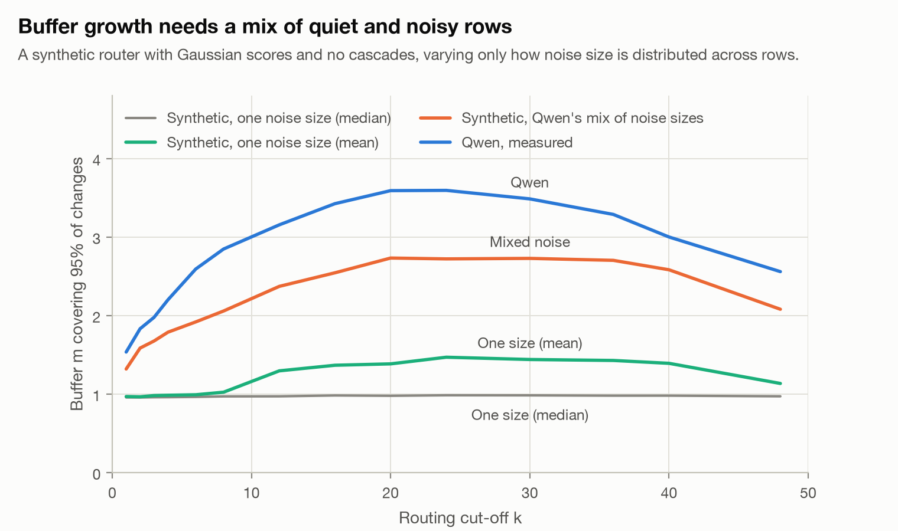
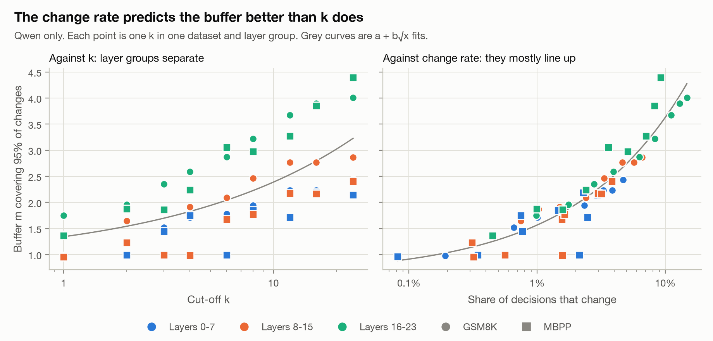

# Does the prefetch buffer scale with k?

**Status:** preliminary (experiment branch `experiment/k-scaling`). Related: #114 (question 3), #110.

**Why this matters.** The project's goal is to prefetch experts before the router selects them. Predicting more than the *k* experts a model needs (a buffer of *m*) improves recall but costs memory transfer, so Phases 3 to 5 must choose *m*. That choice depends mainly on predictor error, which isn't measured yet. This experiment measures one input: how much buffer batch-dependent routing alone would demand, and how that scales with *k*.

**Result.** Very little. With batch noise as the only error, recall is 99.5% with no buffer and 99.98% with *m* = 2 (Qwen, *k* = 4). So batch noise won't set *m*. The buffer it does demand doesn't scale as a fixed number or a fixed ratio of *k*, so *m* = 2 shouldn't be carried over as a rule. [Later phases](#what-this-implies-for-later-phases) are covered at the end.

## Question

For Qwen (k = 4), k + 2 and 1.5k are both 6. Does the buffer stay roughly constant as k grows, or grow in proportion?

## Method

Each row stores all 60 expert probabilities, so a hypothetical top-k cut-off can be applied to the same routing. For each pair of orderings and each k, we find the smallest m such that each ordering's top-k is inside the other's top-(k+m).

Every k from 1 to 40 is measured, stopping well short of the 60-expert ceiling. m is reported as a fraction, interpolating where coverage of changed decisions crosses each target, because whole-number m can't separate candidate curves.

**The main limit:** this measures how crowded the ranking is around rank k. It doesn't simulate a model built with that k: hidden states and cascades still come from top-4 routing, so only k = 4 is a real measurement. It also covers batch effects only, not a predictor's error.

## Data

Trial collection at `38ef1da` (1,462,560 comparisons; fp16, batch 32, A100 40 GB; before the `position_ids` fix): [Drive, `trial_38ef1da`](https://drive.google.com/drive/folders/1F5ObENu9J_J5yH7ZIr-J4qMPwDqnyfyP?usp=drive_link).

```bash
python phase_1/scripts/k_scaling.py <collection output>/determinism
```

## Results

m95 is the buffer covering 95% of changed decisions. "Missed at m=2" is a share of all decisions.

```text
all layers:
   k  changed  median gap  m90.frac  m95.frac  m99.frac  (k+m95)/k  missed at m=2
   1   0.49%     0.05382      0.98      1.53      2.85       2.53        0.009%
   2   0.86%     0.02411      1.29      1.83      3.44       1.92        0.029%
   3   1.38%     0.01077      1.56      1.98      3.75       1.66        0.065%
   4   2.02%     0.00501      1.68      2.20      3.95       1.55        0.115%
   5   2.65%     0.00291      1.78      2.39      4.30       1.48        0.174%
   6   3.23%     0.00195      1.85      2.59      4.65       1.43        0.249%
   7   3.76%     0.00144      1.91      2.73      4.95       1.39        0.322%
   8   4.25%     0.00114      1.97      2.85      5.07       1.36        0.404%
   9   4.71%     0.00093      2.03      2.90      5.38       1.32        0.479%
  10   5.19%     0.00082      2.10      2.94      5.38       1.29        0.551%
  11   5.42%     0.00070      2.24      3.10      5.52       1.28        0.621%
  12   5.87%     0.00063      2.29      3.15      5.57       1.26        0.699%
  13   6.14%     0.00054      2.35      3.23      5.66       1.25        0.758%
  14   6.48%     0.00051      2.35      3.26      5.79       1.23        0.793%
  15   6.71%     0.00046      2.38      3.30      5.88       1.22        0.843%
  16   6.87%     0.00042      2.45      3.42      6.09       1.21        0.900%
  17   7.08%     0.00039      2.53      3.53      6.13       1.21        0.974%
  18   7.30%     0.00037      2.55      3.56      6.13       1.20        1.023%
  19   7.50%     0.00034      2.58      3.58      6.27       1.19        1.061%
  20   7.74%     0.00032      2.58      3.59      6.23       1.18        1.094%
  21   7.70%     0.00030      2.61      3.62      6.25       1.17        1.123%
  22   7.93%     0.00029      2.60      3.62      6.25       1.16        1.139%
  23   8.02%     0.00027      2.59      3.60      6.21       1.16        1.153%
  24   7.96%     0.00026      2.59      3.59      6.17       1.15        1.143%
  25   8.16%     0.00025      2.56      3.57      6.13       1.14        1.140%
  26   8.09%     0.00024      2.58      3.56      6.11       1.14        1.155%
  27   8.15%     0.00023      2.55      3.52      6.02       1.13        1.143%
  28   8.32%     0.00022      2.52      3.48      5.95       1.12        1.135%
  29   8.25%     0.00021      2.50      3.49      5.97       1.12        1.114%
  30   8.08%     0.00021      2.51      3.48      5.93       1.12        1.098%
  31   8.04%     0.00020      2.56      3.57      5.97       1.12        1.126%
  32   8.10%     0.00019      2.55      3.55      5.92       1.11        1.118%
  33   8.04%     0.00019      2.57      3.50      5.84       1.11        1.144%
  34   7.92%     0.00018      2.49      3.37      5.74       1.10        1.089%
  35   7.93%     0.00018      2.41      3.31      5.69       1.09        1.021%
  36   7.77%     0.00017      2.38      3.29      5.57       1.09        0.970%
  37   7.50%     0.00017      2.38      3.22      5.47       1.09        0.949%
  38   7.42%     0.00017      2.31      3.14      5.41       1.08        0.892%
  39   7.37%     0.00016      2.29      3.10      5.28       1.08        0.881%
  40   7.24%     0.00016      2.24      3.00      5.16       1.07        0.837%
  fit m90 k=1-40: linear: 1.82+0.023x R2=0.466 LOO=0.298  sqrt: 1.38+0.211x R2=0.641 LOO=0.247  log2: 1.18+0.276x R2=0.814 LOO=0.174
  fit m90 k=1-16: linear: 1.24+0.084x R2=0.914 LOO=0.147  sqrt: 0.69+0.454x R2=0.976 LOO=0.081  log2: 0.94+0.365x R2=0.989 LOO=0.050
  fit m95 k=1-40: linear: 2.55+0.029x R2=0.422 LOO=0.426  sqrt: 1.96+0.279x R2=0.598 LOO=0.357  log2: 1.69+0.369x R2=0.770 LOO=0.264
  fit m95 k=1-16: linear: 1.72+0.117x R2=0.936 LOO=0.168  sqrt: 0.97+0.629x R2=0.988 LOO=0.070  log2: 1.33+0.500x R2=0.978 LOO=0.119
  fit m99 k=1-40: linear: 4.68+0.040x R2=0.323 LOO=0.717  sqrt: 3.80+0.396x R2=0.497 LOO=0.622  log2: 3.34+0.544x R2=0.693 LOO=0.479
  fit m99 k=1-16: linear: 3.23+0.196x R2=0.926 LOO=0.302  sqrt: 1.96+1.055x R2=0.982 LOO=0.142  log2: 2.56+0.841x R2=0.978 LOO=0.185

layers 16-23:
   k  changed  median gap  m90.frac  m95.frac  m99.frac  (k+m95)/k  missed at m=2
   1   0.87%     0.07847      1.09      1.71      3.64       2.71        0.023%
   2   1.60%     0.03042      1.49      1.95      3.70       1.97        0.071%
   3   2.53%     0.01304      1.74      2.28      3.98       1.76        0.154%
   4   3.61%     0.00616      1.86      2.55      4.37       1.64        0.275%
   5   4.69%     0.00347      1.94      2.74      4.74       1.55        0.417%
   6   5.70%     0.00239      2.08      2.90      5.20       1.48        0.599%
   7   6.70%     0.00177      2.19      2.99      5.54       1.43        0.747%
   8   7.63%     0.00135      2.33      3.19      5.70       1.40        0.932%
   9   8.20%     0.00109      2.47      3.35      5.99       1.37        1.108%
  10   9.09%     0.00096      2.51      3.41      5.93       1.34        1.263%
  11   9.55%     0.00081      2.61      3.57      6.10       1.32        1.413%
  12  10.23%     0.00072      2.67      3.63      6.15       1.30        1.569%
  13  10.72%     0.00061      2.71      3.68      6.28       1.28        1.700%
  14  11.15%     0.00057      2.74      3.74      6.54       1.27        1.793%
  15  11.49%     0.00050      2.78      3.80      6.62       1.25        1.905%
  16  11.93%     0.00045      2.84      3.89      6.84       1.24        2.057%
  17  12.17%     0.00042      2.91      3.98      6.83       1.23        2.210%
  18  12.52%     0.00040      2.93      4.05      6.88       1.22        2.330%
  19  12.81%     0.00037      2.95      4.04      6.87       1.21        2.400%
  20  13.12%     0.00035      2.96      4.05      6.85       1.20        2.472%
  21  13.08%     0.00033      2.96      4.12      6.91       1.20        2.510%
  22  13.26%     0.00031      2.99      4.14      6.97       1.19        2.555%
  23  13.57%     0.00029      2.97      4.06      6.93       1.18        2.586%
  24  13.55%     0.00028      2.96      4.06      6.88       1.17        2.581%
  25  13.76%     0.00026      2.96      4.08      6.83       1.16        2.593%
  26  13.58%     0.00025      2.96      4.02      6.88       1.15        2.583%
  27  13.63%     0.00024      2.93      3.97      6.78       1.15        2.564%
  28  13.76%     0.00023      2.91      3.95      6.75       1.14        2.551%
  29  13.89%     0.00022      2.88      3.95      6.73       1.14        2.502%
  30  13.40%     0.00021      2.92      3.96      6.74       1.13        2.463%
  31  13.56%     0.00020      2.96      4.14      6.81       1.13        2.556%
  32  13.53%     0.00019      2.97      4.07      6.69       1.13        2.552%
  33  13.41%     0.00019      2.95      3.94      6.61       1.12        2.570%
  34  13.36%     0.00018      2.85      3.83      6.41       1.11        2.442%
  35  13.30%     0.00017      2.81      3.81      6.37       1.11        2.317%
  36  13.10%     0.00017      2.79      3.77      6.23       1.10        2.183%
  37  12.62%     0.00017      2.78      3.76      6.20       1.10        2.146%
  38  12.55%     0.00016      2.75      3.71      6.00       1.10        2.053%
  39  12.39%     0.00015      2.74      3.67      5.93       1.09        2.049%
  40  12.16%     0.00015      2.68      3.56      5.80       1.09        1.926%
  fit m90 k=1-40: linear: 2.07+0.028x R2=0.501 LOO=0.342  sqrt: 1.54+0.256x R2=0.677 LOO=0.278  log2: 1.31+0.334x R2=0.849 LOO=0.187
  fit m90 k=1-16: linear: 1.37+0.104x R2=0.920 LOO=0.173  sqrt: 0.69+0.561x R2=0.981 LOO=0.087  log2: 1.01+0.450x R2=0.988 LOO=0.067
  fit m95 k=1-40: linear: 2.87+0.036x R2=0.470 LOO=0.473  sqrt: 2.16+0.336x R2=0.646 LOO=0.389  log2: 1.85+0.439x R2=0.815 LOO=0.275
  fit m95 k=1-16: linear: 1.91+0.139x R2=0.937 LOO=0.199  sqrt: 1.01+0.746x R2=0.990 LOO=0.080  log2: 1.45+0.592x R2=0.979 LOO=0.142
  fit m99 k=1-40: linear: 5.20+0.046x R2=0.351 LOO=0.781  sqrt: 4.22+0.452x R2=0.524 LOO=0.670  log2: 3.73+0.608x R2=0.702 LOO=0.522
  fit m99 k=1-16: linear: 3.62+0.216x R2=0.941 LOO=0.285  sqrt: 2.25+1.153x R2=0.975 LOO=0.193  log2: 2.96+0.903x R2=0.937 LOO=0.382

```

Check: k = 4 reproduces the 2.02% change rate from `batch_variance.py`, and its m95 of 2.20 agrees with 94.5% coverage at m = 2.

## Reading the results


*Figure 1. Buffer against k, with both candidate rules.*

- **Neither simple rule fits.** m95 is 1.53 at k = 1 and 3.42 at k = 16, far below proportional growth, and (k+m95)/k falls from 2.53 to 1.21. The 1.5 ratio at k = 4 (1.55) is a coincidence of that point.
- **For k = 1 to 16, a square-root curve describes it best:** m95 ≈ 0.97 + 0.63√k (R² 0.988, leave-one-out error 0.07; logarithmic 0.12, linear 0.17). Square root also wins for m99 and in layers 16-23. It's a description of this range, chosen after seeing the data, not a law. See [Why a square root?](#why-a-square-root) for a possible mechanism.
- **The curve doesn't continue.** m95 levels off at about 3.6 around k = 20 to 24, then falls to 3.0 at k = 40; the change rate peaks near 8% at k = 30. No single form fits k = 1 to 40. This looks structural: see [the plateau](#the-plateau).
- **Ranking crowding isn't the whole explanation.** At k = 4, layers 16-23 have a *larger* median gap than all layers (0.0062 against 0.0050) but change about 1.8 times as often. Disturbances also grow with depth, which fits the cascade finding.
- **For Qwen (k = 4):** m90 = 1.68, m95 = 2.20, m99 = 3.95; in layers 16-23, 1.86, 2.55 and 4.37. So m = 2 falls just short of 95% of changed decisions from batch effects alone, and doesn't include predictor error.

## How much recall does batch noise cost?

m95 is the buffer covering 95% of *changed* decisions, and only about 2% of decisions change at k = 4. So m95 is **not** a recall target. Recall@(k+m) is the design's Phase 5 metric: the share of experts actually used that are in the predicted top-(k+m). Here each ordering "predicts" the other, so batch noise is the only error:

| Buffer | Recall, all layers | Recall, layers 16–23 |
|---|---|---|
| m = 0 (predict 4) | 99.49% | 99.09% |
| m = 1 (predict 5) | 99.93% | 99.85% |
| m = 2 (predict 6) | 99.98% | 99.96% |
| m = 4 (predict 8) | 100.00% | 99.99% |

Batch noise alone clears the design's >95% goal with no buffer at all. Whatever buffer the project needs, predictor error will be the reason. The rest of this document explains how the batch-noise demand behaves, not how large m should be.

## Why a square root?

This section gives a mechanism and tests each step with `k_scaling_theory.py`. **The first two steps hold up well. The third explains the pattern but not the exact exponent, so the square root remains a description of the data rather than a derived law.** All the checks were designed after seeing the fit.

Throughout, *k* is the routing cut-off, *s* is the mean gap in log-probability between ranks *k* and *k* + 1, and δ is how much the gap between those two experts changes between two batch orderings.

### Step 1: neighbouring experts get closer together as 1/k

Spacing falls with a slope of −0.97 on log-log axes for k = 1 to 16.

This is a standard result for ranked samples. If the top scores have an exponential-shaped tail, the gap between ranks *k* and *k* + 1 is exponentially distributed with mean proportional to 1/*k* (the Rényi representation). So nothing about this needs to be specific to Qwen, though it does depend on the tail: Gaussian scores with 60 experts give a shallower slope of −0.73 over the same range.

### Step 2: the change rate grows in proportion to k

A decision changes when the noise pushes against a gap smaller than itself. Exponential gaps have density 1/*s* near zero, and the noise points the right way half the time, so:

> change rate ≈ c · E|δ| / s, with c ≈ 0.5

The noise E|δ| is almost flat across ranks (0.0066 to 0.0077), so the rate should grow in proportion to *k*.

- The measured slope on *k* is **1.00**.
- The measured constant *c* is **0.41 to 0.61** for all rows, and 0.41 to 0.71 across the subsets. The theory predicts it with no fitted parameters, which makes this the strongest check here.


*Figure 2. Steps 1 and 2: spacing and change rate.*

### Step 3: the buffer grows more slowly, if the noise is heavy-tailed

Needing a buffer larger than *m* means δ > *m* · *s*, roughly. If the noise has a power-law tail, P(δ > x) ∝ x^(−β), then the share of changes needing more than *m* is:

> P(δ > m · s) / rate ∝ m^(−β) · s^(1−β)

Setting this equal to 1 − *q* and using *s* ∝ 1/*k* gives:

> **m ∝ k^(1 − 1/β)**, so **β = 2 gives √k**

The intuition is that a larger *k* lets smaller disturbances cause flips, so the typical flip needs relatively less buffer. The heavy tail has a plausible source: most rows have noise near 0.003, while a few have far more (90th percentile 0.016, 99th percentile 0.075). The cascade analysis in #114 suggests those are rows downstream of an earlier flip.

**What the data says:**

| | k-slope of m95 − 1 | β (95th to 99.9th percentile) | Hill estimate of β | 1 − 1/β predicts |
|---|---|---|---|---|
| All rows | 0.55 | 1.79–2.04 | 2.33–2.64 | 0.44–0.51 |
| GSM8K | 0.52 | 1.87–2.04 | 2.41–2.70 | 0.47–0.51 |
| Layers 16–23 | 0.53 | 2.22–2.41 | 2.73–2.99 | 0.55–0.59 |
| Layers 8–15 | 0.68 | 1.65–1.87 | 2.20–2.65 | 0.39–0.47 |
| Layers 0–7 | not defined (m95 < 1) | 1.30–1.39 | 1.69–2.01 | 0.23–0.28 |
| MBPP | not defined (m95 < 1) | 1.51–1.68 | 2.05–2.25 | 0.34–0.40 |


*Figure 3. The size of the noise at k = 4, by layer group.*

The curves aren't straight lines, so no single power law describes them. That's why β depends on where it's measured.

**Where this falls short:**

- **β isn't one number.** It changes with the layer group (about 1.4 to 2.3), so "β = 2" is an average over different conditions, not a constant of the model. β also depends on the quantile range. Earlier, an exploratory 90th-to-99th-percentile fit gave only about 1.2.
- **The prediction fits the deepest layers and the pooled data, but not layers 8–15.** Layers 0–7 and MBPP can't be tested this way, and raw m95 has a slope of about 0.3 in every layer group (0.28 to 0.31), despite the different β. That constancy isn't explained.
- **Using m − 1 was a choice made after seeing the data.** It's defensible, since any change needs at least m = 1, but it gets unstable near that floor.
- **m95 is a coarse statistic near whole numbers.** Interpolated m reads 0.95 when every change needs exactly m = 1 and jumps once coverage at m = 1 drops below 95%. MBPP layers 8–15 at k = 4 read 0.99, while GSM8K at a similar change rate read 1.92.

### What is needed: a mixture of noise sizes

The synthetic router below tests this directly. With Gaussian scores and **the same noise size on every row**, m95 stays at about 1 for every k from 1 to 40 (at the median noise size), or reaches only 1.47 (at the mean). Drawing the noise size per row from Qwen's distribution brings back the growth, reaching 2.73. So in this model the buffer growth comes from the mix of quiet and noisy rows, not from the crowding alone. This supports the mechanism more directly than the exponent does.


*Figure 4. Real and synthetic routers with different noise mixes.*

### The quiet rows are counted in fp16 rounding steps

The charts revealed something the tables had hidden: Figure 3 starts in stair-steps, and Figure 7 below starts flat rather than at zero. Checking these directly:

- **98.6% of non-zero noise values at ranks 4 and 5 lie on multiples of 2⁻⁹ (about 0.002).** About 12% would by chance. This is the spacing of 16-bit floating-point logits of size 2 to 4.
- **The noise is mostly a small count of steps.** Of non-zero values, 44% are one step and 20% are two. By layer group, the median non-zero change is 1, 2 and 3 steps, and the 99th percentile is 13, 38 and 81 steps. The share of exactly zero noise falls from 42% to 24% to 14%.
- **Many flips are exact ties.** 1.4% of all decisions have a gap of exactly zero in at least one ordering, but that's true of 26% of changed decisions and 43% of first flips.

This gives a more concrete picture, though the causal story is still an interpretation. Rounding moves a logit by a step, which can break or create a tie and flip a decision. The flip changes the hidden state, so later layers see much larger changes, which would make up the heavy tail.

It also qualifies the argument above: at small sizes the noise and the gaps are discrete, so the smooth power-law form can only describe the far tail.

### The plateau

Spacing is smallest at k = 28 of 60. Gaussian scores give k = 30, the middle of the ranking, where scores are densest. m95 flattens at about the same place in both Qwen (k ≈ 20–24) and the synthetic router (k ≈ 20–36), and then falls, as Figure 4 shows. This answers the question left open above: the plateau is structural. The cut-off moves through the densest part of the ranking and out the other side.

## Does this generalize to other MoE models?

**Partly. The mechanism should carry over, but the numbers should not.** All measurements here come from one model on one GPU, so the evidence below is reasoning and simulation, not a measurement on any second model.

**Expected to carry over, because it doesn't rely on anything specific to Qwen:**

- **Change rate ≈ noise ÷ spacing.** This is geometry that applies to any router that ranks scores and takes the top k. It depends only on the order of the scores, so softmax (Qwen), sigmoid (DeepSeek-V3) and renormalising after selection (Mixtral) don't change it, though the scale of a "gap" should be measured on the raw scores.
- **Spacing ∝ 1/k while k is small compared with the number of experts N.** This needs an exponential-like top tail. Qwen is close to that, and it should be checked for each model.
- **Worst crowding near k ≈ N/2.** This scales with N, so a model's position relative to its plateau is k/N: Qwen is at 0.07, DeepSeek-V3 at 0.03, Mixtral at 0.25.

**Promising, but only shown within Qwen: the buffer tracks the change rate.** Different layers have very different noise, but m95 follows the change rate much better than it follows k. Fitting m95 = a + b√x on five of the six dataset-by-layer groups and predicting the sixth:

| Predictor | Mean held-out error in m95 | Worst group |
|---|---|---|
| √k | 0.67 | 0.99 |
| √(change rate) | **0.31** | 0.52 |

The theory would predict this if noise and spacing act only through their ratio. If it holds elsewhere, it's practical: measure a model's change rate at its real k, which takes only two orderings, and read off an estimated buffer. Two limits apply: an error of 0.3 in m is large when m is about 2, and this curve is fitted to Qwen.


*Figure 5. The buffer against k and against change rate.*

**A synthetic router, to see what depends on N.** Gaussian scores, with Qwen's noise sizes and Qwen's fitted score scale, and no Qwen routing:

| Experts | Real k of | k | Changed | m95 | m99 | m95 from the Qwen curve |
|---|---|---|---|---|---|---|
| 8 | Mixtral 8x7B | 2 | 0.60% | 1.01 | 1.86 | 1.35 |
| 60 | Qwen1.5-MoE-A2.7B | 4 | 1.86% | 1.79 | 2.81 | 1.91 |
| 256 | DeepSeek-V3 | 8 | 4.31% | 2.63 | 4.65 | 2.59 |


*Figure 6. Simulated effect of the number of experts.*

For comparison, Qwen's real values at k = 4 are 2.02%, 2.20 and 3.95, so the simulation runs low. It uses Gaussian scores, whose spacing at k = 8 to 16 is about 1.5–1.7 times Qwen's, and it has no cascades.

The curve fitted on Qwen tracks the synthetic router within about 0.25 for 60 experts at every k. It holds within about 0.4 for 256 experts up to k = 16, then badly underestimates (4.66 against 7.64 at k = 128). With 8 experts it overestimates by 0.2 to 0.43, because m95 sits at its floor. **So it isn't a universal curve.** The synthetic rows are not evidence about those models, because they borrow Qwen's noise.

**Not expected to carry over:**

- **"m = 2 is enough."** That's a Qwen result at one noise level. On this model's logic, m depends on the noise and on k.
- **The noise itself,** which drives everything above. The rounding result makes precision an explicit variable: the step size is set by the number format and the size of the logits, so a model in bf16 or fp32 should have a very different noise floor. Noise should also depend on hardware, batch size and shape, and how far cascades spread, so also on the number of routed layers (Mixtral 32, Qwen 24, DeepSeek-V3 61). Nothing here measures that.
- **The values of β, c and the fitted constants.**

**Three further limits apply to all of the above:**

1. **Only k = 4 was run.** Every other k applies a cut-off to top-4 routing, so its hidden states and cascades come from top-4. The router was also trained at top-4. Its top ranks are more spread out than Gaussian scores (k = 2 to 4) and the lower ones less so, but there's no sharp step at k = 4.
2. **This is batch noise, not predictor error.** Predictor error is probably much larger and may have a different distribution. The argument in Steps 1 to 3 would apply to any disturbance with those properties, but that's untested. It's the number that matters for prefetching.
3. **The data is the trial collection,** from before the `position_ids` fix.

**The cheapest tests, if we want real evidence:**

1. **Change the precision on Qwen: bf16.** bfloat16 uses the same memory as fp16 and has rounding steps 8 times coarser, and `model_loader.py` already accepts it. Two orderings of the 200-prompt subsets is 800 prompt-passes, under a minute of collection at the measured rate plus setup. This tests the rounding explanation directly, and tests whether the buffer stays on the change-rate curve when the noise changes for a known reason.
2. **Run real k on Qwen.** Set `num_experts_per_tok` to 2 and 8 with the same weights, and collect two orderings of the same subsets. This removes limit 1's cascade problem, though not the training one. That's about 1,600 prompt-passes, a couple of minutes of A100 time plus setup. The Phase 1 hooks reject k ≠ 4, so it would stay on this experiment branch.
3. **Run fp32 on Qwen.** It should remove nearly all of this rounding noise, so it would show what's left. It needs about 57 GB, so only the 80 GB A100 would do.
4. **Run a second model.** This is the real test, and it's more work. Mixtral 8x7B needs far more memory than Qwen, and quantizing it would change the router gate as it did Qwen's. A smaller MoE model would need finding first.

### Reproducing this

```bash
python phase_1/scripts/k_scaling_theory.py <collection output>/determinism
```

To regenerate the figures, and their numbers in `figures/k_scaling_data.json`:

```bash
python phase_1/scripts/k_scaling_figures.py data <collection output>/determinism
python phase_1/scripts/k_scaling_figures.py plot   # needs matplotlib, not in requirements.txt
```

Each runs on a CPU in a few minutes or less, with the same trial data as above. Model configurations are from each model's `config.json` on Hugging Face.

## Are changes really at near-ties?

The gap between the 4th and 5th expert (k = 4, all layers), from the same data. Each comparison uses the smaller of the gaps in the two orderings:


*Figure 7. Top-4 gaps for all decisions, changed decisions and first flips.*

| | Median | 99th percentile | Exact tie | Within 0.001 | Within 0.005 | Within 0.02 |
|---|---|---|---|---|---|---|
| All decisions | 0.0048 | 0.0756 | 1.4% | 18.9% | 50.8% | 84.6% |
| Changed decisions | 0.00017 | 0.0043 | 26.3% | 83.9% | 99.4% | 100% |
| First flip per token | 0.00006 | 0.0013 | 43.4% | 97.8% | 100% | 100% |

The validator's near-tie window (0.02) includes 85% of all decisions, so passing it is weak evidence. The gaps themselves are strong evidence: changed decisions, and first flips especially, sit at far smaller gaps than decisions in general. A window of 0.005 would make the check meaningful, since it holds about half of all decisions and 99.4% of changed ones.

**The definition matters.** Using the gap from only one ordering, the share of changed decisions within 0.005 drops to 96.4% and the median rises to 0.00035. A validator therefore has to say which gap it uses. Since flips are often whole fp16 steps, a window based on rounding steps might also be more natural than a fixed probability.

## What this implies for later phases

These follow from the results above and are subject to the same limits. Decisions are tracked in the linked issues.

- **Phase 1 validation (#105):** the near-tie window should be about 0.005, and must say which ordering's gap it uses.
- **Phase 3, predictor:** labels contain noise a predictor can't remove, so batch effects alone limit recall to about 99.5% at m = 0. Evaluate against labels from the same collection run. Exact ties are settled by fp16 rounding, so they probably can't be learned.
- **Phase 4, simulation:** treat m as a parameter to sweep, set by predictor error and transfer cost.
- **Phase 5, targets (#110):** a >95% goal says nothing about batch noise, since noise alone clears it. Report predictor recall alongside this ceiling.
- **Other models or precisions:** measure the change rate again. The numbers here don't transfer.
